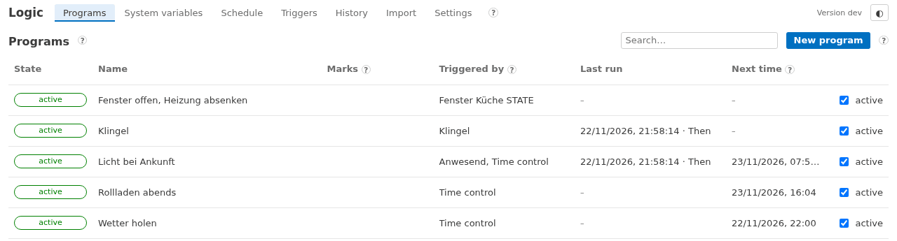
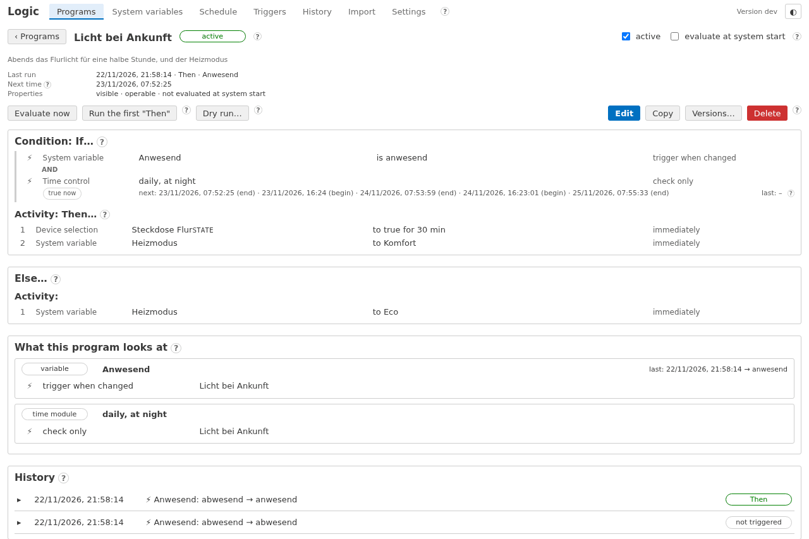
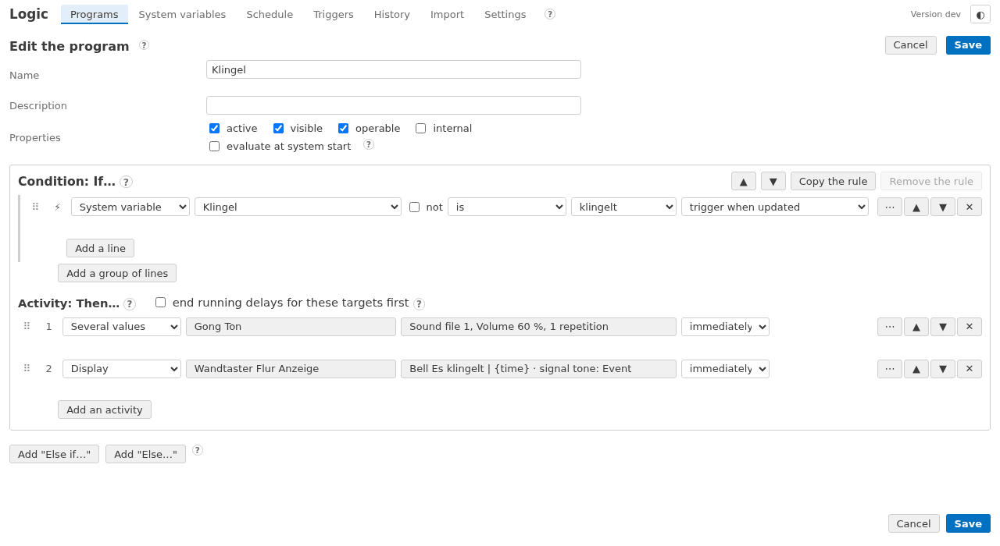
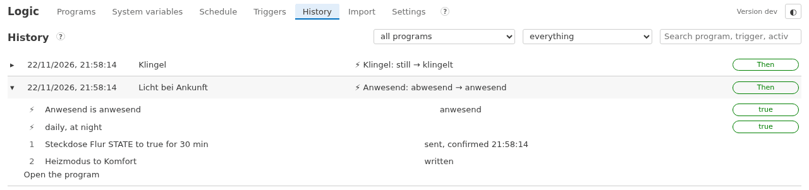
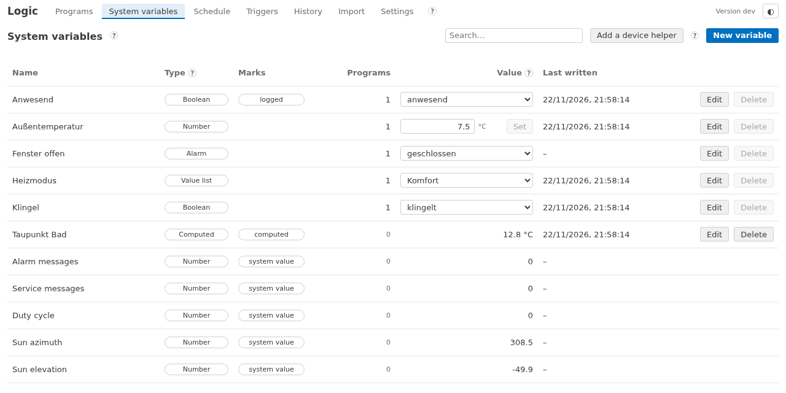
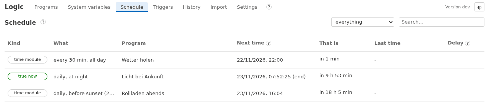
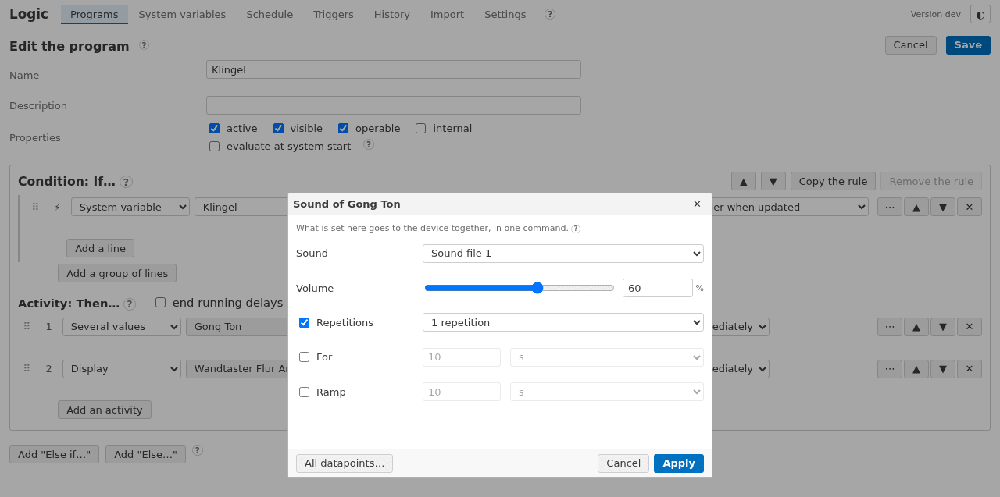
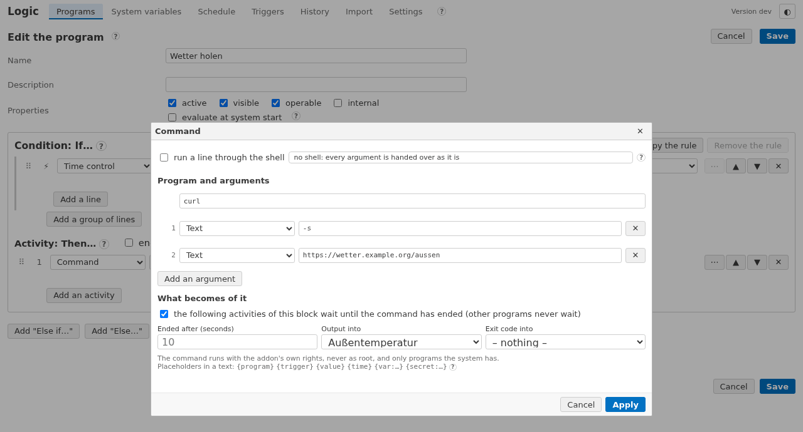
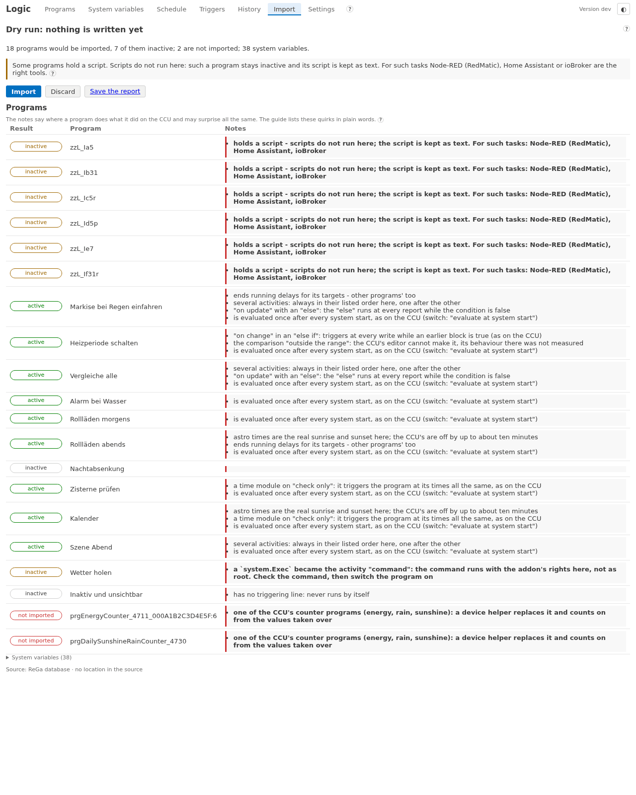

# Logic

**Programs and system variables for [openccu-lite](https://github.com/openccu-lite/openccu-lite)** · [Deutsch](README.md)

> **First pre-release: 1.0.0-beta.0.** Needs openccu-lite 2.0.0-rc.1 or newer. Much of it has not yet been tried in
> daily use: it was tested on test systems and against a simulated system, and some of the device forms, the
> HmIP-WRCD's display and the counter helpers have not yet run on a real device. Feedback and bugs please as an
> [issue in the Logic repository](https://github.com/openccu-lite/lite-addon-logic/issues).

Logic runs programs as known from the CCU (*If … Then … Else*) and holds system variables. It imports both from a CCU
backup or from the ReGa database kept on the system after the switch. A program without a script then behaves as it
did on the CCU.

<picture><source media="(prefers-color-scheme: dark)" srcset="docs/screenshots/en/01-programs-dark.png"></picture>

## What Logic is – and what it is not

Logic is **not a new ReGa**. It does not replace the CCU's logic layer with everything that hung on it; it carries on
exactly two things: **programs and system variables**.

- **No scripting language.** Logic runs no HomeMatic scripts and offers no replacement for them.
- **No migration of scripts.** A script is not translated on import. It stays in the program as text, and the
  program comes in inactive. For tasks that need a script, Node-RED (RedMatic), Home Assistant or ioBroker are the
  right tools.
- **No big automation system.** Logic is for the simple, local automations a CCU could always do: "when it is not
  raining, not windy and the sun is shining, extend the awning", timers, alarms. Its scope stays small on purpose; the
  focus is on bug fixes, not new features.

The model is the CCU as eQ-3 ships it: Logic behaves like the ReGaHss of the CCU3 firmware – its
[quirks](docs/en/guide.md#quirks) included – and is [measured against a real ReGaHss](docs/en/guide.md#compared).
OpenCCU's changed program logic is followed only where it matches corrections Logic makes anyway;
backups of OpenCCU 3.89.14 and newer can be imported all the same.

## What it looks like

A program as the CCU shows it: conditions and activities in its words, what it checks, when it last ran.

<picture><source media="(prefers-color-scheme: dark)" srcset="docs/screenshots/en/02-program-dark.png"></picture>

The editor: condition lines and activities, devices and variables picked from lists.

<picture><source media="(prefers-color-scheme: dark)" srcset="docs/screenshots/en/03-editor-dark.png"></picture>

The history: every run with its trigger, every condition as the run saw it, and what became of every activity.

<picture><source media="(prefers-color-scheme: dark)" srcset="docs/screenshots/en/08-history-dark.png"></picture>

The system variables, with their values and a computed dew point; the schedule with what is due next.

<picture><source media="(prefers-color-scheme: dark)" srcset="docs/screenshots/en/06-variables-dark.png"></picture>

<picture><source media="(prefers-color-scheme: dark)" srcset="docs/screenshots/en/07-schedule-dark.png"></picture>

## What is imported

| Comes along | How |
| --- | --- |
| **Programs** | one to one: *If … Else if … Else*, AND/OR, every condition with its trigger kind (*when changed*, *when updated*, *check only*), negated lines, activities *immediately* or *delayed*, the properties *active*, *visible*, *operable*, *internal* |
| **Time modules** | with every setting, including astro (sunrise and sunset), patterns and validity; the CCU's location is imported |
| **System variables** | with type (boolean, value list, number, string, alarm), labels, unit, limits, channel assignment – and with their current **value** |
| **Some one-line scripts** | "run program", "activate/deactivate program" or "system.Exec" are recognised and become ordinary activities |
| **The CCU's counters** (energy, feed-in, gas, water, rain, sunshine) | are recognised and counted on by built-in [device helpers](docs/en/guide.md#helpers): the total, today and yesterday come along with their readings, without a jump at the device's first report. The hidden counter programs themselves (scripts) are no longer needed |

## What is not imported

Logic runs no scripts. Programs with scripts come in inactive, the script is kept as text.

## What now works without a script

Some of what needed a script on the CCU is available in Logic as an ordinary condition or activity of a program:

| Task | On the CCU | In Logic |
| --- | --- | --- |
| Call a web address: a notification service, a chat, another home automation | a script with `system.Exec` and `wget` or `curl` | the activity [Webhook](docs/en/guide.md#webhook), with headers, a body and placeholders such as `{value}` or `{var:…}` |
| Switch on a computer, a NAS or a TV | a script with `system.Exec` and an additional program | the activity [Wake-on-LAN](docs/en/guide.md#wake) |
| Set several values of a channel together | a script or a ready-made text in `COMBINED_PARAMETER` | the activity [Several values](docs/en/guide.md#values): one command, checked against the device's description |
| Signal light, sound, siren, coloured light, blind with slats | a ready-made text in `COMBINED_PARAMETER` | [forms](docs/en/guide.md#forms) for these channels |
| Texts on the HmIP-WRCD's display, also with a variable's value | a script that assembles the display's text | the activity [Display](docs/en/guide.md#display), with a preview and [placeholders](docs/en/guide.md#display-text) |
| Switch on for a time, the device switches back by itself | two lines and a delay, or a script with `ON_TIME` | *on for …* on the activity ([Beyond the CCU](docs/en/guide.md#additions)) |
| A random delay, for a presence simulation, say | a script with a random number | *at random* as an activity's time ([Beyond the CCU](docs/en/guide.md#additions)) |
| "Window open for ten minutes": a condition that has held for a while | a delay with a counter-command, or a script with a timestamp | *holds for* on the condition line ([Beyond the CCU](docs/en/guide.md#additions)) |
| Dew point, absolute humidity, sum, difference, average, minimum, maximum | a script that calculates and writes a variable | [computed values](docs/en/guide.md#computed), recalculated as soon as an input reports |
| The sun's position for shading | a script or an additional program | the [system values](docs/en/guide.md#system-values) `sun-azimuth` and `sun-elevation` |
| Run a program of the system, its output into a variable | `system.Exec`, as root; while it waits, every program stands still | the activity [Command](docs/en/guide.md#command): with a time limit, in the background or waited for, output and exit code into variables, with the addon's rights |
| Count energy, gas, water, rain and sunshine: total, today, yesterday | the CCU's hidden counter programs, scripts | built-in [device helpers](docs/en/guide.md#helpers) |
| Run, activate or deactivate another program | a one-line script | an ordinary [activity](docs/en/guide.md#editor-activities); the two one-line scripts are recognised on import |

A form for a channel – the sound of an HmIP-MP3P, in one command – and a command in place of `system.Exec`:

<picture><source media="(prefers-color-scheme: dark)" srcset="docs/screenshots/en/04-form-dark.png"></picture>

<picture><source media="(prefers-color-scheme: dark)" srcset="docs/screenshots/en/05-command-dark.png"></picture>

## How an import goes

1. **Choose the source.** After the switch from (Open)CCU the system has kept the old CCU's ReGa database: *Read the
   kept database*. Alternatively a system backup (`.sbk`) or the file `homematic.regadom`.
2. **Dry run.** At first the import writes nothing. It reads the source and shows a report: which program is
   imported, which stays inactive and why, which devices are missing. The report can be saved.
3. **Import.** A program is then active if it was active on the CCU, all its devices are present on this system and
   nothing else speaks against it (a script, CUxD, …). With *import everything inactive* nothing switches at first.
4. **Review.** Every inactive program names its reason. *Dry run…* shows for every program what it would do now,
   without switching anything.

A later import of the same CCU updates the same files instead of creating everything twice.

<picture><source media="(prefers-color-scheme: dark)" srcset="docs/screenshots/en/09-import-dark.png"></picture>

### How devices are matched

On the CCU a program refers to devices, channels and variables by internal object numbers (`ise_id`). These numbers
no longer exist on openccu-lite. The import therefore resolves them while reading:

- **Devices and channels** by their **address**, that is serial number and channel (`000A1B2C3D4E56:3`), which the
  ReGa database holds for every object number. Afterwards the program holds only the address.
- A device that is **paired** on this system has the same address as on the CCU: the program fits at once. After a
  switch with the radio module taken along, that is the normal case.
- A device that is (still) **missing** stays in the program with its address; the report names it with the name,
  type and room it had on the CCU. The program comes in inactive. Once the device is paired, the program is complete.
  *Replace a device* moves a device to another one in all programs.
- **System variables** are linked by their **name**; each becomes a file of its own, and the programs refer to it.
- **Value lists** are imported by the entry's name, not by its number.

Logic remembers per source which CCU object became which file. So a second import hits the right files, even if
something has been renamed in the meantime.

## For other software

Programs and system variables are devices of the interface **`Logic`** and available over XML-RPC and lite-rpc.
Node-RED, Home Assistant, ioBroker or hm2mqtt.js read and set variables and run programs through it.

## More

The [guide](docs/en/guide.md) describes everything in detail, with a chapter for everyone who comes from a CCU, and
the quirks of CCU programs in plain words: what Logic does just the same, where it corrects the CCU, and what goes
away with the scripts.

## Development

```sh
go test ./...                 # the tests
scripts/coverage.sh           # with coverage, held to the floor in scripts/coverage-floor
(cd ui && npm ci && npm run check && npm run coverage && npm run build)
(cd ui && npx playwright test)   # the page against the daemon on the fake system
VERSION=0.0.0-dev scripts/build.sh   # the packages into dist/
```

Licence: MIT.
