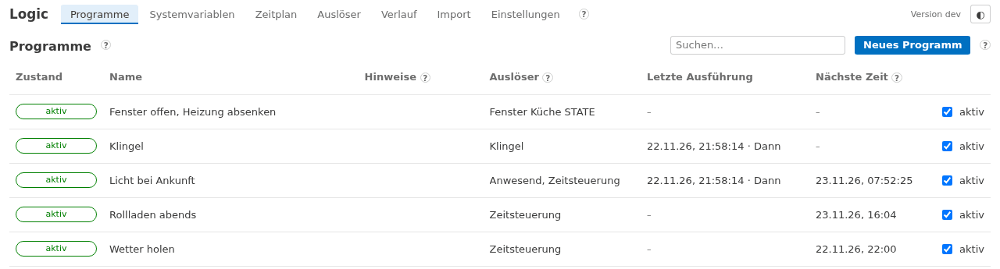
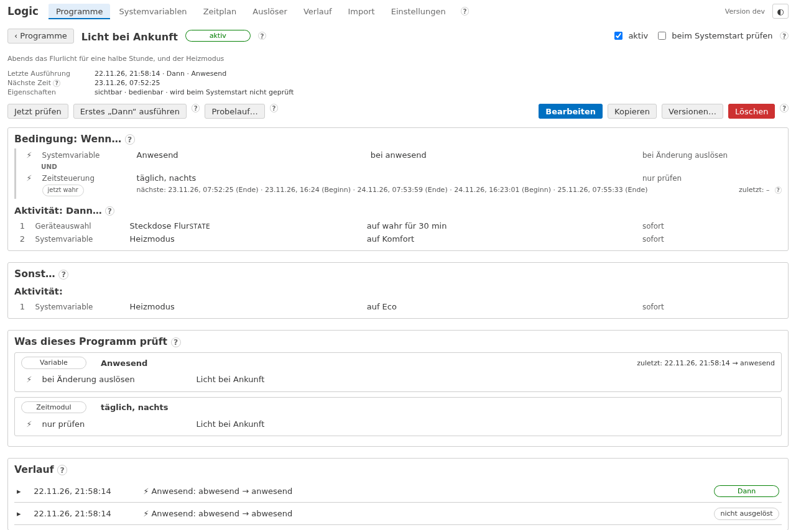
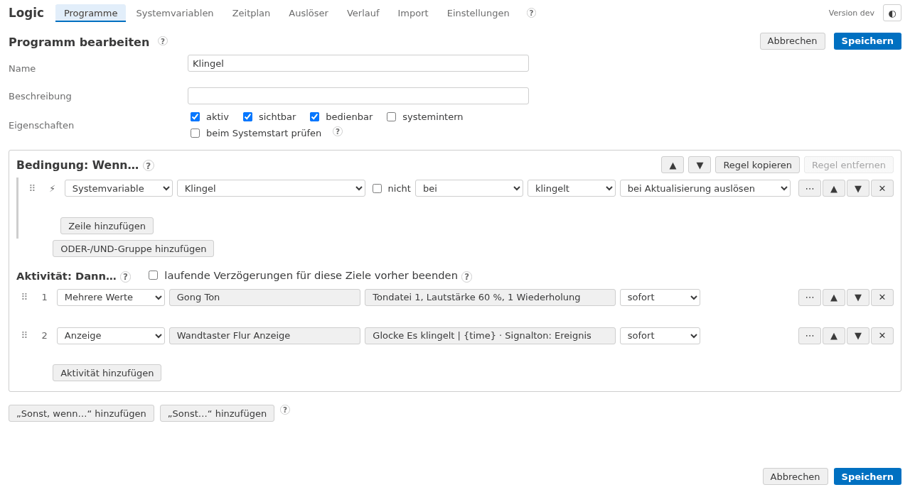
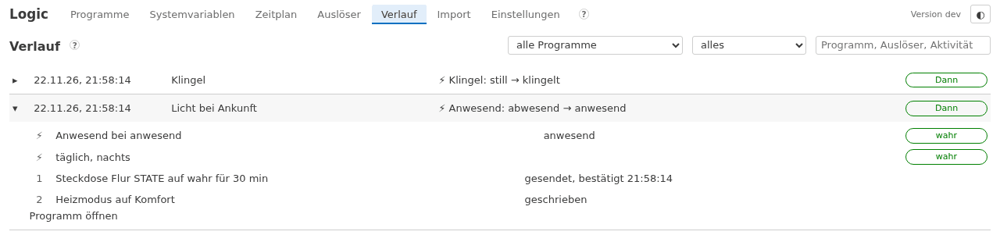
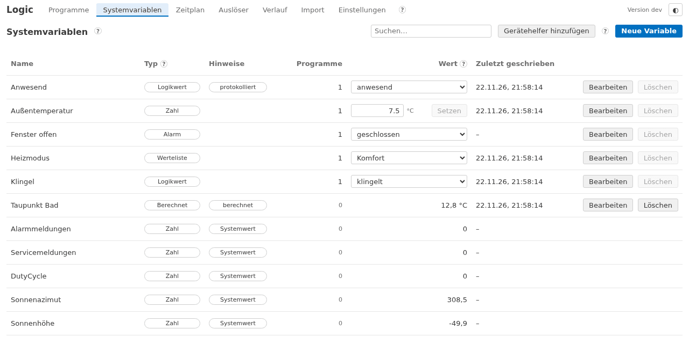
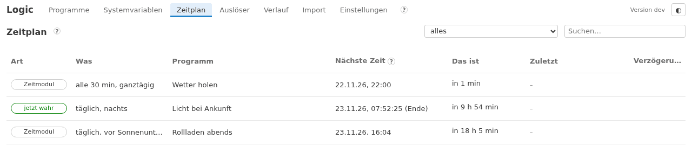
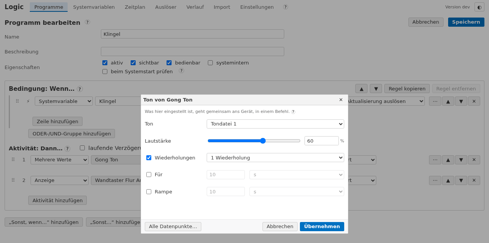
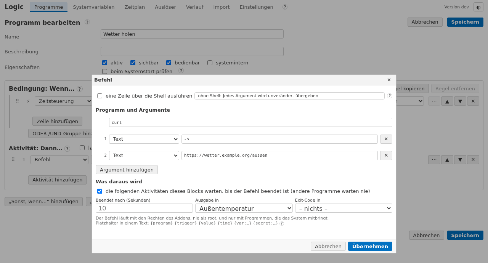
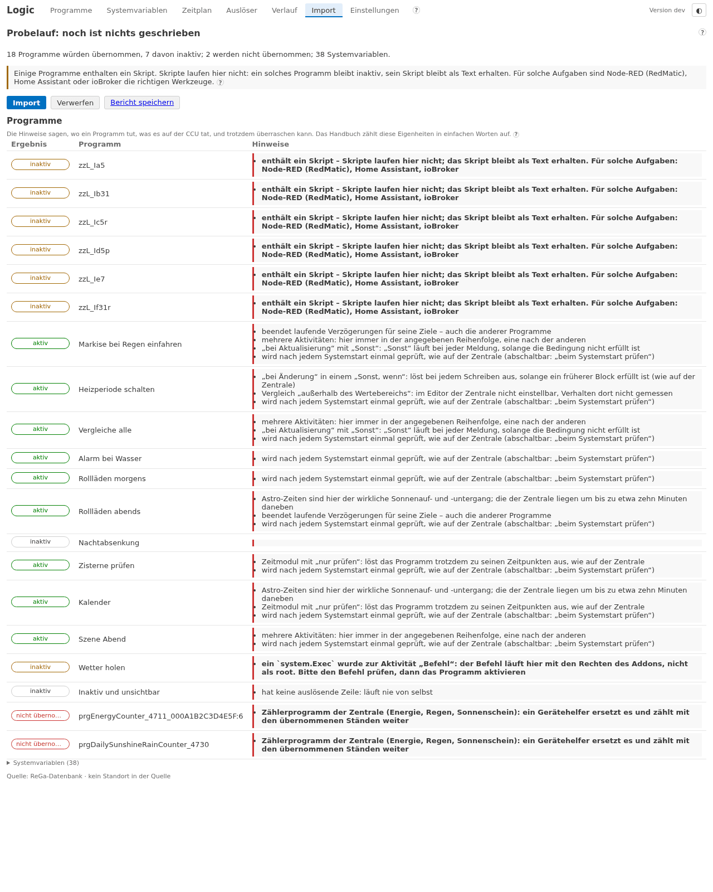

# Logic

**Programme und Systemvariablen für [openccu-lite](https://github.com/openccu-lite/openccu-lite)** · [English](README.en.md)

> **Vorabversion: 1.0.0-beta.1.** Braucht openccu-lite 2.0.0-rc.1 oder neuer. Vieles ist noch nicht im Alltag
> erprobt: Getestet wurde auf Testsystemen und gegen ein simuliertes System, einige Geräteformulare, die Anzeige des
> HmIP-WRCD und die Zähler-Helfer noch an keinem echten Gerät. Rückmeldungen und Fehler bitte als
> [Issue im Logic-Repository](https://github.com/openccu-lite/lite-addon-logic/issues).

Logic führt Programme aus, wie man sie von der CCU kennt (*Wenn … Dann … Sonst*), und hält Systemvariablen. Beides
übernimmt es aus einer CCU-Sicherung oder aus der ReGa-Datenbank, die nach dem Umstieg auf dem System geblieben ist.
Ein Programm ohne Script verhält sich danach wie auf der CCU.

<picture><source media="(prefers-color-scheme: dark)" srcset="docs/screenshots/de/01-programs-dark.png"></picture>

## Was Logic ist – und was nicht

Logic ist **keine neue ReGa**. Es ersetzt nicht die Logikschicht der CCU mit allem, was daran hing, sondern führt
genau zwei Dinge weiter: **Programme und Systemvariablen**.

- **Keine Scriptsprache.** Logic führt keine HomeMatic-Scripte aus und bietet auch keinen Ersatz dafür.
- **Keine Migration von Scripten.** Ein Script wird beim Import nicht übersetzt. Es bleibt als Text im Programm
  stehen, und das Programm kommt inaktiv. Für Aufgaben, die ein Script brauchen, sind Node-RED (RedMatic), Home
  Assistant oder ioBroker die richtigen Werkzeuge.
- **Kein großes Automationssystem.** Logic ist für die einfachen, lokalen Automationen da, die eine CCU schon immer
  konnte: „wenn es nicht regnet, nicht windet und die Sonne scheint Markise ausfahren“, Zeitsteuerungen, Alarme. Der Funktionsumfang bleibt bewusst klein, Fokus liegt auf Fehlerbehebungen, keine neuen Funktionen.

Vorbild ist die CCU, wie eQ-3 sie ausliefert: Logic verhält sich wie die ReGaHss der CCU3-Firmware – samt ihrer
[Eigenheiten](docs/de/handbuch.md#quirks) – und ist [gegen eine echte ReGaHss gemessen](docs/de/handbuch.md#compared).
Die geänderte Programmlogik von OpenCCU übernimmt Logic nur dort, wo sie mit eigenen Korrekturen
übereinstimmt; Sicherungen von OpenCCU 3.89.14 und neuer lassen sich trotzdem importieren.

## So sieht es aus

Ein Programm, wie die CCU es zeigt: Bedingungen und Aktivitäten in ihren Worten, was es prüft, wann es zuletzt lief.

<picture><source media="(prefers-color-scheme: dark)" srcset="docs/screenshots/de/02-program-dark.png"></picture>

Der Editor: Bedingungszeilen und Aktivitäten, Geräte und Variablen aus Listen.

<picture><source media="(prefers-color-scheme: dark)" srcset="docs/screenshots/de/03-editor-dark.png"></picture>

Der Verlauf: jeder Lauf mit seinem Auslöser, jeder Bedingung, wie er sie sah, und dem, was aus jeder Aktivität wurde.

<picture><source media="(prefers-color-scheme: dark)" srcset="docs/screenshots/de/08-history-dark.png"></picture>

Die Systemvariablen, mit ihren Werten und einem berechneten Taupunkt; der Zeitplan mit dem, was als Nächstes fällig ist.

<picture><source media="(prefers-color-scheme: dark)" srcset="docs/screenshots/de/06-variables-dark.png"></picture>

<picture><source media="(prefers-color-scheme: dark)" srcset="docs/screenshots/de/07-schedule-dark.png"></picture>

## Was übernommen wird

| Kommt mit | Wie |
| --- | --- |
| **Programme** | eins zu eins: *Wenn … Sonst, wenn … Sonst*, UND/ODER, jede Bedingung mit ihrer Auslöseart (*bei Änderung*, *bei Aktualisierung*, *nur prüfen*), verneinte Zeilen, Aktivitäten *sofort* oder *verzögert*, die Eigenschaften *aktiv*, *sichtbar*, *bedienbar*, *systemintern* |
| **Zeitmodule** | mit allen Angaben, inklusive Astro (Sonnenauf- und -untergang), Serienmustern und Gültigkeit; der Standort der Zentrale wird übernommen |
| **Systemvariablen** | mit Typ (Logikwert, Werteliste, Zahl, Zeichenkette, Alarm), Bezeichnungen, Einheit, Grenzen, Kanalzuordnung – und mit ihrem aktuellen **Wert** |
| **Manche einzeiligen Scripte** | „Programm ausführen“ und „Programm aktivieren/deaktivieren“ oder „system.Exec“ werden erkannt und zu normalen Aktivitäten |
| **Die Zähler der CCU** (Energie, Einspeisung, Gas, Wasser, Regen, Sonnenschein) | werden erkannt und von eingebauten [Gerätehelfern](docs/de/handbuch.md#helpers) weitergezählt: Gesamtstand, heute und gestern kommen mit ihren Ständen, ohne Sprung beim ersten Wert des Geräts. Die versteckten Zählerprogramme selbst (Scripte) braucht es nicht mehr |

## Was nicht übernommen wird

Logic führt keine Scripte aus. Programme mit Scripten werden inaktiv, das Script bleibt als Text erhalten.

## Was jetzt ohne Script geht

Einiges, wofür man auf der CCU ein Script brauchte, ist in Logic als gewöhnliche Bedingung oder Aktivität eines
Programms verfügbar:

| Aufgabe | Auf der CCU | In Logic |
| --- | --- | --- |
| Eine Web-Adresse aufrufen: ein Benachrichtigungsdienst, ein Chat, eine andere Hausautomation | ein Script mit `system.Exec` und `wget` oder `curl` | die Aktivität [Webhook](docs/de/handbuch.md#webhook), mit Kopfzeilen, Inhalt und Platzhaltern wie `{value}` oder `{var:…}` |
| Einen Rechner, ein NAS oder einen Fernseher einschalten | ein Script mit `system.Exec` und einem Zusatzprogramm | die Aktivität [Wake-on-LAN](docs/de/handbuch.md#wake) |
| Mehrere Werte eines Kanals gemeinsam setzen | ein Script oder ein fertiger Text im `COMBINED_PARAMETER` | die Aktivität [Mehrere Werte](docs/de/handbuch.md#values): ein Befehl, gegen die Beschreibung des Geräts geprüft |
| Signalleuchte, Ton, Sirene, Farblicht, Jalousie mit Lamellen | ein fertiger Text im `COMBINED_PARAMETER` | [Formulare](docs/de/handbuch.md#forms) für diese Kanäle |
| Texte auf der Anzeige des HmIP-WRCD, auch mit dem Wert einer Variable | ein Script, das den Text der Anzeige zusammensetzt | die Aktivität [Anzeige](docs/de/handbuch.md#display), mit Vorschau und [Platzhaltern](docs/de/handbuch.md#display-text) |
| Für eine Zeit einschalten, das Gerät schaltet selbst zurück | zwei Zeilen und eine Verzögerung, oder ein Script mit `ON_TIME` | *ein für …* an der Aktivität ([Über die Zentrale hinaus](docs/de/handbuch.md#additions)) |
| Eine zufällige Verzögerung, etwa für eine Anwesenheitssimulation | ein Script mit einer Zufallszahl | *zufällig* als Zeitpunkt einer Aktivität ([Über die Zentrale hinaus](docs/de/handbuch.md#additions)) |
| „Fenster seit zehn Minuten offen“: eine Bedingung, die eine Zeit lang gehalten hat | eine Verzögerung mit Gegenbefehl oder ein Script mit Zeitstempel | *hält seit* an der Bedingungszeile ([Über die Zentrale hinaus](docs/de/handbuch.md#additions)) |
| Taupunkt, absolute Luftfeuchte, Summe, Differenz, Mittelwert, Minimum, Maximum | ein Script, das rechnet und eine Variable schreibt | [berechnete Werte](docs/de/handbuch.md#computed), neu berechnet, sobald ein Eingang meldet |
| Der Sonnenstand für die Beschattung | ein Script oder ein Zusatzprogramm | die [Systemwerte](docs/de/handbuch.md#system-values) `sun-azimuth` und `sun-elevation` |
| Ein Programm des Systems ausführen, seine Ausgabe in eine Variable | `system.Exec`, als root; solange es wartet, steht jedes Programm still | die Aktivität [Befehl](docs/de/handbuch.md#command): mit Zeitgrenze, im Hintergrund oder wartend, Ausgabe und Exit-Code in Variablen, mit den Rechten des Addons |
| Energie, Gas, Wasser, Regen und Sonnenschein zählen: Gesamtstand, heute, gestern | die versteckten Zählerprogramme der CCU, Scripte | eingebaute [Gerätehelfer](docs/de/handbuch.md#helpers) |
| Ein anderes Programm ausführen, aktivieren oder deaktivieren | ein einzeiliges Script | eine gewöhnliche [Aktivität](docs/de/handbuch.md#editor-activities); die beiden einzeiligen Scripte werden beim Import erkannt |


Ein Formular für einen Kanal – der Ton eines HmIP-MP3P, in einem Befehl – und ein Befehl an Stelle von `system.Exec`:

<picture><source media="(prefers-color-scheme: dark)" srcset="docs/screenshots/de/04-form-dark.png"></picture>

<picture><source media="(prefers-color-scheme: dark)" srcset="docs/screenshots/de/05-command-dark.png"></picture>

## Wie ein Import abläuft

1. **Quelle wählen.** Nach dem Umstieg von (Open)CCU hat das System die ReGa-Datenbank der alten Zentrale behalten:
   *Gebliebene Datenbank lesen*. Alternativ eine Systemsicherung (`.sbk`) oder die Datei `homematic.regadom`.
2. **Probelauf.** Der Import schreibt zunächst nichts. Er liest die Quelle und zeigt einen Bericht: welches Programm
   übernommen wird, welches inaktiv bleibt und warum, welche Geräte fehlen. Der Bericht lässt sich speichern.
3. **Übernehmen.** Ein Programm ist danach aktiv, wenn es auf der Zentrale aktiv war, alle seine Geräte auf diesem
   System vorhanden sind und nichts anderes dagegen spricht (Script, CUxD, …). Mit *alle inaktiv übernehmen* schaltet
   zunächst gar nichts.
4. **Durchsehen.** Jedes inaktive Programm nennt seinen Grund. *Probelauf…* zeigt bei jedem Programm, was es jetzt
   täte, ohne etwas zu schalten.

Ein späterer Import derselben Zentrale aktualisiert dieselben Dateien, statt alles doppelt anzulegen.

<picture><source media="(prefers-color-scheme: dark)" srcset="docs/screenshots/de/09-import-dark.png"></picture>

### Wie Geräte zugeordnet werden

Auf der CCU verweist ein Programm über interne Objektnummern (`ise_id`) auf Geräte, Kanäle und Variablen. Diese
Nummern gibt es auf openccu-lite nicht mehr. Der Import löst sie deshalb beim Lesen auf:

- **Geräte und Kanäle** über ihre **Adresse**, also Seriennummer und Kanal (`000A1B2C3D4E56:3`), die in der
  ReGa-Datenbank zu jeder Objektnummer steht. Im Programm steht danach nur noch die Adresse.
- Ein Gerät, das auf diesem System **angelernt** ist, hat dieselbe Adresse wie auf der CCU: das Programm passt
  sofort. Nach einem Umstieg mit übernommenem Funkmodul ist das der Normalfall.
- Ein Gerät, das (noch) **fehlt**, bleibt mit seiner Adresse im Programm stehen; der Bericht nennt es mit dem Namen,
  Typ und Raum, den es auf der CCU hatte. Das Programm kommt inaktiv. Lernt man das Gerät später an, ist das Programm
  vollständig. Mit *Gerät ersetzen* lässt sich ein Gerät in allen Programmen auf ein anderes umstellen.
- **Systemvariablen** werden über ihren **Namen** verknüpft; jede wird eine eigene Datei, und die Programme verweisen
  auf sie.
- **Wertelisten** werden beim Namen des Eintrags übernommen, nicht bei seiner Nummer.

Logic merkt sich je Quelle, welches Objekt der CCU zu welcher Datei wurde. Deshalb trifft ein zweiter Import die
richtigen Dateien, auch wenn man inzwischen etwas umbenannt hat.

## Für andere Software

Programme und Systemvariablen sind Geräte der Schnittstelle **`Logic`** und per XML-RPC und lite-rpc verfügbar. Node-RED, Home Assistant, ioBroker oder hm2mqtt.js lesen und setzen Variablen und starten Programme darüber.

## Mehr

Das [Handbuch](docs/de/handbuch.md) beschreibt alles im Detail, mit einem Kapitel für alle, die von einer CCU kommen,
und den Eigenheiten der CCU-Programme in einfachen Worten: was Logic genauso macht, wo es die CCU korrigiert, und
was mit den Scripten wegfällt.

## Entwicklung

```sh
go test ./...                 # die Tests
scripts/coverage.sh           # mit Testabdeckung, gegen die Untergrenze in scripts/coverage-floor
(cd ui && npm ci && npm run check && npm run coverage && npm run build)
(cd ui && npx playwright test)   # die Seite gegen den Dienst auf dem simulierten System
VERSION=0.0.0-dev scripts/build.sh   # die Pakete nach dist/
```

Lizenz: MIT.
