# Logic: Handbuch

Dieses Handbuch beschreibt das Addon **Logic** für openccu-lite: Programme und Systemvariablen. Es wächst mit dem Addon:
jede Funktion steht hier, sobald es sie gibt. Die Seite des Addons verlinkt mit den **?**-Symbolen direkt auf den
passenden Abschnitt.

## <a id="overview"></a>Überblick
Das Addon führt Programme aus, wie man sie von der CCU kennt (*Wenn … Dann … Sonst*), und hält Systemvariablen. Es
übernimmt beides aus einer CCU-Sicherung oder aus der ReGa-Datenbank, die nach dem Umstieg auf dem System geblieben
ist. Ein Programm ohne Skript verhält sich danach wie auf der CCU.

Skripte gibt es bewusst nicht. Für alles, was über einfache Automationen hinausgeht, sind Node-RED (RedMatic), Home
Assistant oder ioBroker die besseren Werkzeuge.

Wer von einer CCU kommt, beginnt mit [Umstieg von einer CCU](#from-ccu).

Die Seite hat sieben Reiter: **Programme**, **Systemvariablen**, **Zeitplan**, **Auslöser**, **Verlauf**, **Import** und
**Einstellungen**.

## <a id="from-ccu"></a>Umstieg von einer CCU
Dieses Kapitel ist für alle, die Programme und Systemvariablen auf einer CCU3 oder auf OpenCCU (RaspberryMatic) hatten
und jetzt openccu-lite betreiben. Kurz gesagt: man importiert sie, die Programme ohne Skript tun weiter, was sie
taten, und die Seite nennt jedes Programm, das einen Blick braucht. [Die Eigenheiten der CCU in einfachen
Worten](#quirks) zählt auf, was solche Programme schon immer tun und was viele überrascht - und sagt zu jedem Punkt, ob
es hier genauso ist.

### <a id="from-ccu-steps"></a>Der Umstieg, Schritt für Schritt
1. **Den Reiter Import öffnen und die Quelle wählen.** Nach einem Umstieg von (Open)CCU hat das System die Datenbank
   der Zentrale behalten, so wie sie an dem Tag war: *Gebliebene Datenbank lesen*. Sonst eine Systemsicherung (`.sbk`)
   oder die Datei `homematic.regadom` nehmen ([Quellen](#import-sources)).
2. **Den Bericht lesen.** Der Import ist zuerst ein [Probelauf](#import-dry-run): nichts wird geschrieben. Der Bericht
   nennt jedes Programm mit seinem Ergebnis - übernommen, übernommen und inaktiv mit dem Grund, nicht übernommen mit
   dem Grund - und merkt an, wo ein Programm überraschen kann ([Der Bericht](#import-report)). Er lässt sich als Datei
   speichern.
3. **Importieren.** Ein Programm ist danach aktiv, wenn es auf der Zentrale aktiv war, jedes Gerät, das es verwendet,
   auf diesem System vorhanden ist und sonst nichts dagegen spricht. Jedes andere Programm kommt inaktiv. Mit *alle
   Programme inaktiv übernehmen* fängt gar nichts an zu schalten - die Wahl für einen ersten Blick und für die
   Sicherung einer fremden Zentrale.
4. **Die inaktiven Programme durchgehen.** Der Grund steht im Bericht:

   | Grund | Was zu tun ist |
   | --- | --- |
   | Geräte fehlen auf diesem System | Das Gerät an diesem System anlernen - es behält seine Adresse, das Programm ist dann vollständig. Kommt ein anderes Gerät desselben Typs an seine Stelle, das Gerät in allen Programmen auf einmal [ersetzen](#replace-device); oder das Programm bearbeiten und ein anderes Gerät wählen. Dann das Programm aktivieren |
   | es enthält ein Skript | Skripte laufen hier nie. Hat das Skript etwas Einfaches getan, baut man es aus Bedingungszeilen und Aktivitäten ([Über die Zentrale hinaus](#additions) nennt, wofür man auf der CCU oft ein Skript brauchte); sonst gehört die Aufgabe in Node-RED (RedMatic), Home Assistant oder ioBroker. Das Skript aus dem Programm entfernen, bevor man es aktiviert |
   | ein `system.Exec` wurde zum Befehl | Das Skript war ein einziges `system.Exec` und ist jetzt die Aktivität [Befehl](#command) mit derselben Zeile. Sie läuft hier mit den Rechten des Addons, nicht als root, und nur mit Programmen, die dieses System hat: den Befehl ansehen, das Programm mit *Erstes „Dann“ ausführen* ausprobieren und den [Verlauf](#trace) lesen, dann aktivieren |
   | es verwendet CUxD | CUxD gibt es hier nicht. Diese Zeilen entfernen oder ersetzen |
   | es enthält einen Sonderwert („Letzter Wert“ o. ä.) | Die Aktivität wird übersprungen, bis sie im Editor einen Wert bekommt |
   | ein Zeitmodul widerspricht sich selbst, oder die Datenbank enthält ein Feld, das diese Version nicht kennt | Das Programm öffnen, die Stelle ansehen, die der Bericht nennt, und speichern |
   | es war auf der Zentrale inaktiv | Nichts: es ist, wie es war |

5. **Den Standort setzen** (Reiter Einstellungen), wenn der Bericht sagt, dass die Quelle keinen hatte: ohne ihn löst
   kein Astro-Zeitmodul aus ([Der Standort](#time-location)).
6. **Ein Programm ausprobieren, bevor man ihm traut.** *Probelauf…* in der Ansicht eines Programms zeigt, was das
   Programm jetzt täte, oder wenn eine seiner Zeilen einen Wert meldete, ohne es zu tun ([Probelauf](#dry-run)). Der
   Reiter **Auslöser** zeigt, was was auslöst, der Reiter **Zeitplan** jedes Zeitmodul mit seiner nächsten Zeit.
7. **Entscheiden, was nach einem Stromausfall geschieht.** Wie auf der Zentrale wird jedes übernommene Programm nach
   einem Start des Systems einmal geprüft; der Bericht nennt sie, und jedes hat dafür seinen eigenen Schalter
   ([Nach einem Systemstart](#start)).
8. **In den ersten Tagen den Reiter Verlauf im Auge behalten.** Er zeigt jeden Lauf mit dem, was das Programm sah und
   tat, und - sobald man ein Programm wählt - warum es *nicht* lief ([Verlauf](#trace)). Dort sieht man nach, wenn
   ein Programm etwas anderes tut als auf der Zentrale.
9. **Andere Software auf die Schnittstelle `Logic` zeigen lassen.** Was die Systemvariablen der Zentrale gelesen oder
   gesetzt oder ihre Programme gestartet hat, findet sie dort, als Geräte einer Schnittstelle, die das System wie die
   Funk-Schnittstellen anbietet ([Die Schnittstelle „Logic“](#interface)).

Später noch einmal zu importieren ist ungefährlich: ein weiterer Import derselben Zentrale aktualisiert dieselben
Dateien, statt alles ein zweites Mal anzulegen ([Noch einmal importieren](#import-again)).

### <a id="from-ccu-where"></a>Wo man was findet
| Auf der CCU | Hier |
| --- | --- |
| Die Programmliste und der Programmeditor | der Reiter **Programme**: die Liste, die Ansicht eines Programms, *Bearbeiten* ([Ein Programm bearbeiten](#editor)) |
| *Start* neben einem Programm | *Erstes „Dann“ ausführen* in der Ansicht des Programms; *Jetzt prüfen* prüft vorher die Bedingungen ([Ein Programm von Hand starten](#program-run)) |
| Die Systemvariablen - ihre Werte an einer Stelle, ihre Definition an einer anderen | der Reiter **Systemvariablen**: beides in einer Liste ([Variablen auf der Seite](#variable-page)) |
| Der Dialog der Zeitsteuerung | das Formular der Zeitsteuerung im Editor ([Zeitsteuerung im Editor](#editor-time)); jedes Zeitmodul jedes Programms steht im Reiter **Zeitplan** |
| Die Spalte „letzte Ausführung“ | der Reiter **Verlauf**, mit dem Grund für jeden Lauf und für jeden Lauf, den es nicht gab |
| Die Alarmmeldungen | oben im Reiter **Systemvariablen**, solange ein Alarm ausgelöst ist; ihre Zahl steht im Kopf der Seite ([Alarme](#alarms)) |
| Die Servicemeldungen | nicht in diesem Addon: das System zeigt sie selbst |
| Energiezähler, Regenmenge und Sonnenscheindauer eines Geräts (die Zentrale legt sie beim Anlernen an) | [Gerätehelfer](#helpers) im Reiter **Systemvariablen**; die Zähler der Zentrale kommen mit dem Import und zählen weiter |
| Der Standort für Sonnenauf- und -untergang | der Reiter **Einstellungen** ([Der Standort](#time-location)) |
| Der Skript-Editor und „Skript testen“ | gibt es nicht |
| *aktiv*, *sichtbar*, *bedienbar*, *systemintern* eines Programms | dieselben vier Eigenschaften, dazu *beim Systemstart prüfen* |
| Das Kontrollkästchen „Vor dem Ausführen alle laufenden Verzögerungen für diese Aktivitäten beenden“ | *Laufende Verzögerungen für diese Ziele vorher beenden* im Editor ([Aktivitäten und Verzögerungen](#delays)) |
| Einen früheren Stand eines Programms zurückholen (auf der CCU: eine Sicherung einspielen) | Programme und Variablen sind lesbare Dateien mit einem Verlauf; jede frühere Version lässt sich zurückholen ([Versionen](#versions)) |

### <a id="from-ccu-not"></a>Was nicht mitkommt
- **Skripte.** Ein Programm mit einem Skript kommt inaktiv, das Skript bleibt als Text erhalten. Zwei einzeilige
  Skripte werden erkannt und zu Aktivitäten: ein Programm ausführen und eines aktivieren oder deaktivieren
  ([Was übernommen wird](#import-what)).
- **CUxD-Geräte.**
- **Was ein Skript mit `system.Exec` getan hat**, kommt nur mit, wenn das Skript nichts als dieser eine Aufruf ist:
  Es wird zu einem Webhook, einem Wake-on-LAN oder einem [Befehl](#command)
  ([Was übernommen wird](#import-what)). Ein Befehl läuft mit den Rechten des Addons, nicht als root: Was auf der
  Zentrale root brauchte, geht nicht.
- **Räume, Gewerke und Gerätenamen:** die hat das System beim Umstieg selbst übernommen. **Benutzer, Favoriten und
  direkte Verknüpfungen** sind nicht Sache dieses Addons.
- **Die versteckten Zählerprogramme der Zentrale** für Energie, Gas, Wasser, Regen und Sonnenschein: sie bestehen aus
  Skripten. Ihre Variablen kommen mit ihren Ständen, und ein eingebauter [Gerätehelfer](#helpers) zählt sie
  weiter - ohne Sprung beim ersten Wert des Geräts.
- **Ein ausgelöster Alarm:** die Datenbank der Zentrale speichert keinen Alarmzustand, jede Alarmvariable beginnt
  deshalb als „nie ausgelöst“.
- **Die Zahl der Servicemeldungen und der DutyCycle** sind als [Systemwerte](#system-values) vorhanden, damit
  übernommene Programme, die sie prüfen, gültig bleiben - diese Version füllt sie aber noch nicht; sie stehen auf 0.
- **Was ein Programm nur tat, weil es beschädigt war.** Auf der Zentrale konnte sich ein Programm seltsam verhalten,
  nachdem es in zwei Browser-Tabs bearbeitet oder kopiert worden war, und man hat gelernt, „das Programm neu
  anzulegen“. Der Import liest das Programm so, wie es geschrieben steht; hat es sich auf einen solchen Schaden
  verlassen, verhält es sich hier richtig - und damit anders.

## <a id="quirks"></a>Die Eigenheiten der CCU in einfachen Worten
Programme einer CCU tun einiges, was ihre Worte nicht vermuten lassen. Wer Programme hat, die funktionieren, hat sie -
bewusst oder nicht - um diese Dinge herum gebaut. Darum behält das Addon sie bei, für übernommene wie für neue
Programme; es berichtigt nur, was eindeutig ein Fehler der Zentrale war, und das für alle Programme. Nichts davon
stammt aus einem Handbuch: jeder Punkt wurde an einer echten CCU gemessen und wird bei jeder Änderung am Addon geprüft
([Wie „wie auf der CCU“ geprüft wird](#compared)).

Im Zweifel über ein einzelnes Programm nicht raten: der Reiter [Verlauf](#trace) sagt zu jedem Lauf, welche Zeile
ausgelöst hat, was jede Zeile sah und welcher Block lief, und der [Probelauf](#dry-run) sagt es vorher.

### <a id="quirks-kept"></a>Beibehalten: wie auf der CCU
**Wann ein Programm läuft**

1. **Ein Auslöser sagt, wann das Programm hinsieht, nicht, was wahr sein muss.** Was auch immer auslöst: das Programm
   geht alle seine Blöcke von oben mit den Werten dieses Augenblicks durch und führt den ersten aus, der wahr ist. Das
   muss nicht der Block sein, in dem die auslösende Zeile steht. ([Wann ein Programm läuft](#triggers))
2. **„Bei Änderung auslösen“ heißt: die Antwort der Zeile hat sich geändert - nicht ihr Wert.** Bei *Temperatur größer
   als 10* löst ein Schritt von 6 auf 12 aus, von 12 auf 15 nicht, von 15 auf 8 wieder - und dann ist die Bedingung
   falsch, es läuft also das *Sonst*. Für ein Programm, das bei jedem neuen Wert laufen soll, gibt es hier den
   Auslöser *bei jeder Wertänderung*.
3. **„Bei Aktualisierung auslösen“ löst bei jeder Meldung aus, auch mit demselben Wert.** Ein Thermostat meldet alle
   paar Minuten, ein Sensor mit jeder Messung. Der Vergleich in der Zeile spielt für das Auslösen keine Rolle.
4. **„Nur prüfen“ startet nie etwas.** Ein Programm mit nur solchen Zeilen läuft nie von selbst; die Liste
   kennzeichnet es.
5. **Das *Sonst* läuft viel öfter, als die meisten erwarten:** bei jeder Prüfung, in der kein Block darüber wahr ist.
   Bei einer Zeile „bei Änderung“ ist das der Augenblick, in dem die Zeile falsch wird; bei einer Zeile „bei
   Aktualisierung“ ist es jede Meldung, solange die Bedingung falsch ist. Ein Programm mit einem *Sonst* tut bei jeder
   Prüfung etwas. ([Sonst](#else))
6. **Eine Zeile „bei Änderung“ in einem *Sonst, wenn* kann bei jedem Schreiben auslösen.** Solange ein Block darüber
   wahr ist, hört das Programm dort auf und sieht diese Zeile nie an. Von da an führt jedes Schreiben ihrer Variable -
   auch desselben Werts - das Programm wieder aus (den Block darüber, noch einmal), bis der Block darüber falsch ist.
   Der Importbericht nennt die Programme, die das betrifft.
7. **Denselben Wert noch einmal zu schreiben ist eine Aktualisierung, keine Änderung.** Nur Zeilen „bei
   Aktualisierung“ reagieren darauf.
8. **Ein Text unter „bei Änderung“ löst nur aus, wenn er anfängt oder aufhört, der Text in der Zeile zu sein** - nie
   von einem anderen Text zu einem anderen.
9. **Eine Tastendruck-Zeile löst bei jedem Tastendruck aus,** ein langer Tastendruck bei jeder Wiederholung. Löst
   etwas anderes das Programm aus, gilt eine Tasten-Zeile als wahr, sobald die Taste einmal gedrückt wurde.
10. **Ein Wertebereich ist „von … bis kleiner …“:** der erste Wert gehört dazu, der zweite nicht. Ein Bereich, dessen
    erster Wert über dem zweiten liegt (*von 50 bis kleiner 20*), ist nie wahr.

**Verzögerungen**

11. **Eine Verzögerung zählt ab dem Auslösen,** nicht ab der Aktivität in der Zeile darüber.
12. **Eine verzögerte Aktivität wird nicht noch einmal geprüft, wenn sie fällig ist.** Sie wird ausgeführt, auch wenn
    die Bedingung inzwischen falsch geworden ist. *Fenster seit zehn Minuten offen* baut man deshalb besser mit *hält
    seit* ([Über die Zentrale hinaus](#additions)) als mit einer Verzögerung.
13. **Zweimal ausgelöst, zweimal ausgeführt.** Löst das Programm noch einmal aus, während eine Verzögerung aussteht,
    bleibt die erste und eine zweite kommt dazu - außer der Block hat das Kontrollkästchen, das laufende Verzögerungen
    beendet.
14. **Dieses Kontrollkästchen beendet Verzögerungen nach Ziel, nicht nach Programm.** Bevor der Block läuft, werden
    die ausstehenden Verzögerungen für die Geräte und Variablen entfernt, die *dieser Block* schreibt - **egal,
    welches Programm** sie geplant hat. Darum beendet ein sofortiges „aus“ im *Sonst* das verzögerte „aus“ aus dem
    *Dann*; ein Block, der etwas anderes schreibt, beendet nichts. Der Importbericht nennt Programme, die einander
    Verzögerungen beenden. ([Aktivitäten und Verzögerungen](#delays))
15. **Mit dem Kontrollkästchen und „bei Aktualisierung auslösen“ läuft eine Verzögerung womöglich nie ab:** jede
    Meldung startet sie neu.
16. **Ein Programm zu deaktivieren beendet seine ausstehenden Verzögerungen nicht.** Der Reiter Zeitplan listet sie und
    kann jede beenden.

**Starten**

17. **„Start“ prüft nichts.** *Erstes „Dann“ ausführen* führt diesen Block aus, ohne die Bedingungen anzusehen, auch
    bei einem inaktiven Programm - und ebenso ein Programm, das ein anderes mit einem übernommenen `ProgramExecute()`
    startet.
18. **Nach einem Start des Systems wird jedes aktive Programm einmal geprüft** - der erste wahre Block läuft, sonst
    das *Sonst*. Ein Programm ohne Bedingungen führt bei jedem Start sein *Dann* aus; ein Programm mit nichts als
    Zeitpunkten sein *Sonst*. Bei übernommenen Programmen ist das eingeschaltet, bei neuen aus.
    ([Nach einem Systemstart](#start))
19. **Anwesenheit ist nach jedem Start wahr,** was auch immer sie vorher war.

**Zeit**

20. **Ein Zeitmodul löst auch dann aus, wenn seine Zeile „nur prüfen“ sagt.** Um eine Uhrzeit als bloße Bedingung zu
    nutzen, setzt man mit einem kleinen eigenen Programm eine Variable und prüft die Variable. ([Zeitmodule](#time))
21. **Eine Zeitspanne löst zweimal aus: an ihrem Beginn (wahr, *Dann*) und an ihrem Ende (falsch, *Sonst*).** Ein
    Programm mit mehreren Zeitmodulen bekommt Beginn und Ende von jedem.
22. **Ein Zeitpunkt ist nur in seinem Augenblick wahr.** Löst irgendetwas anderes das Programm aus, ist die Zeile
    falsch.
23. **Ein Intervall zählt ab Mitternacht - oder ab dem Beginn seiner Zeitspanne - und beginnt jeden Tag neu,** das
    letzte Intervall vor Mitternacht kann also kürzer sein. Ein Intervall mit einem Zeitpunkt löst einmal am Tag aus,
    zu diesem Zeitpunkt.
24. **Bei einer Zeitspanne über Mitternacht gilt der Wochentag des Tages, an dem sie beginnt:** *am Wochenende von
    20:00 bis 10:00* endet am Montag um 10:00.
25. **In der Nacht der Uhrumstellung behält ein Intervall seinen Abstand,** seine Zeiten sind an dem Tag also nicht
    die gewohnten auf der Uhr. ([Uhrumstellung](#time-dst))

**Werte**

26. **Ein Programm darf eine Zahl über die Grenzen der Variable hinaus schreiben,** und andere Programme sehen diesen
    Wert. Die Grenzen gelten für die Eingabe durch einen Menschen und durch andere Software.
    ([Grenzen einer Zahl](#variable-limits))
27. **Eine Alarmvariable ist für Programme ein Logikwert.** Wird sie noch einmal ausgelöst, solange sie nicht
    quittiert ist, zählt sie nur hoch und nur Zeilen „bei Aktualisierung“ reagieren; falsch zu schreiben ist das
    Quittieren. ([Alarme](#alarms))
28. **Eine Verzögerung von 24 Stunden oder mehr, die die Zentrale als null gespeichert hat** - das tat sie mit jeder -
    kommt als *sofort*, denn so ist das Programm bisher gelaufen. Der Bericht sagt es; die gemeinte Verzögerung trägt
    man selbst ein.

### <a id="quirks-fixed"></a>Berichtigt: wo die CCU im Unrecht war
Das gilt für jedes Programm, übernommen oder neu. Die Tabelle [Was anders ist als auf der CCU](#differences) stellt es
nebeneinander.

1. **Speichern und Aktivieren führen nie ein Programm aus.** Die CCU führte ein neues Programm beim ersten Speichern
   einmal aus und jedes Programm einmal beim Aktivieren. Hier ist *Jetzt prüfen* eine Schaltfläche.
2. **Aktivitäten laufen in der aufgeführten Reihenfolge,** eine nach der anderen. Die CCU sicherte keine Reihenfolge
   zu; man hat sie mit Verzögerungen von einer Sekunde erzwungen, und die funktionieren weiter.
3. **Eine Prüfung je Ereignis.** Zwei Zeilen, die im selben Augenblick auslösen, oder zwei gleiche Zeitmodule führten
   auf der CCU einen Block zweimal aus.
4. **Ausstehende Verzögerungen überstehen einen Neustart.** Die CCU verlor sie. War eine fällig, während das Addon
   stand, wird sie verworfen und nicht nachgeholt.
5. **Ein Programm, das sich selbst auslöst, wird angehalten:** nach 20 Läufen in 10 Sekunden pausiert es eine Minute
   und wird markiert ([Schleifenschutz](#loop-guard)). Auf der CCU lief es, bis es jemand bemerkte.
6. **Befehle an Funkgeräte gehen mit einer kurzen Pause dazwischen hinaus** ([Schreibbefehle](#pacing)), auch nach
   einem Systemstart. Die CCU schickte sie in einem Schwung, und man hat sie von Hand auseinandergezogen.
7. **Der letzte Lauf ist der letzte, in dem ein Block lief.** Die „letzte Ausführung“ der CCU bewegte sich auch, wenn
   nichts ausgeführt wurde.
8. **Eine Verzögerung darf beliebig lang sein.** (Was der Import mit der Null der CCU tut, steht oben unter Punkt 28.)
9. **Ein Eintrag einer Werteliste wird mit seinem Text benannt.** Auf der CCU merkte sich ein Programm die Nummer des
   Eintrags, und eine geänderte Liste änderte stillschweigend, was bestehende Programme meinten. Hier benennt das
   Umbenennen eines Eintrags ihn auch in den Programmen um, ein verwendeter Eintrag lässt sich nicht entfernen, und
   der Typ einer verwendeten Variable lässt sich nicht ändern. ([Typen](#variable-types))
10. **Was nicht bekannt ist, ist nicht bekannt.** Eine Zeile auf ein Gerät, das seit dem Start nicht gemeldet hat, ist
    falsch - die CCU arbeitete mit erfundenen Startwerten (0 °C, „geschlossen“) und löste Programme damit aus. Der
    erste Wert, den eine Zeile nach einem Start sieht, ist keine Änderung, und ein wiederhergestellter Wert löst
    nichts aus.
11. **Eine Prüfung fragt nie das Gerät.** Eine Zeile nimmt immer den letzten Wert, den das Gerät gemeldet hat; kein
    Programm schickt eine Statusabfrage über den Funk.
12. **„Alle *n* Monate“ wird richtig gezählt,** und einen Tag, den ein Monat nicht hat (den 31. im April), gibt es
    einfach nicht. ([Serienmuster](#time-pattern))
13. **Eine Uhrzeit, die es in der Nacht der Uhrumstellung nicht gibt** (02:30 im Frühjahr), findet in dem Augenblick
    statt, in dem die Uhr springt; eine alte CCU löste sie eine Stunde zu früh aus. **Eine Verzögerung ist** auch in
    dieser Nacht **eine Dauer**.
14. **Zeitmodule warten auf die Uhr.** Nach einem Start ohne gestellte Uhr löst nichts zu einer falschen Zeit aus.
    ([Die Uhr des Systems](#time-clock))
15. **Sonnenauf- und -untergang sind die wirklichen.** Die der CCU liegen um bis zu etwa zehn Minuten daneben, ein
    übernommenes Astro-Programm läuft also einige Minuten früher oder später als bisher. ([Astro](#time-astro))
16. **Ein ausgelöster Alarm übersteht einen Neustart.** Die CCU vergaß ihn.

### <a id="quirks-gone"></a>Mit den Skripten verschwunden
- Ein verzögertes Skript ließ sich nicht beenden, und ein Skript, das wartete, hielt jedes andere Programm auf: es
  gibt keine Skripte, und nichts, was ein Programm tut, lässt ein anderes warten - ein [Befehl](#command), der sich
  Zeit lässt, hält höchstens seinen eigenen Block auf, und nur, wenn man es ihm sagt.
- Ein Skript konnte eine Variable stillschweigend ändern, ohne etwas auszulösen. Hier ist jedes Schreiben eine
  Aktualisierung und ein anderer Wert eine Änderung.
- Die Grenzen für die Zahl der Programme und Variablen, die eine CCU hat, gibt es nicht.

## <a id="programs"></a>Programme
Ein Programm ist eine Kette von Regeln: *Wenn…*, beliebig viele *Sonst, wenn…* und höchstens ein *Sonst…*. Jede Regel
mit Bedingung hat Bedingungszeilen und Aktivitäten. Programme, die von einer CCU übernommen wurden und kein Skript
enthalten, verhalten sich hier wie dort – mit den Eigenheiten, an die sich bestehende Programme gewöhnt haben, und mit
wenigen, unten genannten Korrekturen.

### <a id="program-list"></a>Die Programmliste und ein Programm
Der Reiter **Programme** listet alle Programme: Zustand (*aktiv*, *inaktiv*, *fehlerhaft*, *pausiert*), Name, wodurch
das Programm ausgelöst wird, und die letzte Ausführung mit dem Block, der lief (*Dann*, *Sonst, wenn …*, *Sonst*). Die
Suche findet Programme nach Name, Beschreibung und Auslöser. Systeminterne Programme sind ausgeblendet und lassen sich
einblenden.

<picture><source media="(prefers-color-scheme: dark)" srcset="../screenshots/de/01-programs-dark.png">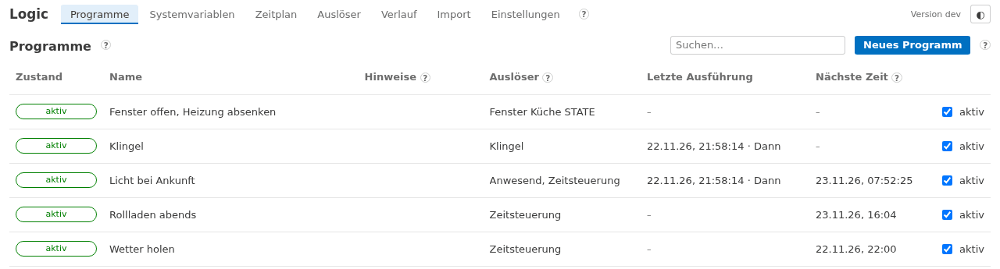</picture>

<picture><source media="(prefers-color-scheme: dark)" srcset="../screenshots/de/02-program-dark.png">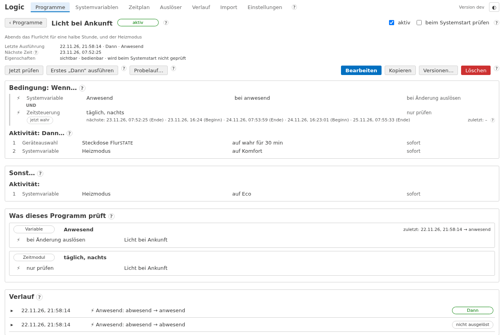</picture>

- Der Schalter **aktiv** schaltet ein Programm ein oder aus. Ein Programm mit einem Skript oder mit einem Fehler
  (eine Variable oder ein Programm, auf das es sich bezieht, gibt es nicht mehr) lässt sich nicht einschalten.
- Ein Klick auf den Namen öffnet das Programm in der Darstellung der CCU: *Bedingung: Wenn…*, *Sonst, wenn…*,
  *Sonst…*, darunter jeweils die Bedingungszeilen mit ihrem Auslöser und *Aktivität: Dann…* mit den Aktivitäten
  (*sofort* oder *verzögert um*). Zeilen, die das Programm auslösen, sind mit ⚡ markiert. Ein Gerät, das es auf
  diesem System nicht gibt, steht mit seiner Adresse da.
- **Jetzt prüfen** und **Erstes „Dann“ ausführen** starten das Programm von Hand (siehe unten).
- Die Spalte **Nächste Zeit** nennt, wann ein Zeitmodul das Programm als Nächstes auslöst.

**Neues Programm** sowie **Bearbeiten**, **Kopieren** und **Löschen** in der Ansicht eines Programms sind unter
[Ein Programm bearbeiten](#editor) beschrieben.

Alle Zeilen der Liste sind gleich hoch. Ein Text, der nicht in seine Spalte passt – Name, Beschreibung, Auslöser –,
wird mit „…“ gekürzt; der ganze Text erscheint, wenn der Mauszeiger darauf steht. Auf einem Telefon ist jedes Programm
eine Karte mit denselben Zeilen.

### <a id="program-marks"></a>Hinweise in der Liste
Die Spalte **Hinweise** sagt, was an einem Programm zu beachten ist:

- *n Befehle abgelehnt* – das System hat Schreibbefehle des Programms abgelehnt; der Hinweis nennt den letzten;
- *Skript* – das Programm enthält ein Skript, das nie ausgeführt wird;
- *kein Standort* und *Uhr nicht gestellt* – ein [Zeitmodul](#time) kann nicht auslösen;
- *systemintern* – ein internes Programm.

Hat ein Programm mehrere Hinweise, steht der wichtigste da und daneben die Zahl der weiteren (*+2*); alle zusammen
nennt der Text, der erscheint, wenn der Mauszeiger darauf steht.

### <a id="triggers"></a>Wann ein Programm läuft
Jede Bedingungszeile hat einen **Auslöser**. Er entscheidet nur, **wann** das Programm seine Bedingungen prüft; er ist
nicht Teil der Bedingung.

| Auslöser | Das Programm wird geprüft, … |
| --- | --- |
| **bei Änderung auslösen** | wenn sich die **Wahrheit dieser einen Zeile** ändert – in beide Richtungen. Nicht, wenn sich nur der Wert ändert: bei „größer als 10“ löst 6 → 12 aus, 12 → 15 nicht, 15 → 8 wieder |
| **bei Aktualisierung auslösen** | bei jeder Meldung des Geräts und jedem Schreiben der Variable, auch mit demselben Wert. Ein Thermostat meldet alle paar Minuten |
| **bei jeder Wertänderung** | wenn sich der Wert gegenüber dem vorigen ändert. Diesen Auslöser gibt es auf der CCU nicht |
| **nur prüfen** | nie. Ein Programm, das nur solche Zeilen hat, läuft nicht von selbst. Die Ausnahme ist ein [Zeitmodul](#time): es löst zu seinen Zeiten aus, was auch immer seine Zeile sagt |

Wird das Programm geprüft, geht es **die ganze Kette von oben nach unten** mit den aktuellen Werten durch: der erste
Block, dessen Bedingung wahr ist, wird ausgeführt, die späteren werden nicht mehr angesehen. Der Block, der läuft, muss
also nicht der sein, in dem die auslösende Zeile steht. Lösen mehrere Zeilen eines Programms durch dasselbe Ereignis
aus, wird es einmal geprüft.

Eine Bedingung ohne Zeilen ist immer wahr. Eine Zeile auf einem Wert, den das System noch nicht kennt (ein Gerät hat
seit dem Start noch nichts gemeldet), ist falsch. Der erste Wert, den eine Zeile zu sehen bekommt, gilt nicht als
Änderung: nach einem Start soll ein wiederhergestellter Wert kein Programm auslösen.

### <a id="triggers-page"></a>Was löst was aus: der Reiter Auslöser
Der Reiter **Auslöser** beantwortet die Frage von der anderen Seite: für jede Systemvariable, jeden Geräte-Datenpunkt
und jedes Zeitmodul, das irgendein Programm prüft, **welche Programme darauf hören und wie**. Das ist die Schaltfläche
*Programme* einer Variable oder eines Kanals auf der CCU, für alle auf einmal.

<picture><source media="(prefers-color-scheme: dark)" srcset="../screenshots/de/17-triggers-dark.png">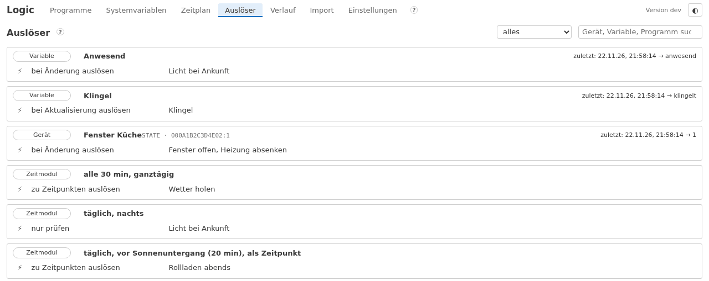</picture>

- Jede Quelle hat ihren Namen (ein Gerät auch Datenpunkt und Adresse), ihr **letztes Ereignis mit dem Wert, den es
  brachte** – bei einem Gerät die letzte Meldung seit dem Start des Addons, bei einer Variable das letzte Schreiben –
  und, sobald ein Gerät dreimal gemeldet hat, **wie oft es meldet** (*meldet etwa alle 3 min*).
- Darunter die Programme, je eine Zeile: ⚡, wo die Zeile das Programm auslöst, ihre Auslöseart in den Worten der CCU
  (*bei Änderung auslösen*, *bei Aktualisierung auslösen*, *nur prüfen* …) und der Name des Programms – ein Klick öffnet
  es. Ein inaktives Programm ist ausgegraut und sagt es.
- **⚠ läuft bei jeder Meldung** markiert eine Gerätezeile, die bei Aktualisierung auslöst: ihr Programm wird bei jeder
  Meldung des Geräts geprüft, auch mit gleichem Wert.
- Der Filter zeigt nur Variablen, nur Geräte oder nur Zeitmodule; die Suche findet eine Quelle über ihren Namen,
  Datenpunkt oder ihre Adresse und über die Programme, die darauf hören.

Dieselbe Liste, nur für ein Programm, steht am Ende der Ansicht des Programms: **Was dieses Programm prüft**.

### <a id="trace"></a>Warum ein Programm lief – und warum nicht: der Reiter Verlauf
Die CCU zeigt von einem Programm nur die „letzte Ausführung“. Der Reiter **Verlauf** zeigt jeden Lauf jedes Programms,
der neueste oben, und zu jedem, was das Programm dabei gesehen und getan hat. Eine Zeile je Eintrag: wann, welches
Programm, **was ausgelöst hat – mit dem Wert vorher und nachher** (*Regen: trocken → es regnet*) – und was daraus
wurde: *Dann*, *Sonst, wenn 1*, *Sonst*, *nichts lief*, *verzögerte Aktivität*, *pausiert*, *verpasst*. Ein Klick
öffnet den Eintrag:

<picture><source media="(prefers-color-scheme: dark)" srcset="../screenshots/de/08-history-dark.png">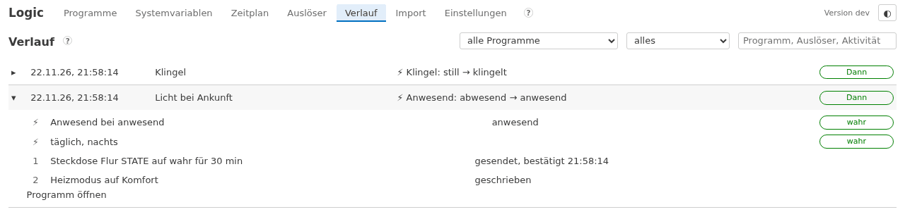</picture>

- **Jede Bedingungszeile mit dem Wert, den sie gesehen hat, und ihrem Ergebnis** – *wahr* oder *falsch*. ⚡ steht vor
  einer Zeile, die auslöst. Eine Zeile ohne Wert (*Wert unbekannt*) ist falsch. Eine Zeile mit „hält seit“ sagt, seit
  wann ihr Vergleich gilt. **Nicht geprüft** heißt: ein Block davor lief, die Zentrale schaut die Zeilen der späteren
  Blöcke dann nicht an – und eine solche Zeile „bei Änderung“ hat danach keinen gemerkten Zustand, ihre nächste Meldung
  löst das Programm aus (wie auf der CCU).
- **Jede Aktivität mit dem, was aus ihr wurde:** *gesendet* und, sobald das System geantwortet hat, *bestätigt* mit der
  Uhrzeit oder *abgelehnt* mit dem Grund; *geschrieben* bei einer Systemvariable; *geplant für* eine Uhrzeit bei einer
  Verzögerung – und später dort *ausgeführt* oder *beendet*, mit dem, der sie beendet hat (von Hand im Zeitplan, ein
  Programm mit „laufende Verzögerungen beenden“); *übersprungen* mit dem Grund (ein Skript, ein Sonderwert, ein Wert,
  der nicht bekannt ist).
- Eine **verzögerte Aktivität**, die fällig wird, ist ein eigener Eintrag: dabei wird nichts erneut geprüft, auch wenn
  die Bedingung inzwischen falsch ist.
- *Ausgeführt, ohne die Bedingungen zu prüfen* steht bei einem Lauf, den „Erstes ‚Dann‘ ausführen“, ein anderes
  Programm oder andere Software so gestartet hat.

Oben wählen Sie ein Programm, zeigen nur Einträge, bei denen etwas lief, oder **nur Probleme** (abgelehnte und
übersprungene Aktivitäten, Pausen des Schleifenschutzes, verpasste Zeiten) und suchen nach Programm, Auslöser oder
Aktivität. Derselbe Verlauf, nur für ein Programm, steht am Ende der Ansicht des Programms.

Das Addon merkt sich die letzten 5000 Einträge aller Programme zusammen; sie überstehen einen Neustart des Addons und
des Systems und liegen neben dem Zustand des Addons, nicht bei den Programmdateien. Solange es läuft, behält das Addon
außerdem von jedem Programm dessen letzte 20 Einträge, gleich wie oft die anderen Programme seitdem gelaufen sind – ein
Programm, das einmal am Tag läuft, zeigt seine letzten Läufe weiterhin.

#### <a id="trace-not-triggered"></a>Nicht ausgelöst
Die häufigste Frage ist „warum lief es nicht?“. Wählen Sie im Reiter Verlauf ein Programm (oder öffnen Sie das
Programm): dann stehen zwischen den Läufen auch die Vermerke **nicht ausgelöst** – etwas, das das Programm prüft, hat
gemeldet, und das Programm wurde nicht geprüft. Der Vermerk sagt, warum:

<picture><source media="(prefers-color-scheme: dark)" srcset="../screenshots/de/19-not-triggered-dark.png"></picture>

- Die Zeile löst **bei Änderung** aus, und ihr Ergebnis (wahr oder falsch) ist dasselbe wie vorher – der Wert darf sich
  dabei geändert haben.
- Die Zeile löst **bei jeder Wertänderung** aus, und der Wert ist derselbe wie vorher.
- Die Zeile steht auf **nur prüfen**: sie löst nie aus.
- Es war der **erste Wert**, den die Zeile sieht (nach einem Start): sie merkt sich nur, wo sie steht.

Mehrere solche Vermerke hintereinander mit demselben Grund sind ein Eintrag, der zählt (*12-mal seit 09:30:00*); ein
Gerät, das alle drei Minuten meldet, füllt den Verlauf so nicht.

### <a id="else"></a>Sonst
**Der *Sonst*-Block läuft bei jeder Prüfung, bei der kein Block davor wahr ist** – also auch dann, wenn eine Zeile „bei
Änderung“ von wahr auf falsch wechselt, und bei jeder Meldung einer Zeile „bei Aktualisierung“, solange die Bedingung
falsch ist. Ein Programm mit *Sonst* tut deshalb bei jeder Prüfung etwas. Das ist das Verhalten der CCU und die
häufigste Überraschung in Programmen.

Eine Besonderheit der CCU ist ebenfalls übernommen: Eine Zeile „bei Änderung“ in einem *Sonst, wenn…*, das gar nicht
erreicht wurde, weil ein Block davor wahr war, löst danach bei **jedem** Schreiben ihrer Variable aus – auch mit
demselben Wert –, bis der Block davor wieder falsch ist.

### <a id="delays"></a>Aktivitäten und Verzögerungen
Die Aktivitäten eines Blocks werden **in der aufgeführten Reihenfolge** ausgeführt. Schreibbefehle an Geräte gehen
nacheinander hinaus, an Funk-Schnittstellen mit einer kurzen Pause dazwischen (0,3 Sekunden), damit ein Programm keinen
Funk-Stoß auslöst. Ein Befehl, den das System ablehnt, wird am Programm vermerkt und nicht wiederholt.

Eine **verzögerte** Aktivität zählt ab der Auslösung, nicht ab der Zeile darüber. Wenn sie fällig ist, wird sie
ausgeführt, **ohne dass die Bedingung noch einmal geprüft wird**. Löst das Programm vorher noch einmal aus, bleibt die
erste Verzögerung bestehen: zwei Auslösungen, zwei Ausführungen.

Das Häkchen **„vor dem Ausführen alle laufenden Verzögerungen für diese Aktivitäten beenden“** (`cancel_pending`)
ändert das: bevor der Block läuft, werden die ausstehenden verzögerten Aktivitäten für die **Ziele, die dieser Block
nennt**, entfernt – gleich, welches Programm sie geplant hat. Deshalb beendet ein sofortiger Gegenbefehl im
*Sonst*-Block die Verzögerung aus dem *Dann*-Block; ein Block, der ein anderes Ziel nennt, beendet nichts. Mit dem
Häkchen und einem Auslöser „bei Aktualisierung“ beginnt die Verzögerung bei jeder Meldung neu und läuft womöglich nie ab.

Ein Programm zu deaktivieren beendet seine ausstehenden Verzögerungen nicht.

### <a id="program-run"></a>Ein Programm von Hand starten
Ein Programm lässt sich auf zwei Arten starten: **mit Prüfung** der Bedingungen (wie bei einer Auslösung) oder **nur der
erste *Dann*-Block ohne Prüfung** – das ist „Start“ auf der CCU, und es führt auch ein inaktives Programm aus. Dieselben
zwei Arten hat die Aktivität „Programm ausführen“ (`run` mit `mode: check` oder `mode: then`).

### <a id="dry-run"></a>Probelauf: was würde passieren?
**Probelauf…** in der Ansicht eines Programms zeigt, was das Programm tun würde – **ohne es zu tun**. Nichts wird
gesendet, geschrieben oder geplant, keine laufende Verzögerung wird beendet, und das Programm merkt sich nichts davon;
im [Verlauf](#trace) steht kein Eintrag.

<picture><source media="(prefers-color-scheme: dark)" srcset="../screenshots/de/14-dry-run-dark.png">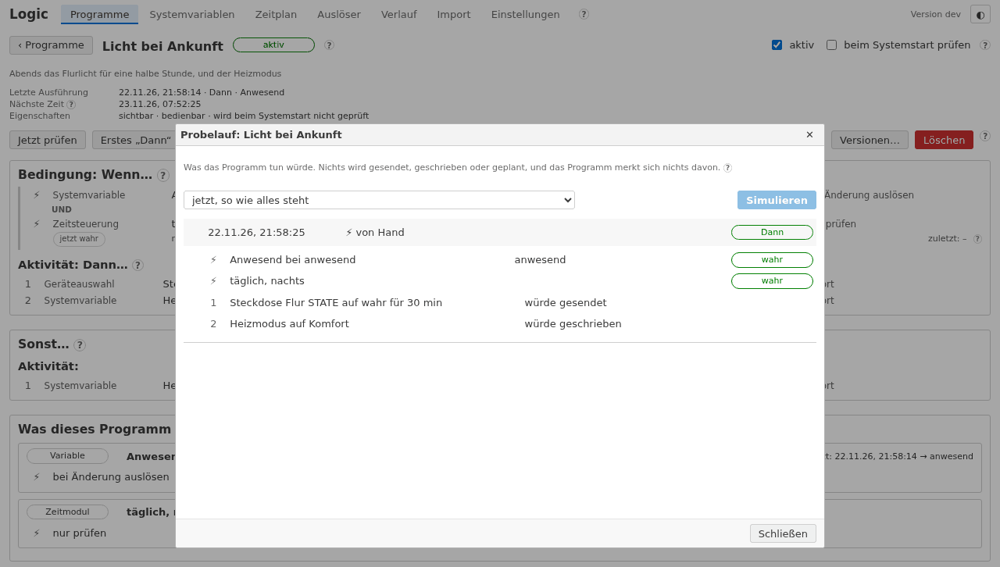</picture>

- **Jetzt, so wie alles steht:** Das Programm wird mit den aktuellen Werten geprüft. Sie sehen jede Bedingungszeile mit
  ihrem Wert und Ergebnis, den Block, der liefe, und zu jeder Aktivität, was sie täte: *würde gesendet*, *würde
  geschrieben*, *würde geplant für* eine Uhrzeit, *übersprungen* mit dem Grund.
- **Auslöser simulieren – „wenn Zeile … meldete“:** Wählen Sie eine Bedingungszeile und einen Wert. Der Probelauf sagt
  zuerst, **ob diese Meldung das Programm überhaupt auslösen würde** – nach der Auslöseart der Zeile und dem Zustand,
  den sie sich gemerkt hat (*würde nicht auslösen*, mit dem Grund wie im Verlauf) – und dann, was das Programm mit
  diesem Wert täte. Bei einem Zeitmodul gibt es keinen Wert: es wird so geprüft, als löste es jetzt aus.

Der Probelauf geht auch bei einem inaktiven Programm: so lässt sich ein importiertes Programm ansehen, bevor Sie es
einschalten. Ein Programm, das ein anderes ausführen würde, sagt nur das – das andere wird nicht mitgeprüft.

### <a id="editor"></a>Ein Programm bearbeiten
**Neues Programm** über der Liste öffnet den Editor mit einem leeren Programm; **Bearbeiten** in der Ansicht eines
Programms öffnet ihn mit diesem Programm, **Kopieren** mit einer Kopie davon (sie heißt „… (Kopie)“ und ist inaktiv, bis
du sie einschaltest), und **Löschen** entfernt das Programm nach einer Rückfrage – ein Programm, das andere Programme
ausführen oder schalten, lässt sich nicht entfernen, und seine früheren Versionen bleiben im Verlauf. Gespeichert wird
erst mit **Speichern**; wer den Editor mit ungespeicherten Änderungen verlässt, wird vorher gefragt. Speichern führt nie
ein Programm aus.

<picture><source media="(prefers-color-scheme: dark)" srcset="../screenshots/de/03-editor-dark.png">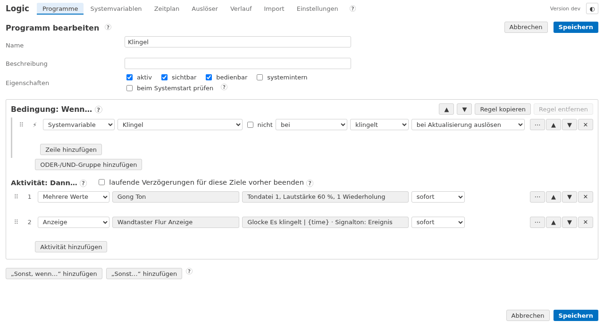</picture>

Der Editor hat den Aufbau der CCU: Name, Beschreibung und Eigenschaften (*aktiv*, *sichtbar*, *bedienbar*,
*systemintern*, *beim Systemstart prüfen*), dann *Bedingung: Wenn…* mit ihren Zeilen und *Aktivität: Dann…* mit ihren
Aktivitäten, dann jedes *Sonst, wenn…* und das *Sonst…*. **„Sonst, wenn…“ hinzufügen** und **„Sonst…“ hinzufügen**
ergänzen Regeln; eine Regel wird mit ihren Pfeilen verschoben, entfernt oder **kopiert** – die Kopie wird das *Sonst,
wenn…* direkt danach.

Was nicht stimmt, steht **schon beim Tippen** in der Zeile unter der betroffenen Reihe, mit dem Grund: ein Gerät oder
Datenpunkt ist noch nicht gewählt, ein Text steht, wo eine Zahl hingehört, eine Variable gibt es nicht mehr. Ein
Programm mit einer solchen Stelle wird nicht gespeichert; *Speichern* nennt ihre Anzahl. Unter den Regeln gibt der
Editor Hinweise, wo ein Programm etwas tun wird, das man vielleicht nicht erwartet – etwa dass *Sonst* bei jeder Meldung
eines Geräts läuft, wenn eine Zeile bei Aktualisierung auslöst.

#### <a id="editor-lines"></a>Bedingungszeilen
Eine Zeile prüft ein **Gerät** (einen Datenpunkt eines Kanals), eine **Systemvariable** oder eine **Zeitsteuerung**,
vergleicht und hat eine Auslöseart. Zeilen, die das Programm auslösen, sind mit ⚡ markiert.

- **Zeile hinzufügen** ergänzt eine Zeile in einer Gruppe; **ODER-/UND-Gruppe hinzufügen** beginnt eine weitere Gruppe.
  In einer Gruppe sind die Zeilen mit *UND* oder *ODER* verknüpft, die Gruppen untereinander ebenso – zwei Ebenen, wie
  auf der CCU.
- Der Vergleich bietet an, was der Wert kann: *bei* und *ungleich* für einen Logikwert, einen Listeneintrag oder einen
  Text; für eine Zahl auch *größer als*, *kleiner als* …, *im Wertebereich* (von … bis kleiner …) und *außerhalb des
  Wertebereichs*.
- Der Wert wird so eingegeben, wie sein Datenpunkt oder seine Variable es verlangt: eine Auswahl für einen Logikwert,
  eine Liste oder eine Aufzählung, ein Feld mit der Einheit für eine Zahl.
- **nicht** kehrt die Zeile um: sie ist wahr, wenn der Vergleich es nicht ist.
- Die Auslöseart ist die der CCU: *bei Änderung auslösen*, *bei Aktualisierung auslösen*, *nur prüfen*, dazu *bei jeder
  Wertänderung auslösen* (siehe [Wann ein Programm läuft](#triggers)).
- **⋯** öffnet die weiteren Optionen der Zeile: *seit mindestens …* (siehe [Über die Zentrale hinaus](#additions)).
- Eine Zeile wird **an ihrem Griff ⠿** an eine andere Stelle gezogen – in ihrer Gruppe, in eine andere Gruppe oder in
  eine andere Regel – oder mit ihren Pfeilen um einen Platz verschoben; ✕ entfernt sie. Eine Gruppe, deren letzte Zeile
  weg ist, verschwindet mit.

#### <a id="editor-devices"></a>Ein Gerät auswählen
Die Schaltfläche mit dem Namen des Geräts öffnet die Auswahl: jeder Kanal des Systems mit Namen, Gerät, Typ, Raum und
Adresse. Die Suche durchsucht all das; die drei Filter grenzen die Liste auf einen Raum, einen Gerätetyp oder eine
Schnittstelle ein. Ein Klick auf einen Kanal wählt ihn; der Datenpunkt wird in der Liste neben der Schaltfläche gewählt
– eine Bedingungszeile bietet die lesbaren Datenpunkte an, eine Aktivität die schreibbaren. Ein Gerät, das dieses System
nicht hat (ein von einer anderen CCU übernommenes Programm), bleibt mit seiner Adresse im Programm, und sein Datenpunkt
wird getippt.

<picture><source media="(prefers-color-scheme: dark)" srcset="../screenshots/de/10-picker-dark.png">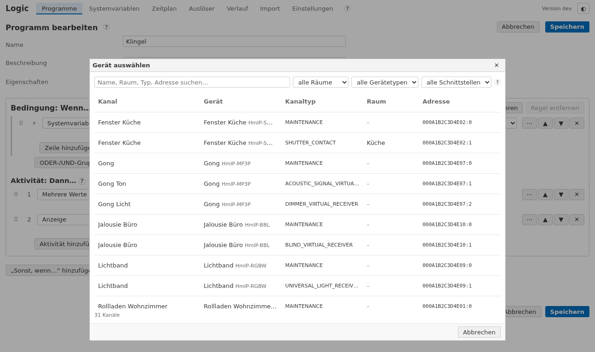</picture>

#### <a id="editor-activities"></a>Aktivitäten
Eine Aktivität schreibt einen Datenpunkt eines **Geräts** oder eine **Systemvariable**, oder sie führt ein anderes
**Programm** aus oder schaltet es (*prüfen*, *erstes „Dann“ ausführen*, *einschalten*, *ausschalten*). Der Wert ist ein
fester, oder der aktuelle Wert einer Variable oder eines anderen Datenpunkts. Jede Aktivität geschieht *sofort* oder
*verzögert um* eine Anzahl Sekunden, Minuten oder Stunden, gezählt ab der Auslösung, oder *zufällig* verzögert; **⋯** öffnet ihre
weiteren Optionen, *ein für …* und die längste Zeit der zufälligen Verzögerung (siehe
[Über die Zentrale hinaus](#additions)). **Laufende Verzögerungen für diese
Ziele vorher beenden** ist das Kontrollkästchen der CCU für den Block (siehe [Aktivitäten und Verzögerungen](#delays)).
Aktivitäten werden wie Zeilen gezogen oder verschoben, auch in eine andere Regel. Ein übernommenes Skript bleibt als
Text an seinem Platz und lässt sich nur entfernen; eine Aktivität mit einem Sonderwert der CCU wird übersprungen, bis
sie hier einen Wert bekommt.

#### <a id="editor-time"></a>Zeitsteuerung im Editor
Eine Zeitzeile öffnet ein Formular: wie sie sich **wiederholt** (einmalig, im Intervall, täglich, wöchentlich,
monatlich, jährlich), **wann** an ihrem Tag (eine Uhrzeit, ganztägig oder die Sonne mit einem Versatz in Minuten), ob
sie ein **Zeitpunkt oder eine Zeitspanne** ist und wie lange die Spanne dauert – bei der Sonne auch ein Zeitpunkt und
eine Dämmerung (siehe [Über die Zentrale hinaus](#additions)) –, und ihre Gültigkeit (*gültig ab*,
*gültig bis* – ein Datum ohne Uhrzeit schließt diesen Tag ein –, eine Anzahl von Malen). Das Formular sagt das Modul in
Worten und listet **die nächsten Zeitpunkte**, zu denen es feuern würde, mit dem Standort und der Uhr des Systems,
während du es ausfüllst. Was die Felder genau bedeuten, steht unter [Zeitmodule](#time).

<picture><source media="(prefers-color-scheme: dark)" srcset="../screenshots/de/13-time-dark.png">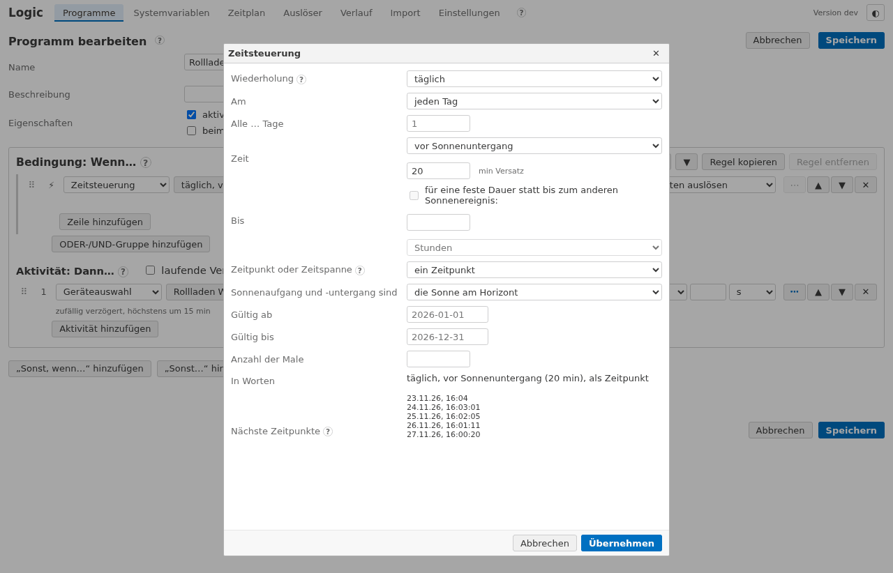</picture>

### <a id="start"></a>Nach einem Systemstart
Eine CCU prüft beim Start jedes aktive Programm einmal. Hier hat jedes Programm dafür einen eigenen Schalter, **beim
Systemstart prüfen** (in der Ansicht des Programms; `at_start` in der Datei): er ist an bei Programmen, die von einer
CCU übernommen wurden – der Importbericht nennt sie –, und aus bei hier angelegten.

- Einmal nach jedem Start des **Systems**, nicht bei einem Neustart oder Update des Addons, wird jedes aktive Programm
  mit eingeschaltetem Schalter mit seinen Bedingungen geprüft: der erste erfüllte Block läuft, sonst „Sonst“. Die
  Ausführung ist mit *Systemstart* gekennzeichnet.
- Ein Programm ohne Bedingungen führt sein „Dann“ aus. Ein Programm, das nur Zeitmodule hat, führt sein „Sonst“ aus,
  außer der Augenblick liegt in einer seiner Zeitspannen. Programme mit Skripten und inaktive Programme nehmen nicht
  teil.
- Das Addon wartet, bis es die Werte der Geräte gelesen hat, die die Programme verwenden, und die Uhr des Systems
  gestellt ist – höchstens fünf Minuten; dann prüft es mit dem, was es weiß (eine Zeile auf einen unbekannten Wert ist
  falsch).
- Von dieser Prüfung geht auch jede Zeile *bei Änderung auslösen* aus: ein Wert, der später eintrifft und die Zeile
  lässt, wie sie war, löst nicht aus.
- Was die Programme dabei schalten, geht Befehl für Befehl mit der [Pause](#pacing) dazwischen hinaus, wie jedes
  Schreiben – ein Start ist kein Schwall auf dem Funk.
- [Werte beim Systemstart](#start-value) werden vorher gesetzt, und verzögerte Aktivitäten, die beim Herunterfahren
  ausstanden, bleiben erhalten, wenn sie noch in der Zukunft liegen.

Schalten Sie ihn aus für ein Programm, das nach einem Stromausfall nichts tun darf – oder sichern Sie es wie auf der
CCU mit einer Variablen ab, die in den ersten Minuten nach einem Start wahr ist.

### <a id="differences"></a>Was anders ist als auf der CCU
| Auf der CCU | Hier |
| --- | --- |
| Ein Programm wird beim ersten Speichern und beim Aktivieren einmal ausgeführt | Speichern und Aktivieren führen nie etwas aus |
| Die Reihenfolge der Aktivitäten eines Blocks ist nicht zugesichert | die aufgeführte Reihenfolge |
| Zwei Zeilen, die im selben Augenblick auslösen, können den Block zweimal ausführen | eine Prüfung je Ereignis |
| Ausstehende Verzögerungen gehen bei einem Neustart verloren | sie bleiben erhalten; war eine während des Stillstands fällig, wird sie verworfen und nicht nachgeholt |
| Ein Programm, das schreibt, worauf es selbst auslöst, läuft endlos | nach 20 Läufen in 10 Sekunden pausiert es eine Minute und wird markiert |
| „Letzte Ausführung“ bewegt sich auch, wenn nichts ausgeführt wurde | der letzte Lauf ist der letzte, in dem ein Block lief |
| Eine Verzögerung von 24 Stunden und mehr wird als null gespeichert | Verzögerungen haben keine Grenze |
| Zwei gleiche Zeitmodule in einem Programm führen es zweimal aus | eine Prüfung je Augenblick |
| „Alle *n* Monate“ wird in mehreren Fällen falsch berechnet | gezählt ab dem Monat des Beginns |
| Am Tag der Uhrumstellung zeigt und speichert die Zentrale eine Verzögerung von zwei Stunden als eine | eine Verzögerung ist eine Dauer; eine Zeitspanne endet zu ihrer Uhrzeit |
| Zeitmodule laufen sofort nach dem Start, auch mit einer noch falschen Uhr | sie warten, bis die Uhr des Systems gestellt ist |

### <a id="compared"></a>Wie „wie auf der CCU“ geprüft wird
Dass sich ein Programm hier verhält wie auf der CCU, wird getestet und nicht angenommen. Jedes
Verhalten, das dieses Handbuch beschreibt - wann eine Zeile auslöst, welcher Block läuft, was eine
Verzögerung tut, wann ein Zeitmodul auslöst -, ist ein kleines Szenario: ein Programm, gebaut wie
der Programmeditor der CCU es baut, und eine Liste von Schreibvorgängen mit ihren Zeiten. Jedes
Szenario wurde auf einer echten CCU-Logik (ReGaHss von OpenCCU 3.89.8, das Verhalten vor den
Änderungen von 3.89.14) mit gesteuerter Uhr abgespielt, und was dort lief, wurde aufgezeichnet. Bei
jeder Änderung am Addon laufen dieselben Szenarien auf dessen eigener Logik - ausgehend von der
Datenbank, die die CCU gespeichert hat, der Import ist also Teil des Tests -, und das Ergebnis muss
der Aufzeichnung gleichen. Wo das Addon absichtlich abweicht (die Tabelle oben), nennt das Szenario
den Unterschied, und der Test hält das Addon daran fest.

Nicht mit einer CCU verglichen sind Bedingungen und Aktivitäten auf echten Geräten sowie
Tastendrücke (die Referenz hat keinen Funk); für sie gelten dieselben Regeln wie für
Systemvariablen.

### <a id="additions"></a>Über die Zentrale hinaus
Ein paar Dinge, die man sich auf einer Zentrale immer wieder von Hand baut, gehören hier zum Programm. Im Editor stehen
sie hinter der Schaltfläche **⋯** einer Bedingungszeile oder Aktivität (*Weitere Optionen*) – die Zeile sagt dann
darunter, was gesetzt ist – und im Formular einer Zeitsteuerung; in der Datei des Programms (siehe
[Programme und Variablen als Dateien](#files)) sind es die hier genannten Felder.

<picture><source media="(prefers-color-scheme: dark)" srcset="../screenshots/de/12-options-dark.png">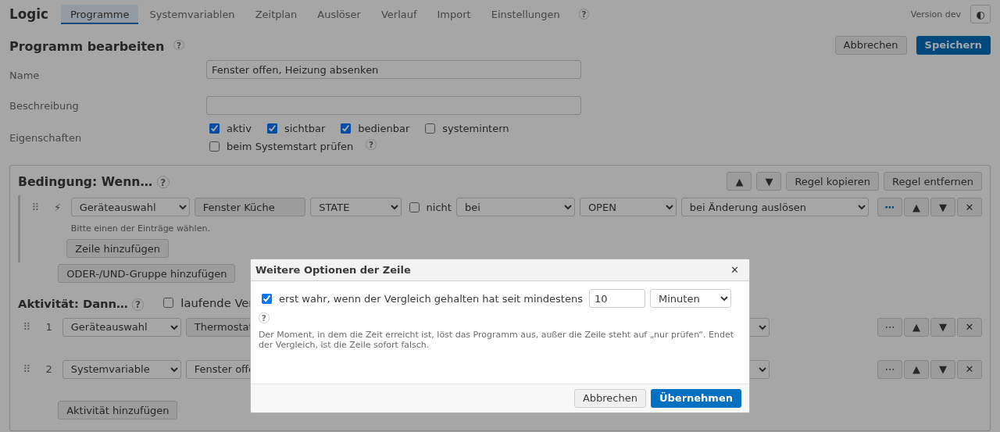</picture>

- **Hält seit** - *erst wahr, wenn der Vergleich gehalten hat seit mindestens …* in den Optionen einer Zeile;
  `for: 10min` in der Datei. Die Zeile ist erst wahr, wenn ihr Vergleich so lange ohne
  Unterbrechung gehalten hat, und der Moment, in dem das erreicht ist, **löst das Programm aus** (außer bei *nur
  prüfen*). Endet der Vergleich, ist die Zeile sofort falsch. *Fenster seit zehn Minuten offen: Heizung absenken* ist
  damit eine Zeile, ohne eine Verzögerung, die auch dann feuert, wenn das Fenster zwischendurch wieder zu war. Die
  Zählung übersteht einen Neustart des Addons.
- **Zufällige Verzögerung** - *zufällig* als Zeitpunkt einer Aktivität, die kürzeste Verzögerung daneben, die längste in ihren
  Optionen; `after: 5min` mit `after_up_to: 30min` in der Datei: verzögert um eine Zeit zwischen beiden, bei jedem Lauf
  neu gezogen. Ohne kürzeste Verzögerung beginnt sie bei null. Für eine Anwesenheitssimulation.
- **Ein für** - *ein für …* in den Optionen einer Aktivität, die einen festen Wert an ein Gerät schreibt;
  `on_for: 5min` in der Datei: Die Einschaltdauer des Kanals (`ON_TIME`) geht
  zusammen mit dem Wert in einem Befehl hinaus, und das Gerät schaltet selbst zurück. Auf der Zentrale braucht das zwei
  Zeilen und eine Sekunde Verzögerung. Der Kanal muss den Datenpunkt `ON_TIME` haben; der Editor sagt es, wenn er fehlt.
- **Astro-Zeitpunkt** - *ein Zeitpunkt* statt einer Zeitspanne im Formular einer Zeitsteuerung mit der Sonne;
  `point: true` in der Datei: einmal, zum Sonnenauf- oder -untergang, um `offset`
  versetzt (*20 Minuten vor Sonnenuntergang*), statt einer Zeitspanne. Mit `twilight: civil` (oder `nautical`,
  `astronomical`) treten Morgen- und Abenddämmerung an die Stelle von Sonnenauf- und -untergang, für Zeitpunkte wie für
  Zeitspannen (*Sonnenaufgang und -untergang sind* im Formular).
- **Der Sonnenstand** - die [Systemwerte](#system-values) `sun-azimuth` und `sun-elevation`.
- **Mehrere Werte eines Kanals in einem Befehl** - die Aktivität [Mehrere Werte](#values), mit [Formularen](#forms)
  für Signalleuchten, Töne, Sirenen, Farblichter und Jalousien mit Lamellen.
- **Die fünf Zeilen einer Anzeige** - die Aktivität [Anzeige](#display) für den HmIP-WRCD, mit Vorschau.
- **Eine Web-Adresse aufrufen** und **ein Gerät aufwecken** - die Aktivitäten [Webhook](#webhook) und
  [Wake-on-LAN](#wake).
- **Ein Programm des Systems ausführen** - die Aktivität [Befehl](#command), anstelle eines Skripts mit
  `system.Exec`.

### <a id="values"></a>Mehrere Werte in einem Befehl
Manche Geräte nehmen mehrere Werte **gemeinsam**: ein farbiges Signallicht seine Farbe, seine Helligkeit und wie es
blinkt; eine Jalousie ihre Höhe und die Stellung ihrer Lamellen; ein Ton seine Datei, seine Lautstärke und seine Dauer.
Nacheinander geschrieben, kann das Gerät einen davon ignorieren oder etwas dazwischen zeigen. Die Aktivität **Mehrere
Werte** schreibt sie in **einem Befehl**.

Im Editor den Kanal wählen, dann **die Werte**: Das Formular listet die schreibbaren Datenpunkte des Kanals, wie das
Gerät selbst sie beschreibt - eine Auswahl für eine Werteliste, ein Feld mit seinen Grenzen für eine Zahl -, und die
angekreuzten werden gesendet. In der Datei steht ein Eintrag einer Werteliste mit seinem **Namen** (`COLOR: RED`), eine
Zahl als Zahl, ein Logikwert als `true` oder `false`:

```yaml
name: Flurlicht rot
rules:
  - when:
      all: []
    then:
      - channel: HmIP-RF/000855699C1234:8
        values:
          COLOR: RED
          LEVEL: 0.5
          DURATION_UNIT: S
          DURATION_VALUE: 10
```

Die Werte werden **zweimal gegen die Beschreibung des Geräts geprüft**: wenn das Programm gespeichert wird und erneut
jedes Mal, wenn der Befehl gesendet wird. Ein Datenpunkt, den der Kanal nicht hat, einer, der nicht geschrieben werden
kann, eine Zahl außerhalb ihrer Grenzen oder ein Eintrag, den die Liste nicht hat, wird **gesagt und nicht gesendet** -
auf der Seite beim Speichern, im [Verlauf](#trace) und am Programm beim Senden. So zeigt sich ein Gerät, dessen Firmware
seine Datenpunkte geändert hat, als Fehler und nicht als Licht, das dunkel bleibt. Ein Kanal, den das System nicht
kennt (ein Gerät, das noch nicht da ist), lässt sich beschreiben, indem man die Datenpunkte benennt; geprüft wird,
sobald das Gerät da ist.

Ein übernommenes CCU-Programm, das ein solches Gerät mit einem fertigen Text setzt (`COMBINED_PARAMETER`), wird
übernommen, wie es ist, und gesendet, wie es war; die [Formulare](#forms) können es umwandeln.

### <a id="forms"></a>Formulare für Lichter, Töne, Sirenen und Jalousien
Für fünf Arten von Kanälen werden die Werte nicht Datenpunkt für Datenpunkt angekreuzt: Der Editor öffnet ein
**Formular**, das für den Kanal gemacht ist. Es wird nach dem **Typ des Kanals** gewählt, bietet an, was die
Beschreibung des Geräts selbst auflistet, und schreibt dieselben Werte - die Datei sieht genau aus wie oben, und **Alle
Datenpunkte…** im Formular öffnet die einfache Liste mit dem, was eingestellt ist (**Formular…** dort führt zurück).

<picture><source media="(prefers-color-scheme: dark)" srcset="../screenshots/de/04-form-dark.png">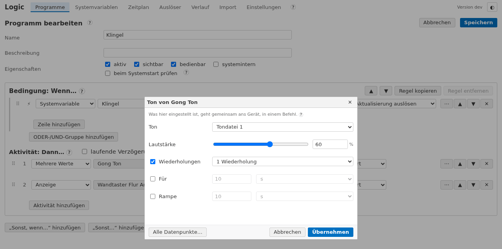</picture>

| Kanal | Das Formular | Datenpunkte, die es schreibt |
| --- | --- | --- |
| **Signalleuchte** - das farbige Licht eines HmIP-BSL, das Licht eines HmIP-MP3P (`DIMMER_VIRTUAL_RECEIVER` mit Farbe) | die Farben zum Anklicken, die Helligkeit, das Verhalten (ein, Blinken, Blitzen, Wogen - wo das Gerät es hat), *für* eine Dauer, eine Rampe | `COLOR`, `LEVEL`, `COLOR_BEHAVIOUR`, `DURATION_VALUE` + `DURATION_UNIT`, `RAMP_TIME_VALUE` + `RAMP_TIME_UNIT` |
| **Ton** - HmIP-MP3P (`ACOUSTIC_SIGNAL_VIRTUAL_RECEIVER`) | die Tondatei, die Lautstärke, Wiederholungen, eine Dauer, eine Rampe | `SOUNDFILE`, `LEVEL`, `REPETITIONS`, `DURATION_…`, `RAMP_TIME_…` |
| **Sirene** - HmIP-ASIR (`ALARM_SWITCH_VIRTUAL_RECEIVER`) | der Ton und das Licht aus den Listen der Sirene und wie lange - alle drei werden immer gesendet | `ACOUSTIC_ALARM_SELECTION`, `OPTICAL_ALARM_SELECTION`, `DURATION_VALUE` + `DURATION_UNIT` |
| **Farblicht** - HmIP-RGBW, ein DALI-Gateway (`UNIVERSAL_LIGHT_RECEIVER`) | eine Farbe aus Farbton und Sättigung **oder** eine Farbtemperatur, die Helligkeit, eine Rampe, eine Dauer, ein Effekt | `HUE` + `SATURATION` oder `COLOR_TEMPERATURE`, `LEVEL`, `RAMP_TIME_…`, `DURATION_…`, `EFFECT` |
| **Jalousie mit Lamellen** - HmIP-BBL, HmIP-FBL, HmIP-DRBLI4 (`BLIND_VIRTUAL_RECEIVER`) | die Behanghöhe und die Stellung der Lamellen, gemeinsam | `LEVEL`, `LEVEL_2` |

Eine Helligkeit, eine Lautstärke, eine Höhe werden in Prozent eingegeben und so gespeichert, wie das Gerät sie nimmt
(`LEVEL: 0.5` für 50 %). Eine Dauer ist eine Zahl mit ihrer Einheit aus der Liste des Geräts (`DURATION_VALUE: 10`,
`DURATION_UNIT: M` für zehn Minuten). Was nicht angekreuzt ist, wird nicht gesendet: Das Gerät behält, was es hat, oder
nimmt seinen eigenen Standard. Ein Wert, für den das Formular kein Feld hat (in der einfachen Liste gesetzt), bleibt
erhalten und wird unter dem Formular genannt.

**Die Lamellen einer Jalousie** bewegen sich nur zusammen mit der Höhe: Das Formular sendet immer beides. Eine
Lamellenstellung allein nehmen die Geräte an und ignorieren sie.

**Von einer CCU:** Ein Programm, das einen solchen Kanal mit einem fertigen Text setzt (`COMBINED_PARAMETER`, zum
Beispiel `L=50,C=4,DV=10,DU=1,CB=1`), wird übernommen, wie es ist, und gesendet, wie es war. Wo sich der Text ganz
lesen lässt, sagt der Editor ihn unter der Aktivität in Worten und bietet **In Formular umwandeln** an: Die Aktivität
schreibt dann dieselben Werte als Datenpunkte (die Helligkeit 50 %, die Farbe Nummer 4 mit ihrem Namen, zehn Minuten,
das Verhalten Nummer 1 mit seinem Namen). Ein Text mit einem Teil, den die Seite nicht kennt, bleibt, wie er ist.

**Wie weit das geprüft ist:** Die Formulare sind gegen die Beschreibungen der Geräte selbst gebaut und getestet
(HmIP-BSL 1.0.2 und 2.0.2, HmIP-MP3P 1.0.26, HmIP-ASIR 1.2.16, HmIP-RGBW 1.0.52, HmIP-BBL 1.6.2), auf einem simulierten
System - **an den Geräten selbst noch nicht gesehen**. Wenn ein Gerät nicht tut, was sein Formular sagt, funktionieren
die einfache Liste der Datenpunkte und der übernommene Text weiter wie bisher; bitte melden.

### <a id="display"></a>Eine Anzeige: der HmIP-WRCD
Der Wandtaster mit Anzeige (HmIP-WRCD) zeigt **fünf Zeilen**, jede mit einem Text, einem Symbol oder beidem, und kann
dazu einen Signalton spielen. Die Aktivität **Anzeige** gestaltet das: den Kanal der Anzeige wählen, dann für jede
Zeile den Text, das Symbol aus der Liste der Anzeige, wo der Text steht (links, zentriert, rechts) und ob die Zeile
invertiert ist (Weiß auf Schwarz). Eine **Vorschau** folgt dem, was man tippt - sie kommt der Anzeige nahe, ist aber
nicht ihr genaues Bild (die Symbole sind Platzhalter). Eine Zeile ohne Text und Symbol wird nicht gesendet: Die Anzeige
behält, was diese Zeile zeigt. Unter den Zeilen: der **Signalton** (einer der acht der Anzeige), wie oft er wiederholt
wird und die Pause zwischen zweien.

<picture><source media="(prefers-color-scheme: dark)" srcset="../screenshots/de/11-display-dark.png">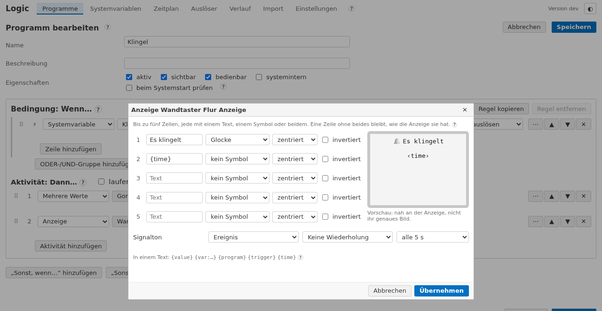</picture>

```yaml
name: Fenster melden
rules:
  - when:
      all: []
    then:
      - display: HmIP-RF/000A1B2C3D4E11:3
        lines:
          - text: "Fenster offen"
            icon: WINDOW_OPEN
          - text: "{var:fenster-kueche}"
            align: LEFT
          - {}
          - text: "seit {time}"
            color: WHITE
            background: BLACK
        sound: EVENT
        repetitions: 2
        interval: 10
```

In der Datei hat eine Zeile `text`, `icon`, `align` (`LEFT`, `CENTER`, `RIGHT`; weggelassen: zentriert), `color` und
`background` (`BLACK`, `WHITE`; weggelassen: schwarzer Text auf weißer Zeile); `- {}` ist eine Zeile, die bleibt, wie
sie ist. `sound` ist der Signalton (`LOW_BATTERY`, `DISARMED`, `INTERNALLY_ARMED`, `EXTERNALLY_ARMED`,
`DELAYED_INTERNALLY_ARMED`, `DELAYED_EXTERNALLY_ARMED`, `EVENT`, `ERROR`), `repetitions` 0 bis 14 oder 15 für „endlos“,
`interval` die Sekunden zwischen zweien (5 bis 80 in Schritten von 5).

Die ganze Anzeige geht in **einem Befehl** ans Gerät, als der Text, den eine CCU in den `COMBINED_PARAMETER` des Kanals
schreibt. Beim Speichern des Programms wird der Kanal geprüft: Er muss eine Anzeige sein, und seine Listen müssen die
genannten Symbole und den Ton haben. Verzögerungen, „laufende Verzögerungen beenden“ und der Probelauf funktionieren
wie bei jeder Aktivität; der [Verlauf](#trace) zeigt die Zeilen, wie sie hinausgingen.

**Von einer CCU:** Ein Programm, das eine Anzeige mit dem fertigen Text der CCU setzt, wird übernommen, wie es ist, und
gesendet, wie es war; wo sich der Text ganz lesen lässt, sagt der Editor ihn in Worten und bietet **In Formular
umwandeln** an, das eine Aktivität *Anzeige* daraus macht. Der Text der CCU für „Anzeige zurücksetzen“ bleibt, wie er
ist.

**Wie weit das geprüft ist:** gebaut und getestet gegen die Beschreibung eines HmIP-WRCD (Firmware 1.4.6) und den
Text, den eine CCU dafür schreibt, auf einem simulierten System - **am Gerät selbst noch nicht gesehen**. Bitte melden,
was eine echte Anzeige anders macht. Eines besonders: Die Töne sind nummeriert, wie das Gerät sie beschreibt; die Seite
der CCU selbst nennt *intern scharf* und *extern scharf* (und ihre verzögerten Formen) andersherum, eine Anzeige kann
also den einen für den anderen spielen.

#### <a id="display-text"></a>Was ein Text enthalten kann
Die Anzeige zeigt **16 Zeichen** einer Zeile. Sie kennt die Buchstaben, Ziffern und Zeichen des einfachen ASCII und `Ä
Ö Ü ä ö ü ß`; ein Komma, ein Gleichheitszeichen und geschweifte Klammern lassen sich nicht zeigen (sie sind die
Trennzeichen des Geräts) - der Editor sagt es. An ihrer Stelle hat das Gerät kein Zeichen für `[ ] # $ | _`: Getippt
erscheinen sie als `Ä & Ö Ü ö ß`.

Ein Text kann **Platzhalter** enthalten, die gefüllt werden, wenn die Aktivität läuft: `{value}` (der Wert, der den
Lauf ausgelöst hat), `{var:<key>}` (der Wert einer Systemvariable - ihr Schlüssel ist der Name ihrer Datei),
`{program}`, `{trigger}` und `{time}`. Was ein Platzhalter bringt, wird auf die Breite der Anzeige gekürzt, und ein
Zeichen, das die Anzeige nicht zeigen kann, wird ein Leerzeichen; ein Geheimnis (`{secret:…}`) wird nie auf einer
Anzeige gezeigt.

### <a id="webhook"></a>Webhooks
Die Aktivität **Webhook** ruft eine Web-Adresse auf: Sie sagt einem anderen Dienst, dass etwas geschehen ist - einem
Benachrichtigungsdienst, einem Chat, einem Gerät mit Web-Oberfläche, einer anderen Hausautomation. Auf einer CCU braucht
das ein Skript mit `wget` oder `curl`; hier ist es ein Formular:

- **Methode** - GET, POST oder PUT - und die **Adresse**, `http://…` oder `https://…`. Adressen auf dem System selbst
  (`127.0.0.1`) sind erlaubt: So wird ein anderes Addon erreicht.
- bis zu acht **Kopfzeilen** (Name und Wert);
- bei POST und PUT ein **Inhalt** der Art *JSON*, *Formular* oder *Text* - die Art bestimmt den `Content-Type` (eine
  Kopfzeile dieses Namens ersetzt ihn) und wie Platzhalter eingesetzt werden;
- **Zertifikat nicht prüfen**, für ein Gerät im Heimnetz, das sein Zertifikat selbst ausstellt. Ohne das muss eine
  `https`-Adresse ein Zertifikat zeigen, dem das System vertraut.

Ein Aufruf wartet höchstens **zehn Sekunden** auf die Antwort. Der Inhalt der Antwort wird **nie gelesen**: Ein Status
von 200 bis 299 gilt als erledigt, alles andere als fehlgeschlagen - ein Programm kann nicht auf das reagieren, was ein
Server sagt. Eine Verbindung, die nicht zustande kommt, wird **einmal wiederholt**; eine Antwort, was immer sie sagt,
und eine Zeitüberschreitung nicht. Einer Weiterleitung wird nur auf demselben Host gefolgt.

Aufrufe gehen **neben den Programmen** hinaus, höchstens vier zugleich: Ein langsamer Server verzögert nie ein Programm
oder eine andere Aktivität. Warten hundert Aufrufe, werden weitere verworfen, und der Verlauf sagt es. Ein verzögerter
Webhook ist eine [laufende Verzögerung](#schedule-delays) wie jede andere: Er lässt sich beenden, von Hand oder durch
„laufende Verzögerungen beenden“ eines Blocks, der dieselbe Adresse nennt.

Der [Verlauf](#trace) zeigt zu jedem Aufruf, ob er beantwortet wurde, den **Statuscode** und wie lange er gedauert hat;
ein fehlgeschlagener Aufruf wird am Programm gezählt wie ein abgelehnter Schreibbefehl. Ein [Probelauf](#dry-run) ruft
nichts auf.

#### <a id="webhook-placeholders"></a>Platzhalter
In der Adresse, in den Werten der Kopfzeilen und im Inhalt stehen diese für einen Wert - eine feste Liste; alles andere
in geschweiften Klammern bleibt, wie es ist, ein JSON-Inhalt braucht also keine Maskierung:

| Platzhalter | Steht für |
| --- | --- |
| `{program}` | den Namen des Programms |
| `{trigger}` | was den Lauf ausgelöst hat: der Name der Variable oder des Programms, das dieses gestartet hat, der Datenpunkt eines Geräts als `Interface/ADRESSE:KANAL/PARAMETER`, oder `time`, `held`, `start`, `user`, `outside` |
| `{value}` | den Wert, den der Auslöser gebracht hat (`true`, `21.5`, ein Text; nichts, wenn er keinen brachte) |
| `{time}` | die Zeit des Laufs, etwa `2026-11-22T16:30:00+01:00` |
| `{var:schluessel}` | den aktuellen Wert der Systemvariable mit diesem Schlüssel |
| `{secret:name}` | ein [Geheimnis](#secrets) aus den Einstellungen |

Ein Wert wird **so eingesetzt, dass er an seine Stelle passt**: prozentkodiert in der Adresse und in einem
*Formular*-Inhalt, als Inneres einer JSON-Zeichenkette in einem *JSON*-Inhalt (`"text": "{program}"` mit den
Anführungszeichen schreiben, `"value": {value}` ohne bei einer Zahl), unverändert in einem *Text*-Inhalt und ohne
Zeilenumbrüche in einer Kopfzeile. Ein verzögerter Webhook nimmt `{value}` vom Auslöser, der ihn eingeplant hat, und
`{time}` und `{var:…}` aus dem Moment, in dem er ausgeführt wird.

In der Datei:

```yaml
name: Tür melden
active: true
rules:
  - when:
      all:
        - all:
            - variable: haustuer-offen
              is: true
              for: 5min
              trigger: change
    then:
      - webhook: "https://ntfy.example.org/zuhause"
        method: POST
        headers:
          - name: Authorization
            value: "Bearer {secret:ntfy-token}"
        body_type: text
        body: Die Haustür ist seit fünf Minuten offen ({time}).
      - wake: "AA:BB:CC:00:11:22"
```

### <a id="wake"></a>Wake-on-LAN
Die Aktivität **Wake-on-LAN** schaltet einen Rechner, ein NAS oder einen Fernseher ein, der darauf hört: Sie sendet drei
*Magic Packets* mit der **Hardware-Adresse** des Geräts (MAC, `AA:BB:CC:DD:EE:FF`) an den UDP-Port 9. Ohne weitere
Angabe gehen sie ins lokale Netz (`255.255.255.255`). Für ein Gerät in einem **anderen Netz** die Broadcast-Adresse
dieses Netzes angeben (*über*, etwa `192.168.2.255`; `broadcast:` in der Datei) - der Router muss solche Pakete
durchlassen.

Auf ein Magic Packet antwortet nichts: Der Verlauf sagt, dass die Pakete gesendet wurden, nicht, dass das Gerät
aufgewacht ist. Am Gerät muss Wake-on-LAN eingeschaltet sein (in seiner Firmware und an seinem Netzwerkadapter), und es
muss per Kabel angeschlossen sein; über WLAN wachen die meisten nicht auf.

### <a id="command"></a>Befehle
Die Aktivität **Befehl** führt ein Programm des Systems aus - das, was auf einer CCU ein Skript mit `system.Exec`
getan hat: einen Wert mit `curl` holen, ein eigenes Skript aufrufen, einen Wert an ein anderes Werkzeug übergeben. Zwei
Dinge sind mit Absicht anders als auf der CCU:

<picture><source media="(prefers-color-scheme: dark)" srcset="../screenshots/de/05-command-dark.png">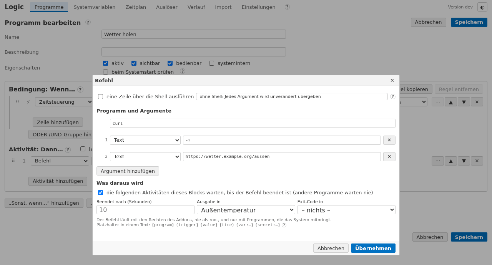</picture>

- **Ein Befehl hält nie ein anderes Programm auf.** Auf einer CCU stand jedes Programm still, solange ein
  `system.Exec` wartete. Hier laufen Befehle neben den Programmen, höchstens vier zugleich; warten fünfzig, werden
  weitere verworfen, und der Verlauf sagt es.
- **Ein Befehl hat die Rechte des Addons, nicht mehr.** Er läuft als der Benutzer, unter dem das Addon läuft - nicht
  als root, und es gibt keinen Weg zu mehr: kein `sudo`, keinen Helfer. Er kann das meiste des Systems lesen, das Netz
  erreichen und unter `/usr/local/addons/logic/`, `/tmp` und `/var/tmp` schreiben; er kann keine Einstellungen des
  Systems ändern, nicht in die Dateien anderer Addons schreiben, keinen Dienst neu starten und nicht neu starten. Ein
  Befehl, der root braucht, schlägt fehl, und der Verlauf nennt den Grund.

Diese Seite sehen überhaupt nur **Administratoren**, also legen nur sie Befehle an und ändern sie.

**Was ausgeführt wird**, ist ohne weitere Angabe eine **Liste**: das Programm, dann seine Argumente, eines je Zeile.
Keine Shell liest sie: Jedes Argument wird dem Programm genau so übergeben, wie es dasteht - ein Leerzeichen, ein
Anführungszeichen oder ein `;` darin bedeutet nichts. Ein Programm ohne Verzeichnis (`curl`) wird in
`/usr/local/sbin`, `/usr/local/bin`, `/usr/sbin`, `/usr/bin`, `/sbin` und `/bin` gesucht.

Mit **eine Zeile über die Shell ausführen** ist der Befehl stattdessen eine Zeile für `/bin/sh` - Pipes, Umleitungen
und mehrere Befehle gehen wie im Terminal. Der Editor kennzeichnet einen solchen Befehl, denn eine Zeile wird
interpretiert: Vorsicht mit dem, was man hineinschreibt. Ein übernommenes `system.Exec` ist eine solche Zeile und läuft
deshalb so, wie es geschrieben wurde.

**Was daraus wird:**

- **Beendet nach** - ein Befehl darf zehn Sekunden laufen, wenn man ihm nicht mehr gibt, bis zu 600 (zehn Minuten).
  Ist die Zeit um, wird er beendet, mit allem, was er gestartet hat. Dasselbe geschieht mit dem, was ein Befehl im
  Hintergrund laufen lässt, wenn er selbst endet: Es bleibt nichts zurück.
- **Die folgenden Aktivitäten warten** - der Rest des Blocks geht weiter, wenn der Befehl beendet ist (auch wenn er
  fehlschlug), und Verzögerungen im Rest zählen ab dann. Nur dieser Block wartet: andere Programme, und dieses
  Programm, wenn es erneut ausgelöst wird, laufen währenddessen. Ohne die Angabe läuft der Befehl im Hintergrund, und
  der Block geht sofort weiter. Neue Befehle laufen im Hintergrund; übernommene warten, wie auf der CCU. Ein Befehl,
  der selbst verzögert ist, lässt den Block nie warten.
- **Ausgabe in** eine Systemvariable - was der Befehl ausgegeben hat (seine Standardausgabe), ohne Leerzeichen und
  Zeilenumbrüche darum herum: in eine *Zeichenkette* unverändert (die ersten 4000 Bytes), in eine *Zahl*, wenn es eine
  ist (`21.5`, nicht `21,5`), in einen *Logikwert*, wenn es `true`, `false`, `1` oder `0` ist. Die Ausgabe wird nur
  geschrieben, wenn der Befehl mit dem Exit-Code 0 geendet hat; eine Ausgabe, die die Variable nicht annimmt, steht im
  Verlauf. Einen Wert aus JSON herauszugreifen geht hier nicht - das tut `jq` im Befehl
  (`curl -s … | jq -r .temperature` als Shell-Zeile).
- **Exit-Code in** eine Zahl-Variable - 0, wenn alles gut ging, sonst der Code des Programms, und **-1**, wenn es
  nicht gestartet werden konnte oder nach seiner Höchstdauer beendet wurde. Ein Programm kann darauf reagieren wie auf
  jede Variable.

Der [Verlauf](#trace) zeigt zu jedem Befehl die Zeile, **wie sie ausgeführt wurde**, mit den eingesetzten Werten (ein
Geheimnis bleibt dort `{secret:name}`), wie lange er gebraucht hat, den Anfang seiner Ausgabe und bei einem Fehler den
Exit-Code und das, was das Programm als Fehler geschrieben hat. Ein fehlgeschlagener Befehl wird am Programm gezählt
wie ein abgelehnter Schreibbefehl. Ein [Probelauf](#dry-run) führt nichts aus. Ein verzögerter Befehl ist eine
[laufende Verzögerung](#schedule-delays) wie jede andere. Wird das Addon gestoppt, werden laufende Befehle beendet; der
Rest eines Blocks, der auf einen gewartet hat, wird danach nicht nachgeholt.

#### <a id="command-values"></a>Werte in einem Befehl
Ein Argument ist ein **Text** oder der **Wert einer Systemvariablen** oder eines **Datenpunkts eines Geräts**. Ein
Wert ist immer **ein Argument**, was auch immer darin steht - eine Zeichenkette mit `a b; reboot` kommt als genau
dieser eine Text an und wird nie ausgeführt. Für einen Wert wählt man, wie er geschrieben wird:

| Wert | Geschrieben als |
| --- | --- |
| eine Zahl | unverändert (`21.5`, `3`) oder mit fester Zahl von Nachkommastellen, 0 bis 6 (`format: ".1"` in der Datei) - immer mit Punkt und ohne Einheit |
| ein Logikwert | `true` oder `false`, oder `1` oder `0` (`format: "01"`) |
| ein Eintrag einer Werteliste | sein Name, oder seine Nummer, ab 0 gezählt (`format: "index"`) |
| ein Text | unverändert |

Ein **Text**-Argument kann die [Platzhalter](#webhook-placeholders) eines Webhooks enthalten - `{program}`,
`{trigger}`, `{value}`, `{time}`, `{var:key}`, `{secret:name}` - an jeder Stelle: `--title=Alarm {program}` bleibt ein
Argument. Das Programm selbst (die erste Zeile) wird ausgeschrieben.

Bei einer **Shell-Zeile** sind die Werte die Positionsparameter der Zeile: der erste ist `"$1"`, der zweite `"$2"` -
mit den doppelten Anführungszeichen schreiben. Platzhalter in der Zeile werden als je **ein Wort in
Anführungszeichen** eingesetzt, ein Wert wird also nie zu einem zweiten Befehl; um einen Platzhalter keine eigenen
Anführungszeichen setzen.

**Was das System mitbringt.** Das Addon bringt keine eigenen Programme mit: Ein Befehl nutzt, was openccu-lite hat,
auf jeder Hardware dasselbe. Unter anderem: `curl`, `wget`, `jq`, `awk`, `sed`, `grep`, `cut`, `tr`, `bc`, `date`,
`nc`, `openssl`, `sqlite3`, `logger`, `tclsh` und die übrigen BusyBox-Werkzeuge. Die Dateien **anderer Addons** sind
für alle außer diesem Addon verschlossen, ihre Programme lassen sich also nicht ausführen - `mosquitto_pub` des
Mosquitto-Addons etwa startet nicht. Die Ausnahme ist das Addon *Tools*, dessen Werkzeuge für alle da sind: über
ihren vollen Pfad in `/usr/local/addons/tools/bin/` (unter anderem `socat`).
Was root braucht, geht **nicht**: `ether-wake` und `ping` (dafür die Aktivität [Wake-on-LAN](#wake)), `reboot`,
`mount`, Änderungen unter `/etc` oder `/usr/local/etc`. Python gibt es nicht.

Ein eigenes Skript gehört in den Datenordner des Addons (`/usr/local/etc/config/addons/logic/`), etwa in einen
Ordner `scripts` dort: Dort bleibt es bei einem Update des Addons erhalten und ist Teil der
Sicherung des Systems. Der Benutzer des Addons muss es lesen und ausführen können.

In der Datei:

```yaml
name: Wetter holen
active: true
rules:
  - when:
      all:
        - all:
            - variable: anwesend
              is: true
              trigger: change
    then:
      - command:
          - "/usr/bin/curl"
          - "-s"
          - "--max-time"
          - "8"
          - "https://wetter.example.org/aussen?key={secret:wetter-key}"
        wait: true
        output: aussentemperatur
        exit_code: wetter-fehler
      - command: "df /usr/local | tail -n 1 | tr -s ' ' | cut -d ' ' -f 5 | tr -d '%'"
        shell: true
        output: speicher-belegt
      - command:
          - "/usr/local/etc/config/addons/logic/melden.sh"
          - variable: aussentemperatur
            format: ".1"
          - device: HmIP-RF/000A1B2C3D4E01:1/STATE
            format: "01"
        timeout: 1min
        after: 5s
```

Ein Befehl ist eine Liste unter `command:` - Texte in Anführungszeichen, ein Wert als `variable:` oder `device:` mit
einem optionalen `format:` - oder, mit `shell: true`, eine Zeile, deren Werte unter `args:` stehen. `timeout:`,
`wait: true`, `output:` und `exit_code:` sind das, was daraus wird.

**Wie weit das geprüft ist:** gebaut und getestet unter Linux gegen echte Programme (Argumente, Quoting, Höchstdauer,
Grenzen der Ausgabe) und auf einem Raspberry Pi 4 mit openccu-lite 2.0.0-rc.2 nachgesehen - was der Benutzer des
Addons ausführen und schreiben kann, ist das, was dieser Abschnitt sagt.

### <a id="not-yet"></a>Was diese Version noch nicht kann
- **Skripte** werden nie ausgeführt. Ein übernommenes Programm mit Skript bleibt inaktiv; das Skript ist als Text
  aufbewahrt. Für solche Aufgaben sind Node-RED (RedMatic), Home Assistant oder ioBroker die richtigen Werkzeuge.
  (Ein Skript, das nur einen Befehl ausführt, wird als [Befehl](#command) übernommen.)

## <a id="time"></a>Zeitmodule
Ein Zeitmodul ist eine Bedingungszeile, die von der Uhr abhängt: *täglich um 06:30*, *am Wochenende von 20:00 bis
10:00*, *alle 15 Minuten*, *von Sonnenuntergang bis Sonnenaufgang*. Zeitmodule kommen mit dem Import von der Zentrale
und verhalten sich hier wie dort – wo die Zentrale gemessen wurde, ist sie der Maßstab; was hier bewusst anders ist,
steht unter [Uhrumstellung](#time-dst) und in der Tabelle [Was anders ist](#differences).

Wie jede Zeile hat ein Zeitmodul einen Auslösemodus, **zu Zeitpunkten auslösen** oder **nur prüfen** – bei einem
Zeitmodul ändert der Modus aber nichts: **ein Zeitmodul löst immer aus.** Das Programm wird zu jeder Zeit des Moduls
geprüft (ein Zeitpunkt, Beginn und Ende einer Zeitspanne, jedes Feuern eines Intervalls), auch wenn die Zeile *nur
prüfen* sagt. So verhält sich die CCU, was auch immer ihr Handbuch sagt, und von ihr übernommene Programme sind daran
gewöhnt; die Seite markiert jede Zeitmodul-Zeile mit ⚡, und der Importbericht nennt die Programme, die es betrifft.
Wer eine Tageszeit nur als Bedingung braucht, ohne dass das Programm an ihrem Beginn und Ende läuft, setzt mit einem
kleinen eigenen Programm eine Systemvariable und prüft diese.

### <a id="time-kinds"></a>Zeitpunkt, Zeitspanne, Intervall
| Zeitmodul | Feuert | Ist wahr |
| --- | --- | --- |
| **Zeitpunkt** (*um 06:30*) | einmal, in seinem Augenblick: das Programm prüft und führt „Dann“ aus | nur in seinem Augenblick (dieser Sekunde). Prüft ein anderer Auslöser das Programm zu einer anderen Zeit, ist die Zeile falsch |
| **Zeitspanne** (*von 22:00 bis 06:00*, *ganztägig*, jede Astro-Zeit) | am Beginn (wahr: „Dann“) **und am Ende** (falsch: „Sonst“) | vom Beginn bis zum Ende; der Beginn gehört dazu, das Ende nicht |
| **Intervall ganztägig** (*alle 15 Minuten*) | an jedem Vielfachen des Intervalls nach Mitternacht; um Mitternacht beginnt die Zählung neu, das letzte Intervall eines Tages ist also kürzer, wenn das Intervall nicht in den Tag passt | den ganzen Tag: prüft ein anderer Auslöser das Programm zwischen zwei Feuern, ist die Zeile wahr. Nur bis zum ersten Feuern nach einem Start des Addons ist sie falsch (wie auf der CCU) |
| **Intervall in einer Zeitspanne** (*alle 5 Minuten von 22:27 bis 23:42*) | am Beginn und dann in jedem Intervall ab dem Beginn („Dann“), am Ende noch einmal („Sonst“) | in der Zeitspanne |
| **Intervall an einem Zeitpunkt** | einmal am Tag, am Zeitpunkt – ein Intervall braucht eine Zeitspanne | nur in seinem Augenblick |

- Feuern zwei Zeitmodule eines Programms im selben Augenblick, wird das Programm **einmal** geprüft (die Zentrale führte
  es zweimal aus). Hat ein Programm mehrere Zeitmodule, feuert jedes seinen Beginn und sein Ende: mit einem „Sonst“
  läuft dieses bei jedem Ende, zu dem keine andere Bedingung wahr ist.
- Ein Programm, das nur Zeitpunkte als Auslöser hat, ist zu jeder anderen Zeit falsch: prüft man es von Hand oder beim
  Systemstart, läuft sein „Sonst“.
- Bei einer Zeitspanne über Mitternacht gelten Wochentag und Datum **des Tages, an dem sie beginnt**: *am Wochenende
  von 20:00 bis 10:00* endet am Montag um 10:00.
- *Ganztägig* an aufeinanderfolgenden Tagen feuert an jedem Mitternacht seinen Beginn; ein Ende gibt es erst, wenn der
  nächste Tag nicht mehr dazugehört.

### <a id="time-pattern"></a>Serienmuster
| Muster | Bedeutung |
| --- | --- |
| einmalig | an einem Datum |
| täglich | jeden Tag, alle *n* Tage, *werktags* (Montag bis Freitag) oder *am Wochenende* |
| wöchentlich | an den gewählten Wochentagen, jede oder alle *n* Wochen (eine Woche geht von Montag bis Sonntag) |
| monatlich | am *n*. Tag oder am ersten … fünften eines Wochentags, jeden oder alle *n* Monate |
| jährlich | am *n*. Tag eines Monats oder am ersten … fünften eines Wochentags in einem Monat |
| Zeitintervall | siehe oben |

- **Alle *n* Tage, Wochen, Monate** zählt ab dem Beginn der Gültigkeit: ab dessen Tag, dessen Woche, dessen Monat.
  (Die Zentrale rechnete „alle *n* Monate“ in mehreren Fällen falsch; hier stimmt es.)
- **Einen Tag, den der Monat nicht hat**, gibt es nicht: der 31. feuert im April nicht, der 29. Februar nur im
  Schaltjahr, ein fünfter Freitag nur in Monaten mit fünf Freitagen. Es wird nichts auf einen anderen Tag verschoben.

### <a id="time-validity"></a>Gültigkeit
- **Beginn:** was ab diesem Zeitpunkt beginnt, zählt. Ein Datum ohne Uhrzeit ist der Anfang dieses Tages.
- **Endet am:** ein Datum ohne Uhrzeit schließt diesen Tag ein, wie auf der CCU: *endet am 10.11.* feuert am 10.
  noch, am 11. nicht mehr. Mit Uhrzeit (nur in der Datei) findet nicht mehr statt, was ab diesem Zeitpunkt beginnen
  würde. Eine Zeitspanne, die vorher begonnen hat, endet noch.
- **Endet nach *n* Terminen:** gezählt wird im Kalender ab dem Beginn der Gültigkeit, nicht mit einem Zähler – nach
  einem Neustart ist es derselbe letzte Termin. Bei einem Intervall zählt jedes Feuern.

### <a id="time-dst"></a>Uhrumstellung
Zeitmodule gehen nach der Uhr des Systems in seiner Zeitzone.

- **Eine Uhrzeit, die es an dem Tag nicht gibt** (im Frühjahr die Stunde von 02:00 bis 03:00): sie findet in dem
  Augenblick statt, in dem die Uhr springt – *02:00* und *02:30* feuern beide um 03:00. Nichts fällt aus. (Eine alte
  CCU feuerte eine solche Zeit eine Stunde zu früh, um 01:00 und 01:30 Winterzeit; hier ist es der Sprung, wie auf
  einer aktuellen.) Eine Zeitspanne, die ganz in der fehlenden Stunde liegt (*02:10 bis 02:30*), beginnt beim Sprung
  und endet eine Sekunde später: ihr „Dann“ und ihr „Sonst“ laufen beide.
- **Eine Uhrzeit, die es zweimal gibt** (im Herbst die Stunde von 02:00 bis 03:00): sie findet beim ersten Mal statt,
  und nur dann.
- **Ein Intervall behält seinen Abstand**, wie auf der CCU: *alle 7 Minuten* feuert in der Frühjahrsnacht um 01:59
  und als Nächstes um 03:06, in der Herbstnacht um 02:55 Sommerzeit und als Nächstes um 02:02 Winterzeit – jedes Mal
  sieben Minuten später. Ganztägig zählt es ab dem ersten Augenblick des Tages; an diesen beiden Tagen sind seine
  Zeiten nach der Umstellung deshalb nicht die gewohnten auf der Uhr (*alle 2 Stunden* feuert in der Frühjahrsnacht
  um 03:00, 05:00 …); um Mitternacht beginnt es neu.
- **Eine Zeitspanne endet zu ihrer Uhrzeit:** *22:00 bis 06:00* endet um 06:00, auch in der Nacht der Umstellung –
  sie dauert dann sieben oder neun Stunden.
- **Eine Verzögerung ist eine Dauer** und bleibt es: *verzögert um 2 Stunden* sind auch in dieser Nacht zwei Stunden.

### <a id="time-astro"></a>Astro: Sonnenaufgang und Sonnenuntergang
Ein Astro-Zeitmodul ist immer eine Zeitspanne: *tagsüber* von Sonnenaufgang bis Sonnenuntergang, *nachts* von
Sonnenuntergang bis zum nächsten Sonnenaufgang; der Beginn lässt sich um Minuten nach hinten oder vorn versetzen, und
statt bis zum anderen Ereignis kann die Spanne eine feste Dauer haben (*von 30 Minuten vor Sonnenuntergang, für eine
Stunde*). Die Zeiten werden für den [Standort](#time-location) berechnet und sind der wirkliche Sonnenauf- und
-untergang, auf etwa eine Minute genau. **Die Zeiten der Zentrale sind das nicht**: ihr Sonnenauf- und -untergang liegt
um bis zu etwa zehn Minuten daneben, vor allem im Herbst (am 10. Oktober bei 48,8° N, 9,2° O hat die Zentrale 07:44 und
18:38, die Sonne geht um 07:36 auf und um 18:46 unter). Ein importiertes Astro-Programm läuft hier deshalb einige
Minuten früher oder später als auf der Zentrale; was es tut und in welcher Reihenfolge, ist gleich. Jenseits der Polarkreise, an Tagen ohne Sonnenaufgang oder -untergang, beginnt das Zeitmodul nicht;
*tagsüber* bleibt während der Mitternachtssonne durchgehend wahr, *nachts* während der Polarnacht.

### <a id="time-location"></a>Der Standort
Für Sonnenaufgang und Sonnenuntergang muss das Addon wissen, wo das System steht: Breitengrad und Längengrad in Grad,
Nord und Ost positiv (Berlin: 52,52 und 13,405). Der Reiter **Einstellungen** hält ihn; ein Import übernimmt den
Standort der Zentrale, wenn noch keiner eingetragen ist. **Ohne Standort löst ein Astro-Zeitmodul nie aus** – das
Programm trägt dann die Marke *kein Standort*.

### <a id="time-clock"></a>Die Uhr des Systems
- **Nach dem Start** wartet das Addon, bis die Uhr des Systems gestellt ist (ein System ohne Uhrenbatterie startet mit
  einer alten Zeit, bis das Netzwerk da ist): bis dahin feuert kein Zeitmodul und keines ist wahr, das Programm trägt
  die Marke *Uhr nicht gestellt*. Bleibt die Uhr fünf Minuten lang ungestellt, läuft es mit der Zeit, die da ist.
- **Nichts wird nachgeholt:** was fällig war, während das Addon nicht lief, findet nicht statt. Eine Zeitspanne, die
  gerade läuft, ist nach dem Start einfach wahr.
- **Wird die Uhr vorgestellt**, läuft, was dabei um höchstens zwei Minuten überfahren wurde, sofort – für seinen
  eigenen Zeitpunkt. Was weiter zurückliegt, wird nicht nachgeholt; der Verlauf des Programms vermerkt es.
- **Wird die Uhr zurückgestellt**, feuert bei einem Schritt bis zwei Minuten nichts doppelt. Ein größerer Schritt
  heißt, dass die Zeit vorher falsch war: der Zeitplan folgt der neuen Zeit.

### <a id="time-next"></a>Die nächste Zeit
Die Programmliste zeigt, wann ein Zeitmodul das Programm als Nächstes auslöst; im Programm stehen unter jeder
Zeitmodul-Zeile ihre nächsten fünf Zeiten (bei Zeitspannen mit *Beginn* und *Ende*), wann sie zuletzt gefeuert hat und
ob sie gerade wahr ist. Die Zeiten sind die der Uhr des Systems, nicht die des Browsers. Auch ein inaktives Programm
zeigt die nächsten Zeiten seiner Zeitmodule – ausgelöst wird es erst wieder, wenn es aktiv ist, und dann wird nichts
nachgeholt.

### <a id="time-fields"></a>Zeitmodule in der Datei
| Feld | Bedeutung |
| --- | --- |
| `kind` | `once`, `interval`, `daily`, `weekly`, `monthly`, `yearly` |
| `at`, `all_day`, `astro` | genau eines: die Uhrzeit `"HH:MM"` oder `"HH:MM:SS"`; `all_day: true` (ganztägig); `astro:` `day`, `night`, `before_sunrise`, `before_sunset` (und `sunrise`, `sunset`, wie alte Zentralen *tagsüber* und *nachts* speicherten) |
| `offset` | der Versatz eines Astro-Beginns, z. B. `30min` |
| `point` | `point: true` macht aus einem Astro-Zeitmodul einen Zeitpunkt statt einer Zeitspanne: Es löst einmal aus, zum Ereignis der Sonne, um `offset` versetzt (die Zentrale kennt nur Zeitspannen) |
| `twilight` | `civil`, `nautical` oder `astronomical`: Aus Sonnenauf- und -untergang werden Morgen- und Abenddämmerung dieser Art (die Sonne 6, 12 oder 18 Grad unter dem Horizont) |
| `duration` | macht aus einer Uhrzeit eine Zeitspanne und gibt einer Astro-Spanne eine feste Dauer (höchstens sieben Tage) |
| `interval` | das Intervall eines `interval`-Moduls |
| `every` | alle *n* Tage, Wochen oder Monate, gezählt ab `from` |
| `weekdays` | `mon` … `sun`: die Tage eines wöchentlichen Moduls, *werktags*/*am Wochenende* eines täglichen, mit `nth` der eine Wochentag eines monatlichen oder jährlichen |
| `day`, `nth`, `month` | der Tag des Monats, oder der `nth`-te (1 bis 5) Wochentag; `month` der Monat eines jährlichen Moduls |
| `date` | das Datum eines einmaligen Moduls, `"JJJJ-MM-TT"` |
| `from`, `until`, `count` | die Gültigkeit: `"JJJJ-MM-TT"` oder `"JJJJ-MM-TT HH:MM"`; `count` braucht `from` |

## <a id="schedule"></a>Zeitplan
Der Reiter **Zeitplan** zeigt, was scharf ist: jedes Zeitmodul jedes Programms und jede verzögerte Aktivität, die noch
nicht fällig ist – was als Nächstes feuert, steht oben.

<picture><source media="(prefers-color-scheme: dark)" srcset="../screenshots/de/07-schedule-dark.png">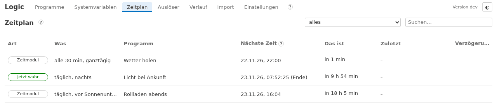</picture>

- **Zeitmodule:** das Modul in Worten, sein Programm (ein Klick öffnet es), **wann es als Nächstes feuert** – bei
  einer Zeitspanne mit *Beginn*, *Ende* oder *Wiederholung* –, wie weit das entfernt ist und wann es seit dem Start des
  Addons zuletzt gefeuert hat. Eine laufende Zeitspanne ist mit *jetzt wahr* markiert. Der Balken unter der Entfernung
  zeigt, wie viel des Wegs vom letzten zum nächsten Feuern vergangen ist.
- Ein Zeitmodul, das nicht feuert, nennt statt einer Zeit den Grund: das Programm ist inaktiv oder fehlerhaft, die Uhr
  des Systems ist noch nicht gestellt, oder Sonnenauf- und -untergang haben keinen Standort (siehe
  [Der Standort](#time-location)).
- **Zeiten sind die Wanduhr des Systems**, nicht die des Browsers. Eine Zeit jenseits einer Uhrumstellung trägt ihren
  Versatz (*UTC+2*, solange die Uhr noch Winterzeit zeigt): *02:30* in der Nacht, in der die Uhr vorgestellt wird, steht
  als *03:00 UTC+2* da, dem Moment, in dem es geschieht (siehe [Uhrumstellung](#time-dst)).
- **Zählende Zeilen:** Eine Bedingungszeile mit *seit mindestens …* (siehe [Über die Zentrale hinaus](#additions))
  steht in der Liste, solange ihr Vergleich hält – mit *zählt* markiert, mit dem Moment, in dem er lange genug gehalten
  haben wird, und dem Balken dafür, wie viel dieser Zeit vergangen ist. Ist er erreicht, ist die Zeile *jetzt wahr*, bis
  der Vergleich endet; dann verlässt sie die Liste. Auch die Zeile eines inaktiven Programms zählt.
- Der Filter zeigt alles, nur die Zeitmodule, nur die ausstehenden Verzögerungen oder nur die zählenden Zeilen; die
  Suche durchsucht Was, Programm und Ziel.

### <a id="schedule-delays"></a>Ausstehende Verzögerungen
Eine verzögerte Aktivität steht in der Liste, von dem Moment an, in dem ihr Block lief, bis sie fällig ist:
*Verzögerung 30 s*, das Programm und das Ziel, das sie schreibt oder ausführt, wann sie fällig ist und wie weit das
entfernt ist. Zwei Schaltflächen:

- **▶ Jetzt ausführen** führt die Aktivität sofort aus statt erst bei Fälligkeit – einmal; sie verschwindet aus der
  Liste.
- **✕ Abbrechen** entfernt sie: sie findet nicht statt. Das ist, was *laufende Verzögerungen beenden* eines Blocks für
  seine Ziele tut (siehe [Aktivitäten und Verzögerungen](#delays)), hier von Hand für eine einzelne Aktivität.

Eine Verzögerung übersteht einen Neustart des Addons und des Systems; war sie fällig, während das Addon nicht lief,
wird sie verworfen und nicht nachgeholt (siehe [Was anders ist als auf der CCU](#differences)).

## <a id="settings"></a>Einstellungen
Der Reiter **Einstellungen** hält den [Standort](#time-location), die Pause zwischen Schreibbefehlen, den
Schleifenschutz und die [Geheimnisse](#secrets) der Webhooks und zeigt die Zeit, nach der das Addon geht. Die Einstellungen stehen in der Datei `settings.yaml`
neben den Programmen und Variablen und sind Teil des Verlaufs; was dort nicht steht, hat seine Vorgabe.

<picture><source media="(prefers-color-scheme: dark)" srcset="../screenshots/de/18-settings-dark.png">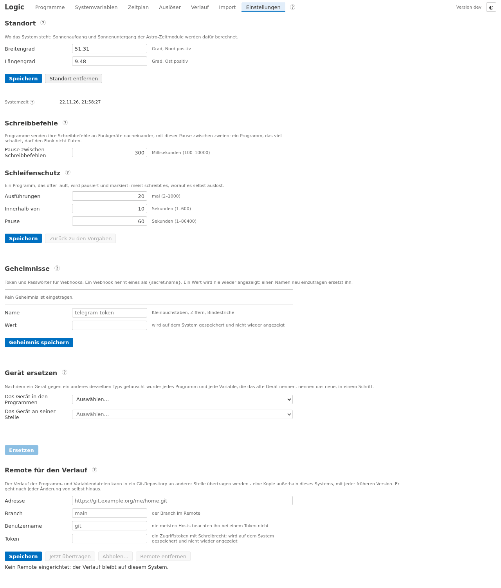</picture>

### <a id="pacing"></a>Schreibbefehle
Programme senden ihre Schreibbefehle an Funkgeräte (HmIP-RF, BidCos-RF) nacheinander, jeder wartet auf die Antwort des
vorigen, mit einer **Pause zwischen zweien** – 300 Millisekunden, wenn nichts anderes eingestellt ist (100 bis 10000;
`pacing_ms` in der Datei). Ein Programm, das zwanzig Rollläden schaltet, oder der Start des Systems wird so nicht zu
einem Schwall auf dem Funk, der den Duty Cycle aufbraucht. Drahtgebundene und virtuelle Geräte werden nicht gebremst.
Ein Befehl, den das System ablehnt, wird am Programm gezählt und nicht wiederholt.

### <a id="loop-guard"></a>Schleifenschutz
Ein Programm, das schreibt, worauf es selbst auslöst, liefe endlos. Ein Programm, das **öfter als 20-mal in 10
Sekunden** läuft, wird deshalb **60 Sekunden pausiert**: es ist in der Liste als *pausiert* markiert, seine
Ausführungen sagen es, und nach der Pause läuft es wieder. Die drei Zahlen lassen sich ändern (2 bis 1000
Ausführungen, 1 bis 600 Sekunden, eine Pause von 1 bis 86400 Sekunden; `loop_guard` mit `runs`, `window_seconds`,
`pause_seconds` in der Datei). Ein Programm, das immer wieder pausiert wird, hat einen Fehler in seiner Logik – die
Pause bewahrt nur das System davor, überflutet zu werden.

### <a id="secrets"></a>Geheimnisse
Ein Token oder ein Passwort, das ein [Webhook](#webhook) oder ein [Befehl](#command) braucht, wird nicht ins Programm
geschrieben: Es wird einmal unter **Geheimnisse** mit einem **Namen** (Kleinbuchstaben, Ziffern, Bindestriche)
eingetragen, und der Webhook oder der Befehl nennt es als `{secret:name}`. Der Wert liegt in einer eigenen Datei, die nur das Addon liest - **nicht** bei den Dateien der
Programme, nicht in deren [Verlauf](#history) und nicht in dem, was ein Git-Remote erhält, aber Teil der Sicherung des
Systems - und wird **nie wieder angezeigt** und nie in ein Protokoll oder den Verlauf der Läufe geschrieben. Um ein
Geheimnis zu ändern, seinen Namen neu eintragen. Ein Geheimnis, das Programme nennen, lässt sich nicht entfernen; ein
Geheimnis, das ein Programm nennt und das nicht eingetragen ist, sagt der Reiter Einstellungen, und ein solcher Webhook
schlägt fehl, ohne gesendet zu werden.

### <a id="replace-device"></a>Gerät ersetzen
Ein Gerät ging kaputt und ein anderes desselben Typs kam an seine Stelle - oder ein Programm kam mit dem Import und
nennt ein Gerät, das es auf diesem System nicht gibt. Das neue Gerät hat eine andere Adresse, und jedes Programm nennt
noch das alte. **Gerät ersetzen** im Reiter Einstellungen zieht sie alle in einem Schritt um:

1. **Das Gerät in den Programmen** wählen. Die Liste hat jedes Gerät, das ein Programm oder eine Variable nennt, mit
   seinem Namen - bei einem Gerät, das nicht da ist, dem Namen, den der Import notiert hat -, seinem Typ und der Zahl
   der Programme und Variablen, die es nennen; ein Gerät, das das System nicht hat, ist mit *nicht auf diesem System*
   gekennzeichnet.
2. **Das Gerät an seiner Stelle** wählen: die Liste bietet die anderen Geräte des Systems **desselben Typs** an (ist
   der Typ eines Geräts, das nicht da ist, nicht bekannt, jedes Gerät).
3. Die Zeile darunter sagt, **was sich ändern würde** - wie viele Stellen, in welchen Programmen und Variablen - oder
   was dagegen spricht: ein Gerät eines anderen Typs, oder ein Kanal oder Datenpunkt, der genannt wird und den das neue
   Gerät nicht hat. Vor *Ersetzen* wird nichts geändert.

Ersetzt wird das Gerät überall, wo es genannt ist: in Bedingungszeilen, in jeder Art von Aktivität, in den Eingängen
eines [berechneten Werts](#computed) und im Kanal, dem eine Variable zugeordnet ist - jeweils mit demselben Kanal und
Datenpunkt des neuen Geräts. Texte bleiben, wie sie sind (eine Notiz, die die Adresse erwähnt, die Adresse eines
Webhooks). Dadurch läuft nichts. Das Ersetzen ist **ein Eintrag** im [Verlauf](#history); jedes geänderte Programm und
jede geänderte Variable bekommt eine [Version](#versions), aus der sich der Stand davor zurückholen lässt. Eine
verzögerte Aktivität, die schon für das alte Gerät geplant war, geht noch an das alte.

Ein Ersetzen über Typen hinweg - ein anderes Modell mit anderen Kanälen - geht so nicht: diese Programme bearbeiten.

## <a id="variables"></a>Systemvariablen
Eine Systemvariable hält einen Wert, den Programme prüfen und setzen und den andere Software lesen und schreiben
kann. Die Variablen gehören diesem Addon; ihre Werte bleiben über einen Neustart des Addons und des Systems erhalten.

### <a id="variable-page"></a>Variablen auf der Seite
Der Reiter **Systemvariablen** listet alle Variablen: Name, Beschreibung, Typ, Hinweise (*Systemwert*,
*systemintern*, *protokolliert*), die Zahl der Programme, die sie verwenden, den Wert und den Zeitpunkt des letzten
Schreibens. Alle Zeilen sind gleich hoch; ein Text, der nicht in seine Spalte passt, wird gekürzt und steht ganz im
Text am Mauszeiger.

<picture><source media="(prefers-color-scheme: dark)" srcset="../screenshots/de/06-variables-dark.png">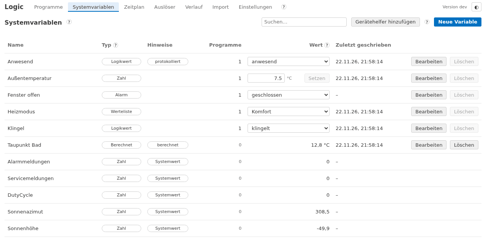</picture>

- **Wert setzen:** Logikwerte und Wertelisten über die Auswahl, Zahlen und Zeichenketten über das Feld und *Setzen*.
  Ein Wert außerhalb der Grenzen einer Zahl wird abgelehnt; warum, steht in der Zeile über der Liste. Das Setzen löst Programme aus wie jedes Schreiben.
- **Neue Variable** und **Bearbeiten:** Name, Beschreibung, Typ und was der Typ braucht – Texte für wahr und falsch,
  die Einträge einer Werteliste, Einheit und Grenzen einer Zahl – sowie *sichtbar*, *protokolliert*, *systemintern*.
  Der Typ einer Variablen, die Programme verwenden, lässt sich nicht ändern. Ein Eintrag einer Werteliste, der hier
  umbenannt wird, wird in den Programmen mit umbenannt; ein verwendeter Eintrag lässt sich nicht entfernen.
- **Löschen** geht nur, wenn kein Programm die Variable verwendet; die Spalte **Programme** nennt ihre Zahl und, am Mauszeiger, ihre Namen.
- **Alarmmeldungen** stehen oben, solange ein Alarm ausgelöst und nicht bestätigt ist, mit *Bestätigen* je Zeile und
  *Alle bestätigen*; die Zahl steht auch im Kopf der Seite.
- **Systemwerte** stehen in derselben Liste und lassen sich nicht ändern.

### <a id="variable-types"></a>Typen
| Typ | Wert | Dazu gehört |
| --- | --- | --- |
| Logikwert | wahr oder falsch | ein Text für jeden der beiden Zustände („es regnet“ / „trocken“) |
| Werteliste | einer der Einträge | die Liste der Einträge |
| Zahl | eine Zahl | Einheit, kleinster und größter Wert |
| Zeichenkette | ein Text | |
| Alarm | ausgelöst oder nicht ausgelöst | siehe [Alarme](#alarms) |
| Berechnet | eine Zahl, die niemand schreibt | eine Funktion und ihre Eingänge, siehe [Berechnete Werte](#computed) |

Eine neue Variable beginnt mit falsch, dem ersten Eintrag ihrer Liste, der Zahl 0 (oder ihrem kleinsten Wert, wenn der
über 0 liegt) oder einem leeren Text.

**Jedes Schreiben ist eine Aktualisierung, ein anderer Wert eine Änderung.** Programme, die auf eine Variable „bei
Aktualisierung“ hören, laufen bei jedem Schreiben, auch wenn derselbe Wert noch einmal geschrieben wird; ein stilles
Schreiben ohne Wirkung auf Programme gibt es nicht.

**Wertelisten:** Programme nennen einen Eintrag mit seinem Text. Wird ein Eintrag umbenannt, werden die Programme, die
ihn nennen, mit umbenannt; ein Eintrag, den ein Programm verwendet, lässt sich nicht entfernen, und der Typ einer
Variable, die ein Programm verwendet, lässt sich nicht ändern. (Auf der CCU verschiebt eine geänderte Liste
stillschweigend die Bedeutung bestehender Programmzeilen.)

Eine als **protokolliert** markierte Variable merkt sich ihre letzten 500 Änderungen. Sie stehen in einer eigenen Datei
im Datenordner des Addons (`state/log.jsonl`, eine Zeile je Änderung mit ihrem Zeitpunkt), und nur neue Änderungen
werden auf den Speicher geschrieben – eine Variable, die sich oft ändert, kostet nicht mehr Schreibzugriffe, wenn ihre
500 voll sind.

### <a id="variable-limits"></a>Grenzen einer Zahl
Kleinster und größter Wert gelten dort, wo ein Mensch oder eine andere Software schreibt: bei der Eingabe auf der Seite
und beim Schreiben über die Schnittstelle `Logic`. Ein Wert außerhalb wird abgelehnt. **Ein Programm dieses Addons darf
über die Grenzen hinaus schreiben**, wie auf der CCU: ein übernommener Zähler, der seinen größten Wert überschritten hat,
zählt weiter. Ein Eintrag, den eine Werteliste nicht hat, wird immer abgelehnt.

### <a id="alarms"></a>Alarme
Eine Alarmvariable verhält sich wie auf der CCU:

| Schreiben | Zustand | Zähler | Erstes Auftreten |
| --- | --- | --- | --- |
| wahr (war falsch) | ausgelöst | 1 | jetzt |
| noch einmal wahr, unbestätigt | ausgelöst | zählt hoch | unverändert |
| falsch – durch ein Programm, die Seite oder andere Software | bestätigt | bleibt | bleibt |
| wahr nach einer Bestätigung | ausgelöst | wieder 1 | jetzt |

**Falsch schreiben heißt bestätigen**, und *Bestätigen* schreibt falsch: Programme, die auf die Variable hören,
reagieren darauf wie auf jedes Schreiben. Ein Programm sieht eine Alarmvariable als Logikwert, mehr nicht. Eines ist
anders als bei einem Logikwert, wie auf der CCU: falsch in einen Alarm zu schreiben, der schon falsch ist, ist gar
nichts - kein Programm läuft, auch keines, das „bei Aktualisierung“ hört; *Bestätigen* zählt bei einem solchen Alarm
dennoch als Aktualisierung.

Die **Alarmmeldungen** sind keine Liste vergangener Ereignisse, sondern die Alarmvariablen, die gerade ausgelöst und
nicht bestätigt sind – je eine Zeile mit erstem und letztem Auftreten und dem Zähler. Ihre Anzahl ist der Systemwert
`alarm-messages`, den Programme wie eine Zahl-Variable prüfen können; schreiben lässt er sich nicht.

Anders als auf der CCU **überlebt ein Alarm einen Neustart**: die CCU vergisst beim Neustart jeden ausgelösten Alarm,
hier bleiben Zustand, Zähler und Zeiten erhalten.

### <a id="computed"></a>Berechnete Werte
Ein **berechneter Wert** ist eine Zahl, die das Addon aus anderen Werten berechnet – der Taupunkt eines Raums aus
Temperatur und Luftfeuchte, die Differenz zweier Temperaturen, der wärmste von vier Räumen. Für eine neue Variable den
Typ *Berechnet* wählen, eine Funktion und ihre Eingänge:

| Funktion | Eingänge | Ergebnis |
| --- | --- | --- |
| Taupunkt | die Temperatur in °C und die relative Luftfeuchte in % | der Taupunkt in °C, auf ein Zehntel Grad |
| Absolute Luftfeuchte | die Temperatur in °C und die relative Luftfeuchte in % | Gramm Wasser in einem Kubikmeter Luft, auf ein Zehntel |
| Differenz | zwei Werte | der erste minus der zweite |
| Summe, Mittelwert, Minimum, Maximum | zwei bis acht Werte | |

- Ein **Eingang** ist ein Datenpunkt eines Geräts, gewählt in der Geräteauswahl (angeboten werden die Zahlen-Datenpunkte
  des Kanals), oder eine Zahl-Variable, ein [Systemwert](#system-values) oder ein anderer berechneter Wert. *Lüften, wenn
  der Taupunkt außen unter dem innen liegt* sind zwei Taupunkte und ihre Differenz, und ein Programm auf *Differenz
  größer als 0*.
- Der Wert wird **neu berechnet, sobald einer seiner Eingänge meldet**. Für Programme ist das ein Schreiben wie jedes
  andere: eine Aktualisierung bei jeder Meldung eines Eingangs, eine Änderung, wenn das Ergebnis ein anderes ist – *bei
  Änderung auslösen* auf *Taupunkt größer als 14* läuft also, wenn der Taupunkt die 14 überschreitet. Ein Programm, das
  vom Eingang selbst ausgelöst wird, sieht bereits das neue Ergebnis.
- **Niemand schreibt einen berechneten Wert:** nicht die Seite, kein Programm, keine andere Software über die
  Schnittstelle. Er hat keine Grenzen und keinen Startwert.
- Bis jeder Eingang einen Wert hat – direkt nach dem ersten Start, oder solange ein Gerät noch nicht gemeldet hat –,
  bleibt der Wert, wie er war (0 bei einem neuen). Auch eine Luftfeuchte von 0 % oder weniger ergibt kein Ergebnis.
- Ein berechneter Wert kann nicht sein eigener Eingang sein, auch nicht über andere; eine Variable, die ein Eingang ist,
  lässt sich nicht entfernen und nicht in einen anderen Typ ändern.
- Die Liste der Funktionen ist abgeschlossen: Formeln gibt es nicht. Taupunkt und absolute Luftfeuchte rechnen mit der
  Magnus-Formel über Wasser.

In der Datei ist ein berechneter Wert eine `number` mit `computed:` – siehe [Programme und Variablen als Dateien](#files).

### <a id="helpers"></a>Gerätehelfer

Ein **Gerätehelfer** führt den Zähler eines Geräts als Systemvariablen: den **Gesamtstand**, und was **heute** und
**gestern** hinzukam. Die Zentrale tut dasselbe mit versteckten Programmen aus Skripten, die sie beim Anlernen eines
Geräts anlegt (`svEnergyCounter…`, `svHmIPRainCounter…`); hier ist es eingebaut, ohne Skript.

<picture><source media="(prefers-color-scheme: dark)" srcset="../screenshots/de/16-helper-dark.png">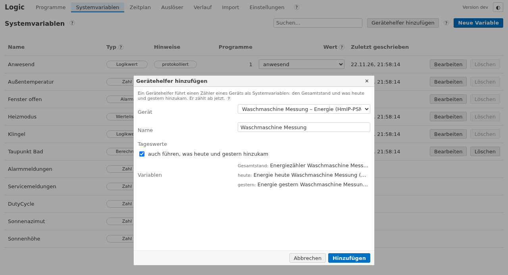</picture>

| Helfer | Geräte | Zählt | Tagesgrenze |
| --- | --- | --- | --- |
| Energie | HmIP-Messaktoren (HmIP-PSM, -BSM, -FSM …) | `ENERGY_COUNTER` in Wh | 0:00 Uhr |
| Einspeisung | HmIP-PSMCO, ELV-SH-PSMCI | `ENERGY_COUNTER_FEED_IN` in Wh | 0:00 Uhr |
| Energie oder Gas | HmIP-ESI | `ENERGY_COUNTER` in Wh oder `GAS_VOLUME` in m³, je nach Sensor | 0:00 Uhr |
| Energie | HomeMatic-Messaktoren (HM-ES-PMSw…) | `ENERGY_COUNTER` in Wh | 0:00 Uhr |
| Strom, Gas, IEC-Zähler | HM-ES-TX-WM | `ENERGY_COUNTER`, `GAS_ENERGY_COUNTER`, `IEC_ENERGY_COUNTER` | 0:00 Uhr |
| Regen | HmIP-SWO-PL, -PR | `RAIN_COUNTER` in mm | 7:00 Uhr |
| Sonnenschein | HmIP-SWO-B, -PL, -PR | `SUNSHINEDURATION` in Minuten | 7:00 Uhr |
| Wasser | HmIP-WSM, ELV-SH-WSM | `WATER_VOLUME` in Litern | 0:00 Uhr |
| Regen | HomeMatic-Wettersensor (HM-WDS100-C6-O) | `RAIN_COUNTER` in mm; nur heute und gestern | 7:30 Uhr |

**Einen Helfer anlegen:** im Reiter **Systemvariablen** *Gerätehelfer hinzufügen*. Angeboten werden die Kanäle dieses
Systems, die einen solchen Zähler haben und noch keinen Helfer. Der Name ist der des Kanals und lässt sich ändern;
darunter steht, wie die Variablen heißen werden (*Energiezähler Waschmaschine*, *Energie heute Waschmaschine*,
*Energie gestern Waschmaschine*). Die Tageswerte lassen sich weglassen. Ein neuer Helfer **zählt ab jetzt**: der Stand,
den das Gerät gerade hat, wird nicht mitgezählt.

- **Den Zählerstand setzen:** der Gesamtstand lässt sich in der Liste wie jeder Wert setzen - auf den Stand des
  Stromzählers etwa, oder auf 0. Von dort wird weitergezählt. Auch ein Programm oder andere Software darf ihn setzen.
  *heute* und *gestern* schreibt nur der Helfer.
- **Die Variablen sind gewöhnliche Zahlen:** Programme prüfen sie, andere Software liest sie über die Schnittstelle,
  sie lassen sich protokollieren. Jede gezählte Meldung des Geräts ist für Programme eine Aktualisierung des
  Gesamtstands, wie auf der Zentrale. In der Liste tragen sie die Marke *Helfer*.
- **Die Tagesgrenze** ist für Regen und Sonnenschein 7:00 Uhr (der meteorologische Tag, wie auf der Zentrale), für den
  HomeMatic-Wettersensor 7:30 Uhr, sonst Mitternacht - auf der Uhr des Systems. Dann wird *heute* zu *gestern* und
  *heute* beginnt bei 0. War das Addon zur Tagesgrenze nicht in Betrieb, holt es den Wechsel beim Start nach;
  *gestern* enthält dann alles seit der letzten Grenze davor. Solange die Uhr des Systems nicht gestellt ist, wird
  nichts gewechselt.
- **Ein kleinerer Zählerstand** des Geräts ist ein Neustart des Geräts (sein Zähler beginnt bei 0; gezählt wird der
  neue Stand) oder ein Überlauf (der Zähler hat seinen größten Wert erreicht und beginnt von vorn; gezählt wird bis
  zum größten Wert und weiter). Welches von beiden, sagt das Gerät selbst; den größten Wert liest das Addon aus der
  Beschreibung des Geräts. Ein Zählerstand von 0 wird übergangen.
- **Ausschalten:** *Gerätehelfer ausgeschaltet* in den Eigenschaften des Gesamtstands. Ein ausgeschalteter Helfer zählt
  nichts hinzu; wieder eingeschaltet, zählt er vom dann aktuellen Stand des Geräts weiter.
- **Löschen** entfernt den Helfer mit allen seinen Variablen; solange ein Programm eine davon verwendet, geht das
  nicht.
- **Gerät getauscht:** [Gerät ersetzen](#replace-device) zeigt auch den Helfer auf das neue Gerät. Dessen Zähler
  beginnt bei 0; der Gesamtstand läuft weiter.

**Was hier anders ist als auf der Zentrale** - bewusst:

- Regen *heute* springt nicht bei 1440 auf 0 (auf der Zentrale ein Versehen im Skript).
- *heute* und der Gesamtstand bewegen sich immer gemeinsam.
- Sonnenschein wird bei jeder Meldung der Sonnenscheindauer gezählt, nicht nur bei einer Meldung der Helligkeit.
- Eine verpasste Tagesgrenze wird nachgeholt (die Zentrale lässt *heute* dann einfach weiterlaufen).
- Der HomeMatic-Wettersensor setzt *heute* und *gestern* nach einem Neustart nicht auf 0.
- Für Energie und Wasser sind *heute* und *gestern* Variablen (auf der Zentrale stehen sie nur in der Gerätebedienung);
  die 30-Tage-Liste der Zentrale gibt es nicht.
- Ein Helfer, den man hier anlegt, zählt ab jetzt; auf der Zentrale zählt die erste Meldung den ganzen bisherigen
  Zählerstand des Geräts mit. Übernommene Zähler verhalten sich beim ersten Wert wie auf der Zentrale, damit ihr Stand
  ohne Sprung weiterläuft.

In der Datei ist die Variable eines Helfers eine `number` mit `helper:` – siehe [Programme und Variablen als Dateien](#files).

### <a id="system-values"></a>Systemwerte

Fünf Zahlen gibt es ohne eigene Variable. Programme prüfen sie wie eine Zahl-Variable unter ihrem festen Schlüssel;
schreiben lassen sie sich nicht, weder von Programmen noch von der Seite noch von anderer Software.

| Schlüssel | Bedeutung |
| --- | --- |
| `alarm-messages` | die Anzahl der Alarmmeldungen (auf der CCU die Systemvariable „Alarmmeldungen“) |
| `service-messages` | die Anzahl der Servicemeldungen (auf der CCU „Servicemeldungen“) |
| `duty-cycle` | der Duty Cycle in Prozent (auf OpenCCU „DutyCycle“) |
| `sun-azimuth` | wo die Sonne steht, in Grad im Uhrzeigersinn von Norden: 90 ist Osten, 180 Süden, 270 Westen |
| `sun-elevation` | wie hoch die Sonne steht, in Grad über dem Horizont; negativ, wenn sie darunter steht |

`alarm-messages` führt das Addon selbst. Die beiden Werte der Sonne werden alle fünf Minuten für den
[Standort](#time-location) berechnet, auf ein Zehntel Grad; ohne Standort stehen sie auf 0. Sie sind für die Beschattung
gedacht: *wenn `sun-azimuth` von 135 bis kleiner 225 und `sun-elevation` größer 25 ist, die Jalousie herunterfahren*.
`service-messages` und `duty-cycle` werden in dieser Version noch nicht gespeist und stehen auf 0; übernommene Programme,
die sie verwenden, bleiben lesbar und gültig.

### <a id="start-value"></a>Wert beim Systemstart
Eine Variable kann nach jedem Start des Systems einen festen Wert bekommen; ohne diese Angabe behält sie ihren Wert.
Das ist die allgemeine Form dessen, was die CCU mit *Anwesenheit* fest eingebaut tut (nach jedem Start wahr). Der Wert
wird gesetzt, bevor Programme laufen, und löst selbst kein Programm aus. Gemeint ist ein Start des Systems, nicht ein
Neustart oder eine Aktualisierung des Addons.

## <a id="import"></a>Import
Der Import übernimmt Programme und Systemvariablen einer CCU. Er liest nur; an der Quelle ändert er nichts.

### <a id="import-sources"></a>Quellen
- **Eine Systemsicherung** (`.sbk`) einer CCU3, einer CCU2 oder von OpenCCU/RaspberryMatic. Aus ihr kommen auch der
  Standort und die Zeitzone, wenn sie auf der Zentrale eingestellt waren.
- **Eine ReGa-Datenbank** (`homematic.regadom`), wie sie auf der Zentrale unter `/etc/config/` liegt.
- **Die Datenbank, die auf dem System geblieben ist:** nach dem Umstieg von (Open)CCU bleibt die ReGa-Datenbank der
  alten Zentrale auf dem System, bis man sie auf der Seite *Sicherung* entfernt. Sie hat den Stand vom Tag des
  Umstiegs.

### <a id="import-dry-run"></a>Erst der Probelauf
Der Import schreibt zunächst nichts. Er liest die Quelle und zeigt einen **Bericht**: was übernommen würde, was
inaktiv bleibt und warum, was nicht übernommen wird. Erst *Übernehmen* legt die Dateien an.

**Welche Programme danach aktiv sind:** Ein Programm behält den Zustand, den es auf der Zentrale hatte, wenn nichts
dagegen spricht. Es wird **inaktiv** übernommen, wenn

- es ein Skript enthält (siehe unten),
- ein Gerät, das es verwendet, auf diesem System nicht angelernt ist,
- es CUxD verwendet,
- es einen Sonderwert enthält („Letzter Wert“ o. ä.),
- die Datenbank etwas enthält, das diese Version nicht kennt – dann wird nicht geraten.

Mit **alle inaktiv übernehmen** bleibt jedes Programm aus, bis man es selbst einschaltet. Das ist die richtige Wahl
für die Sicherung einer fremden Zentrale.

### <a id="import-what"></a>Was übernommen wird
**Programme** kommen eins zu eins: die Kette *Wenn … Sonst, wenn … Sonst*, die Bedingungsblöcke mit UND und ODER,
jede Zeile mit ihrem Vergleich und ihrer Auslöseart (*bei Änderung auslösen*, *bei Aktualisierung auslösen*, *nur
prüfen*), verneinte Zeilen, die Aktivitäten mit *sofort* oder *verzögert um*, das Häkchen zum Beenden laufender
Verzögerungen, und die Eigenschaften *aktiv*, *sichtbar*, *bedienbar*, *systemintern*.

- **Geräte** stehen im Programm mit ihrer Adresse. Das Gerät muss nicht vorhanden sein: der Bericht nennt jedes
  fehlende mit dem Namen, den es auf der Zentrale hatte.
- **Wertelisten** werden beim Namen des Eintrags genommen, nicht bei seiner Nummer.
- **[Zeitmodule](#time)** werden mit allen Angaben übernommen und laufen wie auf der Zentrale. Der Standort der
  Zentrale wird der des Addons, wenn noch keiner eingetragen ist. Ein Zeitmodul, dessen Angaben sich widersprechen
  (ein wöchentliches ohne Wochentag), lässt sein Programm inaktiv; der Bericht nennt den Grund.
- **Systemstart:** Die Zentrale prüft jedes aktive Programm einmal nach ihrem Start. Übernommene Programme tun das
  hier auch; die Einstellung „Bei Zentralenstart ausführen“ neuer OpenCCU-Versionen wird übernommen.
- **Zwei Skripte werden erkannt** und zu Aktivitäten: ein Programm ausführen (`…ProgramExecute();`) und ein Programm
  ein- oder ausschalten (`…Active(true);`, `…Active(false);`).
- **Ein Skript, das ein einziges `system.Exec` ist,** wird ebenfalls zur Aktivität. Ein `wget` oder `curl`, das nur
  eine Adresse abruft, wird zum [Webhook](#webhook) (die Antwort wird nicht gelesen, und das Programm wartet nicht
  darauf), ein `ether-wake` zu [Wake-on-LAN](#wake). Jede andere Zeile wird zu einem [Befehl](#command) mit der Zeile,
  wie sie geschrieben wurde, über die Shell ausgeführt, und der Block wartet darauf wie auf der Zentrale; hat das
  Skript die Ausgabe des Befehls in eine Systemvariable geschrieben
  (`system.Exec("…", &out, &err); dom.GetObject("…").State(out);`), tut der Befehl dasselbe. Ein Programm mit einem
  solchen Befehl kommt **inaktiv**: Auf der Zentrale lief die Zeile als root, hier läuft sie mit den Rechten des
  Addons - erst ansehen. Der Bericht kennzeichnet einen Befehl, der einen Systempfad nennt oder ein Werkzeug, das nur
  root benutzen kann.
- **Jedes andere Skript** bleibt als Text im Programm stehen und wird nie ausgeführt; das Programm kommt inaktiv.
  Für solche Aufgaben sind Node-RED (RedMatic), Home Assistant oder ioBroker die richtigen Werkzeuge.

**Systemvariablen** kommen mit Typ (Logikwert, Werteliste, Zahl, Zeichenkette, Alarm), Bezeichnungen, Einheit,
Grenzen, Beschreibung, den Eigenschaften *sichtbar*, *protokolliert*, *systemintern*, der Kanalzuordnung – und mit
ihrem **Wert**.

- **Alarmvariablen** beginnen als „nie ausgelöst“: die Datenbank der Zentrale speichert keinen Alarmzustand.
- **Anwesenheit** wird wie auf der Zentrale nach jedem Systemstart auf „anwesend“ gesetzt.
- **Zähler der Zentrale** (Energie, Einspeisung, Gas, Wasser, Regen, Sonnenschein: `svEnergyCounter…`,
  `svHmIPRainCounter…`, `svCounter…`, *Regen heute* …) werden zu [Gerätehelfern](#helpers): Gesamtstand, heute und
  gestern kommen als Systemvariablen mit ihren Ständen und werden weitergezählt. Der letzte Zählerstand des Geräts
  (`…OldVal…`) wird im Helfer aufgehoben und ist keine eigene Variable mehr; die versteckten Programme der Zentrale
  werden nicht übernommen, der Helfer ersetzt sie. Was die Zentrale für Energie und Wasser als heutigen und
  gestrigen Wert beim Kanal führte, kommt als zwei Variablen des Helfers. Steht der Kanal eines Zählers nicht mehr in
  der Datenbank, kommt er als gewöhnliche Variable; der Bericht sagt es.
- **Anzahl der Alarm- und Servicemeldungen, DutyCycle:** das sind hier Systemwerte, die das System selbst pflegt.
  Ein Programm, das sie auf der Zentrale verwendet hat, liest nach dem Import den Systemwert.

**Nicht übernommen** werden Räume, Gewerke und Gerätenamen (die übernimmt das System selbst), Servicemeldungen,
Benutzer, Favoriten und Direktverknüpfungen.

### <a id="import-report"></a>Der Bericht
Der Bericht nennt

<picture><source media="(prefers-color-scheme: dark)" srcset="../screenshots/de/09-import-dark.png">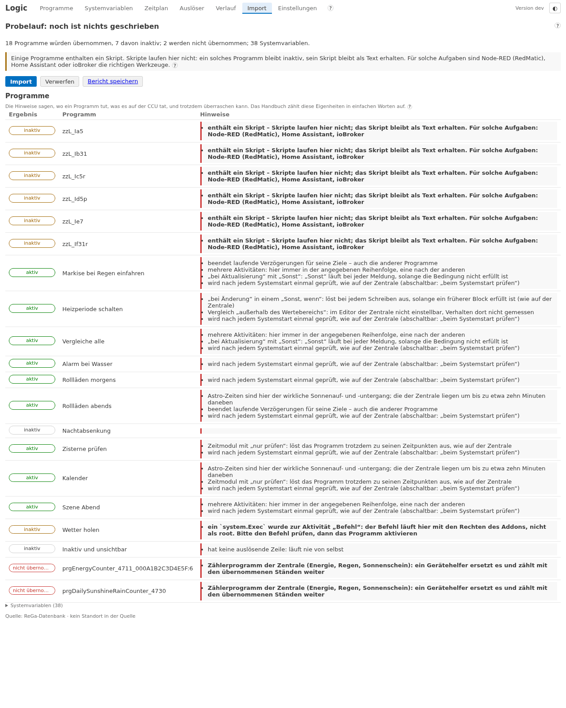</picture>

- jedes **Programm** mit seinem Ergebnis – übernommen, übernommen und inaktiv mit den Gründen, nicht übernommen mit
  dem Grund – und mit Hinweisen zum Verhalten, wo es überraschen kann: Prüfung beim Systemstart, *Sonst* unter *bei
  Aktualisierung*, das Beenden von Verzögerungen anderer Programme, Astro-Zeiten, eine Verzögerung von 24 Stunden
  oder mehr, die die Zentrale als null gespeichert hat;
- jede **Systemvariable** mit Typ und Wert;
- die **Geräte**, die in Programmen vorkommen, mit Name, Typ und Raum auf der Zentrale, und ob sie auf diesem
  System vorhanden sind;
- reparierte Namen, den Standort, und was die Datenbank an Bausteinen enthält.

Der Bericht lässt sich als Markdown-Datei speichern.

### <a id="import-again"></a>Noch einmal importieren
Das Addon merkt sich je Quelle, welches Programm und welche Variable der Zentrale zu welcher Datei wurde. Ein
weiterer Import derselben Zentrale **aktualisiert** deshalb dieselben Dateien, statt alles ein zweites Mal
anzulegen; der Bericht kennzeichnet sie. Was man hier inzwischen umbenannt hat, behält seinen Namen in den
Verweisen.

### <a id="import-anonymise"></a>Eine Datenbank weitergeben
Wenn ein Import schiefgeht, hilft die Datenbank, an der es sich zeigt, am meisten - nur steht darin das eigene
Zuhause: die Namen von Räumen, Geräten und Programmen, Seriennummern, Texte, Skripte. Das Addon schreibt eine Kopie
**ohne** all das:

    /usr/local/addons/logic/bin/logic anonymise backup.sbk anonym.regadom

Es nimmt ein Backup oder eine `homematic.regadom` und schreibt eine Datenbank mit denselben Programmen, Bedingungen,
Zeitmodulen und Gerätetypen, in der

- Namen ersetzt sind („Programm 1“, „Variable 2“, „Gerät 3“; derselbe Name bekommt denselben Ersatz),
- Seriennummern neu durchgezählt sind (aus `MEQ0123456:1` wird `MEQ0000001:1`),
- Texte, die Variablen halten und Programme vergleichen oder schreiben, „Text 1“ heißen, Einträge von Wertelisten
  „Wert 1“, Beschreibungen „Beschreibung“,
- Skripte zu einer Zeile werden, die sagt, wie lang sie waren (die zwei einzeiligen Skripte, die der Import versteht,
  bleiben, mit dem ersetzten Namen),
- Benutzer, Passwörter, Mailadressen, der Standort und die Beschreibungen der Geräte geleert sind.

**Zahlen bleiben**: die Werte von Zahlenvariablen (auch Zählerstände), Zeiten, Grenzen. Die Kopie wird genau so
importiert wie das Original - deshalb taugt sie für eine Fehlermeldung. Vor dem Weitergeben die Datei durchsehen. Sie
ist für diesen Import gedacht, nicht für eine Zentrale.

## <a id="files"></a>Programme und Variablen als Dateien
Jedes Programm und jede Systemvariable ist eine eigene, lesbare Datei im YAML-Format. Sie liegen auf dem System
unter `/usr/local/etc/config/addons/logic/tree/`:

```
tree/
  programs/markise-bei-regen-einfahren.yaml
  variables/regen.yaml
```

Der Dateiname ist der **Schlüssel** des Programms oder der Variable: aus dem Namen beim Anlegen gebildet (Kleinbuchstaben,
Ziffern, Bindestriche, höchstens 48 Zeichen; aus „Rollläden abends“ wird `rolllaeden-abends`) und danach stabil. Wird
ein Programm umbenannt, ändert sich nur `name:` in der Datei, nicht der Dateiname. Programme verweisen über diesen
Schlüssel auf Variablen und andere Programme.

Das Addon schreibt eine Datei immer auf dieselbe Weise: feste Reihenfolge der Schlüssel, zwei Leerzeichen Einzug,
Voreinstellungen werden weggelassen. Dasselbe Programm ergibt so immer dieselbe Datei, und ein Vergleich zweier
Fassungen zeigt nur, was sich wirklich geändert hat. Die **Werte** der Variablen stehen nicht in diesen Dateien; sie
gehören zum Zustand des Addons und sind Teil der Systemsicherung.

### <a id="file-program"></a>Ein Programm
```yaml
name: Markise bei Regen einfahren
note: Regensensor auf der Terrasse; im Winter deaktiviert
active: true
rules:
  - when:
      any:
        - all:
            - variable: regen
              is: true
              trigger: change
            - device: HmIP-RF/00111BE9AB9012:4/LEVEL  # Markise Terrasse
              op: gt
              value: 0
              trigger: check
    cancel_pending: true
    then:
      - set: HmIP-RF/00111BE9AB9012:4/LEVEL  # Markise Terrasse
        to: 0
      - variable: markise-hinweis
        to: wegen Regen eingefahren
        after: 30s
  - else: []
```

| Schlüssel | Bedeutung |
| --- | --- |
| `name`, `note` | Name und Beschreibung |
| `active` | das Programm ist aktiv (ohne Angabe: nein) |
| `visible`, `operable`, `internal` | sichtbar, bedienbar (ohne Angabe: ja), systemintern (ohne Angabe: nein) |
| `at_start` | beim Systemstart prüfen (ohne Angabe: nein) |
| `rules` | die Regeln in ihrer Reihenfolge: *Wenn…*, beliebig viele *Sonst, wenn…*, höchstens ein *Sonst…* am Ende |

Eine Regel mit Bedingung hat `when` und `then`; die *Sonst*-Regel hat nur `else` mit ihren Aktivitäten. `cancel_pending: true`
ist das Häkchen „vor dem Ausführen alle laufenden Verzögerungen für diese Aktivitäten beenden“.

Eine Bedingung hat immer zwei Ebenen, wie auf der CCU: Gruppen von Zeilen. `all` heißt UND, `any` heißt ODER, auf jeder
der beiden Ebenen. Eine Bedingung ohne Gruppen (`all: []`) ist immer wahr.

Eine **Bedingungszeile** steht auf genau einem von:

| Zeile | Bedeutung |
| --- | --- |
| `device: Schnittstelle/ADRESSE:KANAL/PARAMETER` | ein Datenpunkt eines Geräts; der Kommentar dahinter ist der Gerätename zum Zeitpunkt des Speicherns |
| `variable: schlüssel` | eine Systemvariable |
| `time:` | ein Zeitmodul; seine Felder stehen unter [Zeitmodule in der Datei](#time-fields) |

Der Vergleich ist `is: Wert` (gleich) oder `op:` mit seinen Werten: `ne` (ungleich), `gt` (größer), `ge` (größer oder
gleich), `lt` (kleiner), `le` (kleiner oder gleich), jeweils mit `value:`; `range` mit `from:` und `below:` (von … bis
kleiner …); `outside` mit `from:` und `to:` (außerhalb des Bereichs). Ein Eintrag einer Werteliste wird mit seinem
**Text** genannt, nie mit seiner Nummer. `not: true` kehrt die Zeile um.

`trigger` ist Pflicht und sagt, wann die Zeile das Programm auslöst: `change` (bei Änderung auslösen), `update` (bei
Aktualisierung auslösen), `value` (bei jeder Wertänderung), `check` (nur prüfen). `for:` (`10min`) macht die Zeile erst
wahr, wenn ihr Vergleich so lange gehalten hat: siehe [Über die Zentrale hinaus](#additions).

Eine **Aktivität** ist genau eines von:

| Aktivität | Bedeutung |
| --- | --- |
| `set: Schnittstelle/ADRESSE:KANAL/PARAMETER` | einen Datenpunkt schreiben |
| `variable: schlüssel` | eine Systemvariable schreiben |
| `run: schlüssel` mit `mode: then` oder `mode: check` | ein anderes Programm ausführen: nur dessen ersten *Dann*-Block ohne Prüfung (`then`) oder mit Prüfung der Bedingungen (`check`) |
| `activate: schlüssel`, `deactivate: schlüssel` | ein anderes Programm aktivieren oder deaktivieren |
| `script:` | ein übernommenes Skript, als Text aufbewahrt und nie ausgeführt |
| `channel: Interface/ADRESSE:KANAL` mit `values:` (Datenpunkte mit ihren Werten) | mehrere Datenpunkte eines Kanals in einem Befehl schreiben: siehe [Mehrere Werte in einem Befehl](#values) |
| `display: Interface/ADRESSE:KANAL` mit `lines:` und `sound:` | bis zu fünf Zeilen auf einer Anzeige zeigen und einen Signalton spielen: siehe [Eine Anzeige](#display) |
| `webhook: "Adresse"` mit `method:` und nach Bedarf `headers:` (eine Liste aus `name:` und `value:`), `body_type:` (`json`, `form`, `text`) mit `body:`, `insecure: true` | eine Web-Adresse aufrufen: siehe [Webhooks](#webhook) |
| `wake: "AA:BB:CC:DD:EE:FF"`, mit `broadcast:` für ein anderes Netz | Wake-on-LAN: siehe [Wake-on-LAN](#wake) |
| `command:` - eine Liste (das Programm, dann seine Argumente) oder, mit `shell: true`, eine Zeile mit `args:` - und nach Bedarf `timeout:`, `wait: true`, `output:`, `exit_code:` | ein Programm des Systems ausführen: siehe [Befehle](#command) |

Was geschrieben wird, steht bei `set` und `variable` in genau einem von `to:` (ein Wert), `from:` (der aktuelle Wert
eines anderen Datenpunkts), `from_variable:` (der Wert einer Variable) oder `special:` (ein Sonderwert der CCU wie
„letzter Wert“; eine solche Aktivität wird übersprungen, bis sie bearbeitet ist). `after:` verzögert die Aktivität,
gezählt ab der Auslösung: `30s`, `5min`, `2h`, `1h30min`. Mit `after_up_to:` daneben wird die Verzögerung zufällig gezogen,
sekundengenau zwischen `after` (`0s`, wenn es fehlt) und `after_up_to`, bei jedem Lauf des Blocks neu. `on_for:` an einem
`set` mit `to:` ist *ein für*: siehe [Über die Zentrale hinaus](#additions).

### <a id="file-variable"></a>Eine Systemvariable
```yaml
name: Regen
note: Regensensor Terrasse
type: bool
labels:
  "false": trocken
  "true": es regnet
logged: true
```

| Schlüssel | Bedeutung |
| --- | --- |
| `name`, `note` | Name und Beschreibung |
| `type` | `bool` (Logikwert), `list` (Werteliste), `number` (Zahl), `string` (Zeichenkette), `alarm` (Alarm) |
| `labels` | die Texte für falsch und wahr (Logikwert, Alarm) |
| `entries` | die Einträge einer Werteliste |
| `unit`, `min`, `max` | Einheit und Grenzen einer Zahl |
| `visible`, `internal`, `logged` | sichtbar (ohne Angabe: ja), systemintern, protokolliert |
| `channel` | die Kanalzuordnung, `Schnittstelle/ADRESSE:KANAL` |
| `start_value` | der Wert, den die Variable nach einem Start des Systems bekommt; ohne Angabe behält sie ihren Wert |
| `computed` | macht eine `number` zu einem [berechneten Wert](#computed): `function` (`dew-point`, `absolute-humidity`, `difference`, `sum`, `average`, `min`, `max`) und `inputs`, eine Liste von Einträgen `device: Interface/ADDRESS:CHANNEL/PARAMETER` und `variable: key`; ohne `min`, `max` und `start_value` |
| `helper` | macht eine `number` zur Variablen eines [Gerätehelfers](#helpers): `kind` (`energy`, `feed-in`, `esi`, `energy-hm`, `energy-wm`, `gas-wm`, `iec-wm`, `rain`, `sunshine`, `water`, `rain-hm`), `channel` (`Interface/ADDRESS:CHANNEL`), `role` (`total`, `today`, `yesterday`; `rain-hm` hat kein `total`) und am Gesamtstand `off: true` für einen ausgeschalteten Helfer. Die Variablen mit gleichem `kind` und `channel` sind ein Helfer; ohne `start_value` |

### <a id="file-rules"></a>Dateien von Hand bearbeiten
Die Dateien dürfen von Hand bearbeitet werden. Das Addon liest dabei eine strenge Teilmenge von YAML: eine Angabe je
Zeile (keine `[…]`- oder `{…}`-Schreibweise außer für leere Listen), keine Anker, keine Tags, ein Dokument je Datei,
kein Schlüssel doppelt und keiner, den das Format nicht kennt. Texte, die YAML als etwas anderes lesen würde (`true`,
`on`, Zahlen, Uhrzeiten), gehören in Anführungszeichen. Eine Datei, die das Addon nicht lesen kann, wird mit Datei und
Zeile gemeldet; nur dieses eine Programm läuft dann nicht, alle anderen laufen weiter. Kommentare (`#`) sind erlaubt,
gehen aber verloren, sobald das Programm über die Seite gespeichert wird; für Bemerkungen, die bleiben sollen, gibt es
`note:` am Programm, an jeder Regel, jeder Zeile und jeder Aktivität.

### <a id="history"></a>Der Verlauf der Dateien
Der Ordner `tree/` ist ein gewöhnliches Git-Repository. Das Addon führt den Verlauf darin selbst, ohne dass Git auf dem
System installiert sein muss; ein anderes Git kann den Ordner lesen und klonen. Die Dateien sind dabei die Wahrheit, der
Verlauf eine Bequemlichkeit: ein Speichern hängt nie davon ab, dass der Eintrag in den Verlauf gelingt, und das Addon
liest Programme nie aus dem Verlauf.

Ein Eintrag entsteht im Hintergrund, kurz nach dem Speichern. Er enthält jede Datei als eine ganze gespeicherte
Fassung - auch eine Datei, die erneut gespeichert wird, während der Eintrag entsteht; diese spätere Fassung gehört zum
nächsten Eintrag. Dateien, die Sie von Hand in den Ordner legen oder ändern, werden aufgenommen, wenn das Addon den
Ordner neu liest (bei seinem Start); was eine `.gitignore` im Ordner nennt, bleibt außen vor.

### <a id="versions"></a>Versionen: vergleichen und zurückholen
Jedes Speichern eines Programms oder einer Systemvariable ist eine **Version**. **Versionen…** – in der Ansicht eines
Programms neben *Kopieren*, bei einer Variable im Dialog *Bearbeiten* – zeigt sie, die neueste oben: wann, was geschah
(*angelegt*, *geändert*, *auf die Fassung … zurückgesetzt*, ein Import, eine Änderung von Hand) und wer es war.

<picture><source media="(prefers-color-scheme: dark)" srcset="../screenshots/de/15-versions-dark.png">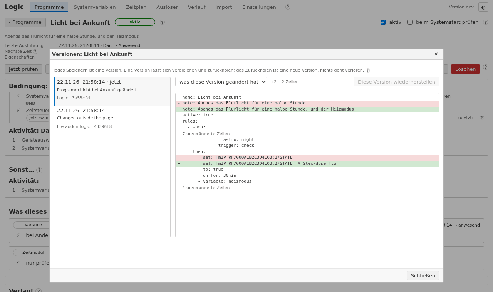</picture>

- Ein Klick auf eine Version zeigt rechts den **Vergleich, Zeile für Zeile**: grün mit `+`, was dazukam, rot mit `-`,
  was wegfiel; lange unveränderte Strecken sind ausgelassen. Verglichen wird wahlweise, **was diese Version geändert
  hat** (gegen die Version davor), oder **von dieser Version bis jetzt**. Was Sie sehen, ist die
  [Datei](#file-program) des Programms – dieselbe, die im Ordner liegt.
- **Diese Version wiederherstellen** macht das Programm oder die Variable wieder zu dem, was sie in dieser Version
  war. Das ist ein Speichern wie jedes andere: es wird geprüft (eine Version, die eine inzwischen gelöschte Variable
  nennt, wird abgelehnt und sagt warum), es läuft dabei nichts, und es entsteht **eine neue Version** – der jetzige
  Stand bleibt im Verlauf und lässt sich genauso zurückholen.

Zwei Speichervorgänge kurz hintereinander können eine Version sein: der Verlauf wird im Hintergrund geschrieben und
hält die Datei fest, wie sie dann ist.

### <a id="remote"></a>Ein Remote für den Verlauf
Der [Verlauf](#history) kann in ein Git-Repository an anderer Stelle übertragen werden - auf jeden Git-Host, der über
HTTPS oder SSH erreichbar ist. Das ist eine Kopie jedes Programms und jeder Variable außerhalb des Systems, mit jeder
früheren Version, lesbar mit jedem git; und es ist der Weg, Programme von einem System auf ein anderes zu bringen. Es
ist freiwillig: ohne Remote bleibt der Verlauf einfach auf dem System.

**Einrichten** (Reiter Einstellungen, *Remote für den Verlauf*): beim Host ein leeres Repository anlegen, dann seine
**Adresse** eintragen und, wenn er nicht `main` heißt, den **Branch**.

| Adresse | Was der Host braucht |
| --- | --- |
| `https://host/pfad.git` | ein **Zugriffstoken** mit Schreibrecht auf dieses Repository, eingetragen als *Token* (einen Benutzernamen nur, wenn der Host einen will). Es liegt auf dem System in einer Datei, die nur das Addon liest, und wird nie wieder angezeigt |
| `ssh://git@host/pfad.git` oder `git@host:pfad.git` | den **öffentlichen Schlüssel**, den das Addon zeigt, sobald das Remote gespeichert ist: beim Host als *Deploy-Key* mit Schreibrecht eintragen. Der private Schlüssel verlässt das System nie. *Neuer Schlüssel* erzeugt ein anderes Paar |

Ein Remote als Ordnerpfad ist nicht möglich, und `http://` nur für einen Host auf dem System selbst: ein Token darf
nicht ungeschützt reisen.

Bei SSH **merkt sich das Addon den Schlüssel des Hosts beim ersten Kontakt** und lehnt den Host ab, wenn er später
einen anderen zeigt - *Vergessen* ist für einen Host, der neu aufgesetzt wurde.

**Was hinausgeht:** der Ordner `tree/` - Programme, Variablen, die Einstellungen, die Aufzeichnung der Importe. Nicht
die Werte der Variablen, nicht der Verlauf der Läufe, nicht die [Geheimnisse](#secrets) und nicht Token oder
Schlüssel des Remotes selbst.

**Übertragen** wird von selbst nach jeder Änderung, im Hintergrund. Ein Speichern wartet nie darauf und scheitert nie
daran: ist das Remote nicht erreichbar oder lehnt es ab, sagt die Seite das in einer Zeile oben und im Reiter
Einstellungen, mit dem Grund, und das Addon versucht es alle fünf Minuten und mit der nächsten Änderung wieder.
*Jetzt übertragen* versucht es sofort. Nie wird etwas erzwungen: ein Remote, das Einträge hat, die dieses System nicht
hat, behält sie.

**Übernehmen, was das Remote hat:** *Abholen…* holt den Branch des Remotes und zeigt, wie er zum Verlauf hier steht -
ohne etwas zu ändern:

- *derselbe*, oder dieses System ist *voraus* (die nächste Übertragung sendet es): nichts zu übernehmen;
- das Remote hat **Einträge, die diesem System fehlen**, und sie setzen den Verlauf hier fort: die Liste zeigt diese
  Einträge und **jede Datei, die sich ändern würde** - neu, geändert, entfernt, mit dem Namen des Programms oder der
  Variable. Jede Datei wird gelesen und geprüft wie beim Speichern. *Übernehmen* schreibt die Dateien und liest
  Programme und Variablen neu; **dadurch läuft nichts**, Werte und ausstehende Verzögerungen bleiben;
- eine Datei, die das Addon nicht lesen kann, oder ein Programm, das eine Variable nennen würde, die es nicht mehr
  gibt, ist mit dem Grund markiert, und *Übernehmen* wird nicht angeboten, bis das im Remote in Ordnung gebracht ist;
- beide sind **jedes seinen eigenen Weg gegangen** (eine Änderung hier und eine andere dort): nichts wird
  übernommen. Das Addon führt nie zusammen - beide mit git auf einem anderen Rechner zusammenführen, das Ergebnis
  übertragen und noch einmal abholen.

Ein **neues System**, dessen Verlauf noch leer ist, kann den Verlauf eines Remotes übernehmen, wie er ist: so ziehen
Programme auf ein anderes System um oder kommen nach einer Neuinstallation zurück.

## <a id="interface"></a>Für andere Software: die Schnittstelle „Logic“
Andere Software braucht für Systemvariablen und Programme keine eigene Anbindung an dieses Addon. Das Addon ist auf
dem System eine **Schnittstelle** wie die der Funkmodule: sie heißt `Logic`, und alles, was über die
Programmierschnittstelle des Systems (lite-rpc) Geräte liest, schaltet und deren Ereignisse verfolgt, sieht Variablen
und Programme als Geräte dieser Schnittstelle – Node-RED (RedMatic), hm2mqtt.js, Homematic Manager, eigene Skripte.

Die Schnittstelle lauscht nur auf dem System selbst (127.0.0.1, Port 31310); von außen erreicht man sie über das
System und mit dessen Zugriffsrechten: wer Geräte lesen darf, sieht die Werte, wer bedienen darf, setzt Variablen und
startet Programme. Programme und Variablen **bearbeiten** kann man nur auf der Seite des Addons.

### <a id="interface-devices"></a>Geräte und Adressen
Jede Systemvariable und jedes Programm ist ein Gerät. Die Adresse entsteht aus dem Schlüssel (dem Dateinamen) und
ändert sich nicht, wenn man den Namen ändert:

| Objekt | Adresse | Gerätetyp | Kanal mit den Werten |
| --- | --- | --- | --- |
| Systemvariable `regen` | `var-regen` | `LOGIC-VARIABLE` | `var-regen:1` |
| Programm `markise-bei-regen` | `prg-markise-bei-regen` | `LOGIC-PROGRAM` | `prg-markise-bei-regen:1` |

Jedes Gerät hat außerdem den Kanal `:0`, wie jedes Homematic-Gerät. Der Name des Geräts und seines Kanals `:1` ist
der Name der Variablen oder des Programms; das Addon trägt ihn in die Namen des Systems ein und hält ihn aktuell. Die
Namen von Variablen und Programmen, die es nicht mehr gibt, werden wieder entfernt – auch von solchen, die
verschwunden sind, während das Addon nicht lief, etwa durch einen zurückgespielten Ordner oder eine von Hand
gelöschte Datei.
Kommt eine Variable oder ein Programm hinzu oder fällt weg, meldet die Schnittstelle das wie ein angelerntes oder
gelöschtes Gerät.

Das Feld `FLAGS` des Kanals `:1` sagt, was auf der Seite des Addons als **sichtbar** und **systemintern**
eingestellt ist, mit den Werten, die Homematic für Kanäle kennt: 1 für sichtbar, 2 für systemintern, 3 für beides,
0 für keines. Eine Oberfläche kann danach entscheiden, was sie zeigt; die Bedienung des Systems lässt Unsichtbares
aus ihrer Liste der nicht zugeordneten Kanäle weg (ein Häkchen zeigt es) und zeigt es dort, wo es einem Raum oder
Gewerk zugeordnet ist.

### <a id="interface-variable"></a>Datenpunkte einer Systemvariablen
| Datenpunkt | Typ | Bedeutung |
| --- | --- | --- |
| `VALUE` | je nach Variable | der Wert; lesen, schreiben, Ereignis bei jedem Schreiben |

- **Logikwert** und **Alarm:** `BOOL`. Hat die Variable eigene Texte für falsch und wahr, stehen sie in
  `VALUE_LIST`: zuerst der Text für falsch, dann der für wahr (leer, wo keiner angegeben ist). Der Wert bleibt
  `true` oder `false`.
- **Zahl:** `FLOAT` mit Einheit, Minimum und Maximum der Variablen.
- **Werteliste:** `ENUM` – der Wert ist die **Nummer** des Eintrags (0 für den ersten), die Einträge stehen in
  `VALUE_LIST`. Beim Schreiben wird auch der Text des Eintrags angenommen.
- **Zeichenkette:** `STRING`.

Eine **Alarmvariable** hat zusätzlich:

| Datenpunkt | Typ | Bedeutung |
| --- | --- | --- |
| `ACKNOWLEDGE` | `ACTION` | bestätigt den Alarm (nur schreiben) |
| `COUNT` | `INTEGER` | wie oft der Alarm seit dem letzten Auslösen gemeldet hat |
| `FIRST` | `INTEGER` | erstes Auslösen, Unix-Zeit in Sekunden (0: nie) |
| `LAST` | `INTEGER` | letztes Schreiben, Unix-Zeit in Sekunden (0: nie) |

**Schreiben von außen:** Eine Zahl außerhalb von Minimum und Maximum wird abgelehnt, ebenso ein Eintrag, den die
Liste nicht hat. Ein Schreiben löst Programme aus wie ein Schreiben auf der Seite.

**Systemwerte** sind ebenfalls Geräte, deren `VALUE` man nur lesen kann: `var-alarm-messages` (Anzahl der
Alarmmeldungen), `var-service-messages` (Anzahl der Servicemeldungen), `var-duty-cycle` (DutyCycle in Prozent).

### <a id="interface-program"></a>Datenpunkte eines Programms
| Datenpunkt | Typ | Bedeutung |
| --- | --- | --- |
| `ACTIVE` | `BOOL` | aktiv; lesen, schreiben, Ereignis beim Umschalten |
| `RUN` | `ACTION` | prüft das Programm jetzt mit seinen Bedingungen und führt aus, was zutrifft |
| `RUN_THEN` | `ACTION` | führt das erste *Dann* aus, ohne die Bedingungen zu prüfen (der „Start“ der CCU) |
| `LAST_RUN` | `INTEGER` | Ereignis bei jedem Lauf: die Nummer des Blocks, der lief (1 für den ersten; 0 für *Sonst* oder nichts) |

`RUN` und `RUN_THEN` nimmt nur ein Programm an, das **bedienbar** ist. Bei einem anderen sagt schon die
Beschreibung der beiden Datenpunkte, dass man sie nicht schreiben kann (`OPERATIONS` 0).

### <a id="interface-notes"></a>Hinweise für eigene Software
- Die Schnittstelle spricht XML-RPC wie rfd und HmIPServer: `init`, `listDevices`, `getDeviceDescription`,
  `getParamsetDescription`, `getParamset`, `getValue`, `setValue`, `putParamset`, `ping`, `system.listMethods`,
  `system.multicall`; Ereignisse kommen als `system.multicall` mit `event`-Aufrufen.
- Funkspezifisches gibt es nicht: keine Servicemeldungen, keine Direktverknüpfungen, keine `MASTER`-Parameter.
- Sprechen Sie die Schnittstelle über lite-rpc mit ihrem Namen `Logic` an, nicht über ihren Port: das System liest
  den Port aus dem Manifest des Addons und trägt die Schnittstelle in `InterfacesList.xml` ein. Bis 1.0.0-beta.1 war
  es 39310; der liegt in dem Bereich, aus dem das System Ports für ausgehende Verbindungen nimmt – hielt eine
  Verbindung eines anderen Programms ihn, startete Logic nicht.
- Das Feld `FIRMWARE` eines Geräts ist ein Kennwert seiner Datenpunkt-Beschreibung. Software, die
  Beschreibungen je Gerätetyp und Firmware zwischenspeichert, hat so für jede Form – eine Zahl mit anderen Grenzen,
  eine Liste mit anderen Einträgen, andere Texte für wahr und falsch – die richtige. Auch sichtbar,
  systemintern und bedienbar gehören zur Form. Ändert sich die Form einer Variablen oder eines Programms, wird
  das Gerät als gelöscht und neu gemeldet - auch einer Software, die sich nach einem Update des Addons wieder
  anmeldet und das Gerät mit der alten Firmware kennt.
