# Logic: guide

This guide describes the addon **Logic** for openccu-lite: programs and system variables. It grows with the addon: every
feature is described here as soon as it exists. The addon's page links to the matching section with its **?** icons.

## <a id="overview"></a>Overview
The addon runs programs as known from the CCU (*If … Then … Else*) and holds system variables. It imports both from
a CCU backup or from the ReGa database kept on the system after the switch. A program without a script then behaves
as it did on the CCU.

There are no scripts, on purpose. For everything beyond simple automations, Node-RED (RedMatic), Home Assistant or
ioBroker are the better tools.

Whoever comes from a CCU starts with [Coming from a CCU](#from-ccu).

The page has seven tabs: **Programs**, **System variables**, **Schedule**, **Triggers**, **History**, **Import** and
**Settings**.

## <a id="from-ccu"></a>Coming from a CCU
This chapter is for everyone who had programs and system variables on a CCU3 or on OpenCCU (RaspberryMatic) and now
runs openccu-lite. In short: you import them, the programs without a script go on doing what they did, and the page
tells you about every program that needs a look. [The CCU's quirks in plain words](#quirks) lists what such programs
have always done that surprises people - and says for each whether it is the same here.

### <a id="from-ccu-steps"></a>The switch, step by step
1. **Open the Import tab and choose the source.** After a switch from (Open)CCU the system has kept the CCU's
   database as it was on that day: *Read the kept database*. Otherwise take a system backup (`.sbk`) or the file
   `homematic.regadom` ([Sources](#import-sources)).
2. **Read the report.** The import first is a [dry run](#import-dry-run): nothing is written. The report names every
   program with its result - imported, imported but inactive with the reason, not imported with the reason - and
   notes where a program may surprise you ([The report](#import-report)). You can save it as a file.
3. **Import.** A program is active afterwards when it was active on the CCU, every device it uses exists on this
   system and nothing else stands against it. Every other program comes in inactive. With *import every program
   inactive* nothing starts switching at all - the choice for a first look, and for somebody else's backup.
4. **Go through the inactive programs.** The reason is in the report:

   | Reason | What to do |
   | --- | --- |
   | devices are missing on this system | Teach the device in on this system - it keeps its address, so the program is complete then. If another device of the same type takes its place, [replace the device](#replace-device) in all programs at once; or edit the program and choose another device. Then switch the program on |
   | it holds a script | Scripts never run here. If the script did something simple, build it from condition lines and activities ([Beyond the CCU](#additions) has what often needed a script on the CCU); otherwise do the task in Node-RED (RedMatic), Home Assistant or ioBroker. Remove the script from the program before you switch it on |
   | a `system.Exec` became a command | The script was one `system.Exec`, and is now the activity [Command](#command) with the same line. It runs with the addon's rights here, not as root, and only with programs this system has: look at the command, try the program with *Run the first "Then"* and read the [history](#trace), then switch it on |
   | it uses CUxD | CUxD does not exist here. Remove or replace those lines |
   | it holds a special value ("last value" or similar) | The activity is skipped until you give it a value in the editor |
   | a time module contradicts itself, or the database holds a field this version does not know | Open the program, look at the place the report names, and save it |
   | it was inactive on the CCU | Nothing: it is as it was |

5. **Set the location** on the Settings tab if the report says the source had none: without it no astro time module
   triggers ([The location](#time-location)).
6. **Try a program before you trust it.** *Dry run…* on a program's view shows what the program would do now, or if
   one of its lines reported a value, without doing it ([Dry run](#dry-run)). The **Triggers** tab shows what triggers
   what, the **Schedule** tab every time module with its next time.
7. **Decide what happens after a power cut.** As on the CCU, every imported program is checked once after a start of
   the system; the report names them, and each has its own switch for it ([After a system start](#start)).
8. **Watch the History tab for the first days.** It shows every run with what the program saw and did, and - once
   you pick a program - why it did *not* run ([History](#trace)). That is the place to look when a program does
   something else than it did on the CCU.
9. **Point other software at the interface `Logic`.** What read or set the CCU's system variables or started its
   programs finds them there, as devices of an interface the system offers like the radio interfaces
   ([The interface "Logic"](#interface)).

Importing again later is safe: another import of the same CCU updates the same files instead of making everything a
second time ([Importing again](#import-again)).

### <a id="from-ccu-where"></a>Where you find what
| On the CCU | Here |
| --- | --- |
| The program list and the program editor | the **Programs** tab: the list, a program's view, *Edit* ([Editing a program](#editor)) |
| *Start* beside a program | *Run the first "Then"* on the program's view; *Evaluate now* checks the conditions first ([Starting a program by hand](#program-run)) |
| The system variables - their values in one place, their definitions in another | the **System variables** tab: both in one list ([Variables on the page](#variable-page)) |
| The time control dialog | the time control form in the editor ([Time control in the editor](#editor-time)); every time module of every program is on the **Schedule** tab |
| The column "last execution" | the **History** tab, with the reason for every run and for every run that did not happen |
| The alarm messages | on top of the **System variables** tab while an alarm is triggered; their number is in the page's header ([Alarms](#alarms)) |
| The service messages | not in this addon: the system shows them itself |
| A device's energy counter, rainfall and sunshine duration (the CCU creates them when a device is paired) | [device helpers](#helpers) on the **System variables** tab; the CCU's counters come with the import and count on |
| The location for sunrise and sunset | the **Settings** tab ([The location](#time-location)) |
| The script editor and "test script" | do not exist |
| *active*, *visible*, *operable*, *internal* of a program | the same four properties, plus *evaluate at system start* |
| The checkbox "before executing, stop all running delays for these activities" | *End running delays for these targets first* in the editor ([Activities and delays](#delays)) |
| Getting an earlier state of a program back (on the CCU: restoring a backup) | programs and variables are readable files with a history; every earlier version can be brought back ([Versions](#versions)) |

### <a id="from-ccu-not"></a>What does not come along
- **Scripts.** A program with a script comes in inactive, with the script kept as text. Two one-line scripts are
  recognised and become activities: running a program and switching one on or off ([What is imported](#import-what)).
- **CUxD devices.**
- **What a script did with `system.Exec`** comes along only when the script is nothing but that one call: it becomes
  a webhook, a Wake-on-LAN or a [command](#command) ([What is imported](#import-what)). A command runs with the
  addon's rights, not as root: what needed root on the CCU does not work.
- **Rooms, functions and device names:** the system took them over itself at the switch. **Users, favourites and
  direct links** are not this addon's business.
- **The CCU's hidden counter programs** for energy, gas, water, rain and sunshine: they are scripts. Their variables
  come in with their readings, and a built-in [device helper](#helpers) counts them on - without a jump at the
  device's first report.
- **A triggered alarm:** the CCU's database stores no alarm state, so every alarm variable starts as "never
  triggered".
- **The numbers of service messages and the duty cycle** exist as [system values](#system-values), so imported
  programs that check them stay valid - but this version does not feed them yet; they stand at 0.
- **Whatever a program did only because it was damaged.** On the CCU a program could behave oddly after it had been
  edited in two browser tabs or copied, and people learned to "create the program anew". The import reads the program
  as it is written; if it relied on such damage, it behaves correctly here - which is differently.

## <a id="quirks"></a>The CCU's quirks in plain words
Programs of a CCU do a number of things that are not what their words suggest. Whoever has programs that work has -
knowingly or not - built them around these things. So the addon keeps them, for imported programs and for new ones
alike; it corrects only what was plainly a fault of the CCU, and for all programs. Nothing here is taken from a manual:
each point was measured on a real CCU and is tested with every change to the addon
([How "as on the CCU" is checked](#compared)).

When in doubt about one program, do not guess: the [History](#trace) tab says for every run which line triggered,
what every line saw and which block ran, and the [dry run](#dry-run) says it beforehand.

### <a id="quirks-kept"></a>Kept: the same as on the CCU
**When a program runs**

1. **A trigger says when the program looks, not what must be true.** Whatever triggers, the program goes through all
   its blocks from the top with the values of that moment and runs the first one that is true. That need not be the
   block the triggering line is in. ([When a program runs](#triggers))
2. **"Trigger when changed" means: the line's answer changed - not its value.** With *temperature greater than 10*,
   a step from 6 to 12 triggers, from 12 to 15 does not, from 15 to 8 does again - and then the condition is false, so
   it is the *Else* that runs. For a program that should run at every new value, the trigger *at every change of the
   value* exists here.
3. **"Trigger when updated" fires at every report, also with the same value.** A thermostat reports every few
   minutes, a sensor with every measurement. The comparison in the line does not matter for the triggering.
4. **"Check only" never starts anything.** A program with only such lines never runs by itself; the list marks it.
5. **The *Else* runs much more often than most expect:** at every check in which no block above it is true. With a
   "when changed" line that is the moment the line becomes false; with a "when updated" line it is every report while
   the condition is false. A program with an *Else* does something at every check. ([Else](#else))
6. **A "when changed" line in an *Else if* can trigger at every write.** While a block above it is true, the program
   stops there and never looks at that line. From then on every write of its variable - also the same value - runs the
   program again (the block above, once more), until the block above is false. The import report names the programs
   this concerns.
7. **Writing the same value again is an update, not a change.** Only "when updated" lines react to it.
8. **A text under "when changed" triggers only when it starts or stops being the text in the line** - never from one
   other text to another.
9. **A key press line triggers at every press,** a long press at every repetition. When something else triggers the
   program, a key line counts as true once the key has been pressed.
10. **A number range is "from … to less than …":** the first value belongs to it, the second does not. A range whose
    first value is above its second (*from 50 to less than 20*) is never true.

**Delays**

11. **A delay counts from the trigger,** not from the activity in the line above.
12. **A delayed activity is not checked again when it is due.** It is carried out even if the condition has become
    false in the meantime. *Window open for ten minutes* is therefore better built with *holds for*
    ([Beyond the CCU](#additions)) than with a delay.
13. **Two triggers, two executions.** If the program triggers again while a delay is pending, the first one stays and
    a second one is added - unless the block has the checkbox that ends running delays.
14. **That checkbox ends delays by target, not by program.** Before the block runs, the pending delays for the
    devices and variables *this block* writes are removed, **whichever program** scheduled them. That is why an
    immediate "off" in the *Else* ends the delayed "off" from the *Then*; a block that writes something else ends
    nothing. The import report names programs that end each other's delays. ([Activities and delays](#delays))
15. **With the checkbox and "trigger when updated" a delay may never run out:** every report starts it anew.
16. **Switching a program off does not end its pending delays.** The Schedule tab lists them and can end each.

**Starting**

17. **"Start" checks nothing.** *Run the first "Then"* runs that block without a look at the conditions, also of an
    inactive program - and so does a program started by another program's imported `ProgramExecute()`.
18. **After a start of the system every active program is checked once** - the first true block runs, otherwise the
    *Else*. A program without conditions runs its *Then* at every start; a program with nothing but points in time
    runs its *Else*. Imported programs have this switched on, new ones off. ([After a system start](#start))
19. **Presence is true after every start,** whatever it was before.

**Time**

20. **A time module triggers even when its line says "check only".** To use a time of day as a mere condition, set a
    variable from a small program of its own and check the variable. ([Time modules](#time))
21. **A time range triggers twice: at its begin (true, *Then*) and at its end (false, *Else*).** A program with
    several time modules gets the begin and the end of each.
22. **A point in time is true for its instant only.** When anything else triggers the program, the line is false.
23. **An interval counts from midnight - or from the begin of its range - and starts again every day,** so the last
    interval before midnight can be shorter. An interval with a point in time fires once a day, at that point.
24. **For a range over midnight the weekday is that of the day it begins on:** *at the weekend from 20:00 to 10:00*
    ends on Monday at 10:00.
25. **In the night of the clock change an interval keeps its spacing,** so its times are not the usual ones on the
    clock that day. ([The clock change](#time-dst))

**Values**

26. **A program may write a number beyond the variable's limits,** and other programs see that value. The limits hold
    for input by a person and by other software. ([The limits of a number](#variable-limits))
27. **An alarm variable is a logic value to programs.** Triggered again while it is not acknowledged, it only counts
    up and only "when updated" lines react; writing false is acknowledging. ([Alarms](#alarms))
28. **A delay of 24 hours or more that the CCU stored as zero** - it did that with every one - comes in as
    *immediately*, because that is how the program has been running. The report says so; set the delay you meant.

### <a id="quirks-fixed"></a>Corrected: where the CCU was at fault
These hold for every program, imported or new. The table [What differs from the CCU](#differences) has them side by
side.

1. **Saving and switching on never run a program.** The CCU ran a new program once at its first save and every
   program once when it was switched on. Here *Evaluate now* is a button.
2. **Activities run in the order they are listed,** one after the other. The CCU promised no order; people forced one
   with delays of a second, which keep working.
3. **One check per event.** Two lines that trigger at the same moment, or two identical time modules, ran a block
   twice on the CCU.
4. **Pending delays survive a restart.** The CCU lost them. One that came due while the addon was stopped is dropped,
   not caught up.
5. **A program that triggers itself is stopped:** after 20 runs in 10 seconds it pauses for a minute and is marked
   ([Loop guard](#loop-guard)). On the CCU it ran until somebody noticed.
6. **Commands to radio devices go out with a short pause between them** ([Write commands](#pacing)), also after a
   system start. The CCU sent them in a burst, and people spaced them by hand.
7. **The last run is the last time a block ran.** The CCU's "last execution" also moved when nothing was run.
8. **A delay may be as long as you like.** (See point 28 above for what the import does with the CCU's zero.)
9. **A value list entry is named by its text.** On the CCU a program remembered the entry's number, and changing the
   list silently changed what existing programs meant. Here renaming an entry renames it in the programs, an entry in
   use cannot be removed, and the type of a variable in use cannot be changed. ([Types](#variable-types))
10. **What is not known is not known.** A line on a device that has not reported since the start is false - the CCU
    worked with made-up start values (0 °C, "closed") and triggered programs on them. The first value a line sees
    after a start is not a change, and a restored value triggers nothing.
11. **A check never asks the device.** A line always uses the last value the device reported; no program sends a
    status request over the radio.
12. **"Every *n* months" is counted correctly,** and a day a month does not have (the 31st in April) simply does not
    happen. ([Patterns](#time-pattern))
13. **A time the night of the clock change does not have** (02:30 in spring) happens at the moment the clock jumps;
    an old CCU fired it an hour early. **A delay is a duration** in that night too.
14. **Time modules wait for the clock.** After a start without a set clock nothing fires on a wrong time.
    ([The clock of the system](#time-clock))
15. **Sunrise and sunset are the real ones.** The CCU's are off by up to about ten minutes, so an imported astro
    program runs some minutes earlier or later than it did. ([Astro](#time-astro))
16. **A triggered alarm survives a restart.** The CCU forgot it.

### <a id="quirks-gone"></a>Gone with the scripts
- A delayed script could not be ended, and a script that waited held up every other program: there are no scripts,
  and nothing a program does makes another one wait - a [command](#command) that takes its time holds up its own
  block at most, and only when it is told to.
- A script could change a variable silently, without triggering anything. Here every write is an update, and a
  different value a change.
- The limits on the number of programs and variables a CCU has do not exist.

## <a id="programs"></a>Programs
A program is a chain of rules: *If…*, any number of *Else if…* and at most one *Else…*. Every rule with a condition has
condition lines and activities. Programs imported from a CCU that hold no script behave here as they did there – with
the quirks existing programs have grown used to, and with a few corrections named below.

### <a id="program-list"></a>The program list and one program
The **Programs** tab lists every program: its state (*active*, *inactive*, *faulty*, *paused*), its name, what
triggers it, and the last run with the block that ran (*Then*, *Else if …*, *Else*). The search finds programs by
name, description and trigger. Internal programs are hidden and can be shown.

<picture><source media="(prefers-color-scheme: dark)" srcset="../screenshots/en/01-programs-dark.png">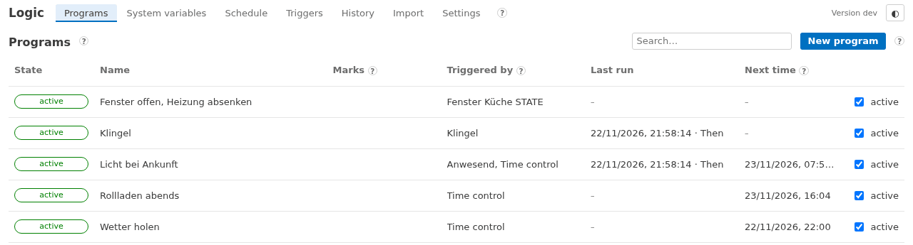</picture>

<picture><source media="(prefers-color-scheme: dark)" srcset="../screenshots/en/02-program-dark.png">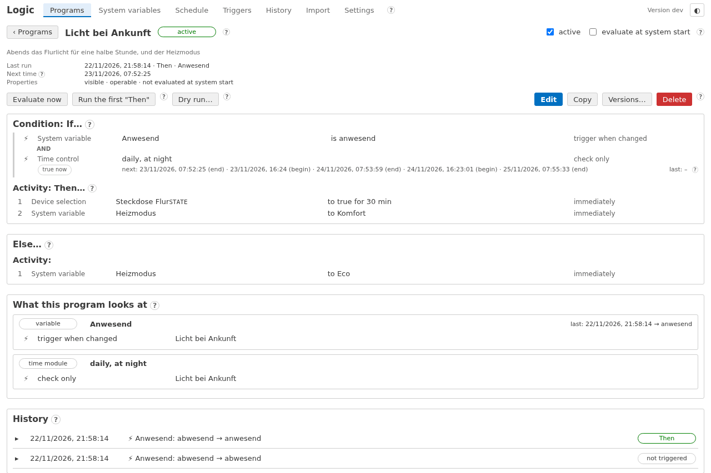</picture>

- The **active** switch turns a program on or off. A program with a script or with a fault (a variable or a program
  it refers to is gone) cannot be switched on.
- A click on the name opens the program the way the CCU shows it: *Condition: If…*, *Else if…*, *Else…*, each with
  its condition lines and their trigger mode, and *Activity: Then…* with the activities (*immediately* or *delayed
  by*). Lines that trigger the program are marked ⚡. A device this system does not have is shown by its address.
- **Evaluate now** and **Run the first "Then"** start the program by hand (see below).
- The column **Next time** says when a time module next triggers the program.

**New program**, and **Edit**, **Copy** and **Delete** on a program's view, are described under [Editing a program](#editor).

Every row of the list has the same height. A text that does not fit its column - name, description, triggers - is
cut with "…"; the whole text appears when the pointer rests on it. On a phone each program is a card with the same
lines.

### <a id="program-marks"></a>Marks in the list
The column **Marks** says what to mind about a program:

- *n writes refused* - the system refused write commands of the program; the mark names the last one;
- *script* - the program holds a script, which is never run;
- *no location* and *clock not set* - a [time module](#time) cannot trigger;
- *internal* - an internal program.

When a program has several marks, the most important one is shown with the number of the others beside it (*+2*); the
text at the pointer names them all.

### <a id="triggers"></a>When a program runs
Every condition line has a **trigger**. It only decides **when** the program checks its conditions; it is not part of
the condition.

| Trigger | The program is checked … |
| --- | --- |
| **trigger when changed** | when the **truth of this one line** changes – in both directions. Not when only the value changes: with "greater than 10", 6 → 12 triggers, 12 → 15 does not, 15 → 8 does again |
| **trigger when updated** | at every report of the device and every write of the variable, also with the same value. A thermostat reports every few minutes |
| **at every change of the value** | when the value differs from the one before. The CCU does not have this trigger |
| **check only** | never. A program with only such lines does not run by itself. The exception is a [time module](#time): it triggers at its times whatever its line says |

When the program is checked it goes through **the whole chain from top to bottom** with the current values: the first
block whose condition is true is run, the later ones are not looked at. The block that runs need not be the one the
triggering line is in. When several lines of a program trigger on the same event, it is checked once.

A condition without lines is always true. A line on a value the system does not know yet (a device has not reported
since the start) is false. The first value a line gets to see does not count as a change: after a start a restored value
must not trigger a program.

### <a id="triggers-page"></a>What triggers what: the Triggers tab
The **Triggers** tab answers the question from the other side: for every system variable, every device datapoint and
every time module some program looks at, **which programs listen to it and how**. It is the CCU's *Programs* button of
a variable or a channel, for all of them at once.

<picture><source media="(prefers-color-scheme: dark)" srcset="../screenshots/en/17-triggers-dark.png">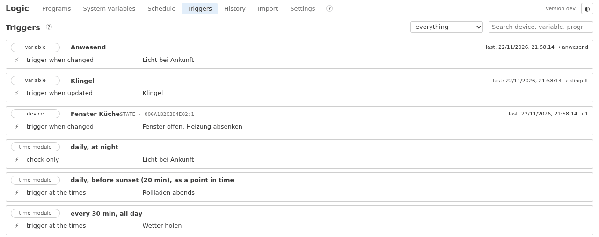</picture>

- Each source has its name (a device also its datapoint and address), its **last event with the value it brought** -
  for a device the last report since the addon started, for a variable its last write - and, once a device reported
  three times, **how often it reports** (*reports about every 3 min*).
- Below it the programs, one line each: ⚡ where the line triggers the program, its mode in the CCU's words (*trigger
  when changed*, *trigger when updated*, *check only* …) and the program's name - a click opens the program. A program
  that is inactive is greyed and says so.
- **⚠ runs at every report** marks a device line that triggers on update: its program is evaluated with every report
  of the device, the same value included.
- The filter shows variables, devices or time modules only; the search finds a source by its name, datapoint or
  address and by the programs that listen to it.

The same list, for one program only, is at the end of the program's view: **What this program looks at**.

### <a id="trace"></a>Why a program ran - and why it did not: the History tab
The CCU shows a program's "last run" and nothing else. The **History** tab shows every run of every program, the newest
first, and for each what the program saw and did. One row per entry: when, which program, **what triggered it - with the
value before and after** (*Regen: dry → raining*) - and what became of it: *Then*, *Else if 1*, *Else*, *nothing ran*,
*delayed activity*, *paused*, *missed*. A click opens the entry:

<picture><source media="(prefers-color-scheme: dark)" srcset="../screenshots/en/08-history-dark.png">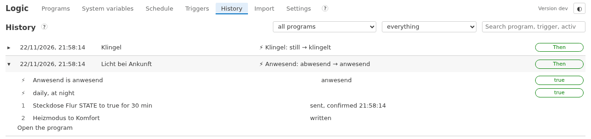</picture>

- **Every condition line with the value it saw and its result** - *true* or *false*. ⚡ marks a line that triggers. A
  line without a value (*value unknown*) is false. A line with "holds for" says since when its comparison holds. **Not
  looked at** means: a block before it ran, and the CCU does not look at the lines of the later blocks then - and such
  a "when changed" line has no remembered state afterwards, its next report triggers the program (as on the CCU).
- **Every activity with what became of it:** *sent* and, once the system has answered, *confirmed* with the time or
  *refused* with the reason; *written* for a system variable; *scheduled for* a time for a delay - and later, in the
  same place, *carried out* or *ended*, with who ended it (by hand on the schedule, a program with "end running
  delays"); *skipped* with the reason (a script, a special value, a value that is not known).
- A **delayed activity** that comes due is an entry of its own: nothing is checked again then, even if the condition
  has become false in the meantime.
- *Run without a look at the conditions* is said of a run that "Run the first 'Then'", another program or other
  software started that way.

At the top you pick a program, show only the entries in which something ran, or **only problems** (refused and skipped
activities, pauses of the loop guard, missed times), and search by program, trigger or activity. The same history, for
one program only, is at the end of the program's view.

The addon remembers the last 5000 entries of all programs together; they survive a restart of the addon and of the
system, and are kept beside the addon's state, not with the program files. While it runs, the addon also keeps every
program's own last 20 entries, however much the other programs have run since - a program that runs once a day still
shows its last runs.

#### <a id="trace-not-triggered"></a>Not triggered
The most frequent question is "why did it not run?". Pick a program on the History tab (or open the program): between
the runs there are then also the notes **not triggered** - something the program looks at reported, and the program was
not evaluated. The note says why:

<picture><source media="(prefers-color-scheme: dark)" srcset="../screenshots/en/19-not-triggered-dark.png"></picture>

- The line triggers **when changed**, and its result (true or false) is the same as before - the value may have changed
  all the same.
- The line triggers **at every change of the value**, and the value is the same as before.
- The line is **check only**: it never triggers.
- It was the **first value** the line sees (after a start): it only notes where it stands.

Several such notes in a row with the same reason are one entry that counts (*12 times since 09:30:00*); a device that
reports every three minutes does not fill the history that way.

### <a id="else"></a>Else
**The *Else* block runs at every check in which no block before it is true** – so also when a "when changed" line goes
from true to false, and at every report of a "when updated" line while the condition is false. A program with an *Else*
therefore does something at every check. This is the CCU's behaviour and the most common surprise in programs.

One peculiarity of the CCU is kept as well: a "when changed" line in an *Else if…* that was not reached at all, because
a block before it was true, afterwards triggers at **every** write of its variable – also with the same value – until
the block before it is false again.

### <a id="delays"></a>Activities and delays
The activities of a block are carried out **in the order they are listed**. Write commands to devices go out one after
the other, on radio interfaces with a short pause between them (0.3 seconds), so that a program does not cause a burst
on air. A command the system refuses is noted on the program and not repeated.

A **delayed** activity counts from the trigger, not from the line above it. When it is due it is carried out **without
the condition being checked again**. If the program triggers again before that, the first delay stays: two triggers, two
executions.

The checkbox **"before executing, stop all running delays for these activities"** (`cancel_pending`) changes that:
before the block runs, the pending delayed activities for the **targets this block names** are removed – whichever
program scheduled them. That is why an immediate opposite command in the *Else* block ends the delay from the *Then*
block; a block that names another target ends nothing. With the checkbox and a "when updated" trigger the delay starts
anew at every report and may never run out.

Switching a program off does not end its pending delays.

### <a id="program-run"></a>Starting a program by hand
A program can be started in two ways: **with its conditions checked** (as at a trigger) or **only the first *Then* block
without checking** – that is "Start" on the CCU, and it runs an inactive program too. The activity "run a program" has
the same two ways (`run` with `mode: check` or `mode: then`).

### <a id="dry-run"></a>Dry run: what would happen?
**Dry run…** on a program's view shows what the program would do - **without doing it**. Nothing is sent, written or
scheduled, no running delay is ended, and the program remembers nothing of it; the [History](#trace) gets no entry.

<picture><source media="(prefers-color-scheme: dark)" srcset="../screenshots/en/14-dry-run-dark.png">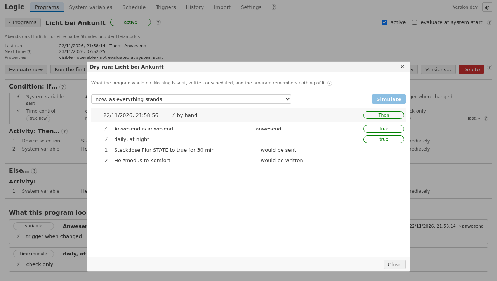</picture>

- **Now, as everything stands:** the program is evaluated with the current values. You see every condition line with
  its value and result, the block that would run, and for each activity what it would do: *would be sent*, *would be
  written*, *would be scheduled for* a time, *skipped* with the reason.
- **Simulate a trigger - "if line … reported":** pick a condition line and a value. The dry run first says **whether
  that report would trigger the program at all** - by the line's mode and the state it remembers (*would not trigger*,
  with the reason as in the History) - and then what the program would do with that value. A time module takes no
  value: it is tried as if it fired now.

The dry run works for an inactive program too: an imported program can be looked at before you switch it on. A program
that would run another one only says so - the other one is not evaluated with it.

### <a id="editor"></a>Editing a program
**New program** above the list opens the editor on an empty program; **Edit** on a program's view opens it on that
program, **Copy** on a copy of it (named "… (copy)", inactive until you switch it on), and **Delete** removes the program
after a question - a program other programs run or switch cannot be removed, and its earlier versions stay in the
history. Nothing is stored before **Save**; leaving the editor with unsaved changes asks first. Saving never runs a
program.

<picture><source media="(prefers-color-scheme: dark)" srcset="../screenshots/en/03-editor-dark.png">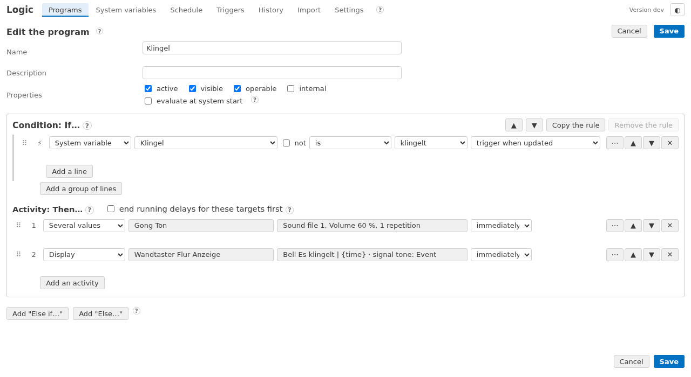</picture>

The editor has the CCU's layout: the name, the description and the properties (*active*, *visible*, *operable*,
*internal*, *evaluate at system start*), then *Condition: If…* with its lines and *Activity: Then…* with its
activities, then every *Else if…* and the *Else…*. **Add "Else if…"** and **Add "Else…"** add rules; a rule is moved
with its arrows, removed, or **copied** - the copy becomes the *Else if…* right after it.

What is wrong is said in the line below the row it concerns **while you type**, with the reason: a device or datapoint
not chosen yet, a text where a number belongs, a variable that is gone. A program with such a place is not saved;
*Save* says how many there are. Below the rules the editor adds hints where a program will do something its author may
not expect - for example that *Else* runs at every report of a device when a line triggers on update.

#### <a id="editor-lines"></a>Condition lines
A line is on a **device** (one datapoint of a channel), a **system variable** or a **time control**, compares it and
has a trigger mode. Lines that trigger the program are marked ⚡.

- **Add a line** adds one to a group; **Add a group of lines** starts another group. Inside a group the lines are
  joined by *AND* or *OR*, the groups by the other or the same - two levels, as on the CCU.
- The comparison offers what the value can do: *is* and *is not* for a logic value, a list entry or a text; for a
  number also *greater than*, *less than* …, *in the range* (from … to less than …) and *outside the range*.
- The value is entered as its datapoint or variable asks: a choice for a logic value, a list or an enumeration, a field
  with the unit for a number.
- **not** negates the line: it is true when the comparison is not.
- The trigger mode is the CCU's: *trigger when changed*, *trigger when updated*, *check only*, and *trigger at every
  change of the value* (see [When a program runs](#triggers)).
- **⋯** opens the line's further options: *for at least …* (see [Beyond the CCU](#additions)).
- A line is **dragged by its handle ⠿** to another place - in its group, in another group or in another rule - or moved
  one place with its arrows; ✕ removes it. A group whose last line went is gone too.

#### <a id="editor-devices"></a>Choosing a device
The button with the device's name opens the picker: every channel of the system by name, with its device, type, room
and address. The search looks at all of them; the three filters narrow the list to a room, a device type or an
interface. A click on a channel chooses it; the datapoint is chosen in the list beside the button - a condition line
offers the datapoints that can be read, an activity those that can be written. A device this system does not have (a
program imported from another CCU) stays in the program by its address, and its datapoint is typed.

<picture><source media="(prefers-color-scheme: dark)" srcset="../screenshots/en/10-picker-dark.png">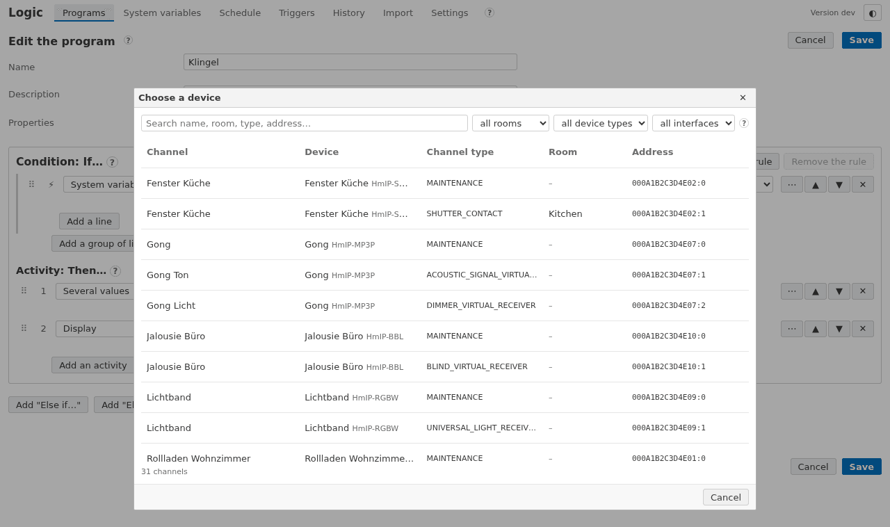</picture>

#### <a id="editor-activities"></a>Activities
An activity writes a **device** datapoint or a **system variable**, or runs or switches another **program**
(*evaluate*, *run the first "Then"*, *switch on*, *switch off*). The value is a fixed one, or the current value of a
variable or of another datapoint. Each activity is done *immediately* or *delayed by* a number of seconds, minutes or
hours, counted from the trigger, or delayed *at random*; **⋯** opens its further options, *on for …* and the random
delay's longest time (see [Beyond the CCU](#additions)). **End running delays for these targets first** is the CCU's checkbox of the block (see
[Activities and delays](#delays)). Activities are dragged or stepped like lines, also into another rule. An imported
script stays in its place as text and can only be removed; an activity with one of the CCU's special values is skipped
until it gets a value here.

#### <a id="editor-time"></a>Time control in the editor
A time line opens a form: how it **repeats** (once, at an interval, daily, weekly, monthly, yearly), **when** on its day
(a time of day, all day, or the sun with an offset in minutes), whether it is a **point or a range** and how long the
range lasts - for the sun also a point in time and a twilight (see [Beyond the CCU](#additions)) -, and its validity (*valid from*, *valid until* - a date without a time includes that day -, a number of
times). The form says the module in words and lists **the next times** it would fire at, with the system's location and
clock, while you fill it in. What the fields mean exactly is in [Time modules](#time).

<picture><source media="(prefers-color-scheme: dark)" srcset="../screenshots/en/13-time-dark.png">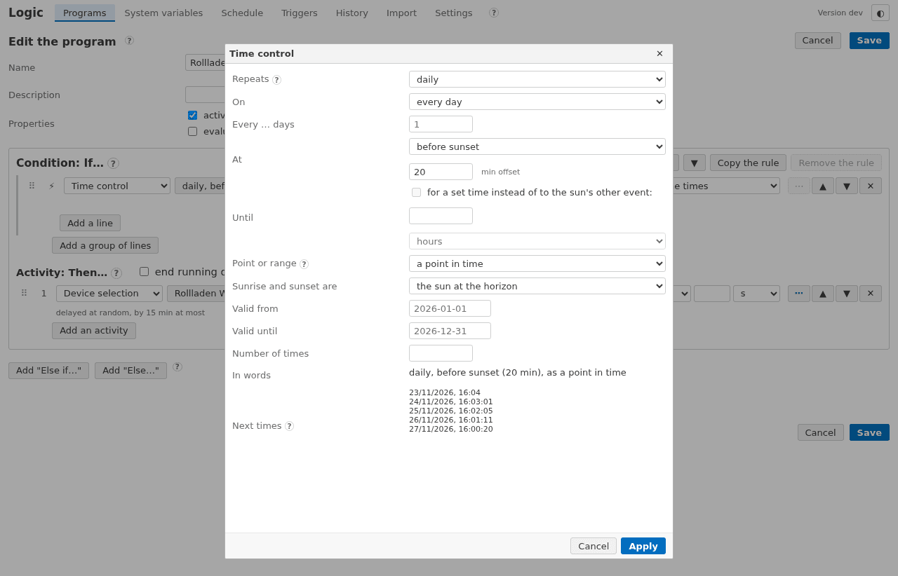</picture>

### <a id="start"></a>After a system start
A CCU checks every active program once when it starts. Here each program has its own switch for that, **evaluate at
system start** (on the program's view; `at_start` in the file): it is on for programs imported from a CCU - the import
report names them - and off for programs made here.

- Once after every start of the **system**, not at a restart or an update of the addon, every active program with the
  switch on is checked with its conditions: the first block that is true runs, otherwise "Else". The run is marked
  *system start*.
- A program without conditions runs its "Then". A program that has only time modules runs its "Else" unless the
  moment lies in one of its ranges. Programs with scripts and inactive programs take no part.
- The addon waits until it has read the values of the devices the programs use and the clock of the system is set -
  five minutes at most; then it checks with what it knows (a line on a value it does not know is false).
- The check also is where every *trigger when changed* line starts from: a value that arrives later and leaves the
  line as it was does not trigger.
- What the programs switch then goes out one command after the other with the [pause](#pacing) between two, like
  every write - a start is no burst on the radio.
- [Values at system start](#start-value) are set before, and delayed activities that were pending when the system
  went down are kept if they are still in the future.

Switch it off for a program that must not act after a power cut - or guard it the way it was done on the CCU, with a
variable that is true for the first minutes after a start.

### <a id="differences"></a>What differs from the CCU
| On the CCU | Here |
| --- | --- |
| A program is run once when it is first saved and when it is switched on | saving and switching on never run anything |
| The order of a block's activities is not guaranteed | the listed order |
| Two lines that trigger at the same moment can run the block twice | one check per event |
| Pending delays are lost at a restart | they are kept; one that came due while the addon was stopped is dropped, not caught up |
| A program that writes what it triggers on runs forever | after 20 runs in 10 seconds it pauses for a minute and is marked |
| "Last execution" moves even when nothing was run | the last run is the last one in which a block ran |
| A delay of 24 hours or more is stored as zero | delays have no limit |
| Two identical time modules in one program run it twice | one evaluation per instant |
| "Every *n* months" is computed wrongly in several cases | counted from the month of the begin |
| On the day of the clock change the CCU shows and stores a delay of two hours as one | a delay is a duration; a range ends at its clock time |
| Time modules run at once after the start, also on a clock that is still wrong | they wait until the clock of the system is set |

### <a id="compared"></a>How "as on the CCU" is checked
That a program behaves here as it did on the CCU is tested, not assumed. Every behaviour this guide
describes - when a line triggers, which block runs, what a delay does, when a time module fires - is
a small scenario: a program built the way the CCU's program editor builds it, and a list of writes
with their times. Each scenario was played on a real CCU logic (ReGaHss of OpenCCU 3.89.8, the
behaviour before the changes of 3.89.14) under a controlled clock, and what ran there was recorded.
With every change to the addon the same scenarios are played on its own engine - starting from the
database the CCU saved, so the import is part of the test - and the result must equal the recording.
Where the addon differs on purpose (the table above), the scenario states the difference and the
test holds the addon to it.

What has not been compared with a CCU: conditions and activities on real devices, and key presses
(the reference has no radio); these follow the same rules as system variables.

### <a id="additions"></a>Beyond the CCU
A few things users of a CCU keep building by hand are part of a program here. In the editor they are behind the
**⋯** button of a condition line or an activity (*More options*) - the row then says below it what is set - and in
the form of a time control; in the program's file (see [Programs and variables as files](#files)) they are the fields
named here.

<picture><source media="(prefers-color-scheme: dark)" srcset="../screenshots/en/12-options-dark.png">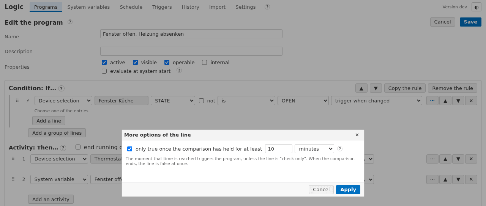</picture>

- **Holds for** - *only true once the comparison has held for at least …* in a line's options; `for: 10min` in the
  file. The line is true only once its comparison has held without a
  break for that long, and the moment that is reached **triggers the program** (unless the line is *check only*). When
  the comparison ends, the line is false at once. *Window open for ten minutes: turn the heating down* is one line,
  without a delay that would fire although the window was closed again in between. The count survives a restart of the
  addon.
- **A random delay** - *at random* as an activity's timing, the shortest delay beside it, the longest in its
  options; `after: 5min`
  with `after_up_to: 30min` in the file: delayed by some time between the two, drawn anew at every run. Without a
  shortest delay it starts at nothing. For a presence simulation.
- **On for** - *on for …* in the options of an activity that writes a fixed value to a device; `on_for: 5min` in the
  file: the channel's on-time (`ON_TIME`) is sent together
  with the value, in one command, and the device switches back by itself. On the CCU this takes two lines and a delay of
  a second. The channel must have the datapoint `ON_TIME`; the editor says so when it has not.
- **An astro point** - *a point in time* instead of a range in the form of a time control with the sun; `point: true`
  in the file: once, at sunrise or sunset shifted by its `offset`
  (*20 minutes before sunset*), instead of a range. With `twilight: civil` (or `nautical`, `astronomical`) the dawn and
  the dusk take the place of sunrise and sunset, for points and ranges alike (*Sunrise and sunset are* in the form).
- **The sun's position** - the [system values](#system-values) `sun-azimuth` and `sun-elevation`.
- **Several values of a channel in one command** - the activity [Several values](#values), with [forms](#forms) for
  signal lights, sounds, sirens, coloured lights and blinds with slats.
- **A display's five lines** - the activity [Display](#display) for the HmIP-WRCD, with a preview.
- **Calling a web address** and **waking a machine** - the activities [Webhook](#webhook) and
  [Wake-on-LAN](#wake).
- **Running a program of the system** - the activity [Command](#command), in place of a script with `system.Exec`.

### <a id="values"></a>Several values in one command
Some devices take several values **together**: a coloured signal light its colour, its brightness and how it blinks; a
blind its height and the position of its slats; a sound its file, its volume and its length. Written one after the
other, the device may ignore one of them or show something in between. The activity **Several values** writes them in
**one command**.

In the editor choose the channel, then **the values**: the form lists the channel's writable datapoints as the device
itself describes them - a choice for a list of entries, a field with its limits for a number - and the ticked ones are
sent. In the file an entry of a list is written by its **name** (`COLOR: RED`), a number as a number, a logic value as
`true` or `false`:

```yaml
name: Flurlicht rot
rules:
  - when:
      all: []
    then:
      - channel: HmIP-RF/000855699C1234:8
        values:
          COLOR: RED
          LEVEL: 0.5
          DURATION_UNIT: S
          DURATION_VALUE: 10
```

The values are **checked twice against the device's own description**: when the program is saved, and again each time
the command is sent. A datapoint the channel does not have, one that cannot be written, a number outside its limits or
an entry the list does not have is **said and not sent** - on the page when saving, in the [history](#trace) and on the
program when sending. So a device whose firmware changed its datapoints shows as an error, not as a light that stays
dark. A channel the system does not know (a device that is not there yet) can be written by naming the datapoints; it
is checked once the device is there.

An imported CCU program that sets such a device with a finished text (`COMBINED_PARAMETER`) is imported as it is and
sent as it was; the [forms](#forms) can convert it.

### <a id="forms"></a>Forms for lights, sounds, sirens and blinds
For five kinds of channels the values are not ticked datapoint by datapoint: the editor opens a **form** made for the
channel. It is chosen by the **type of the channel**, offers what the device's own description lists, and writes the
same values - the file looks exactly as above, and **All datapoints…** in the form opens the plain list with what is
set (and **Form…** there leads back).

<picture><source media="(prefers-color-scheme: dark)" srcset="../screenshots/en/04-form-dark.png">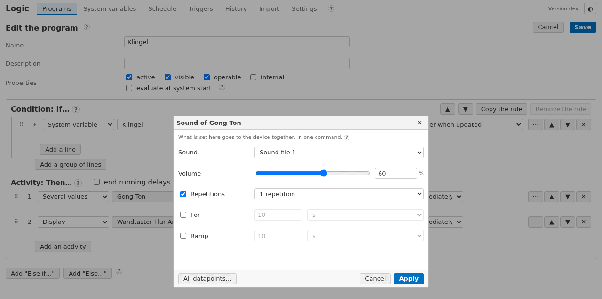</picture>

| Channel | The form | Datapoints it writes |
| --- | --- | --- |
| **Signal light** - the coloured light of a HmIP-BSL, the light of a HmIP-MP3P (`DIMMER_VIRTUAL_RECEIVER` with a colour) | the colours to click, the brightness, the behaviour (on, blinking, flashing, billowing - where the device has it), *for* a duration, a ramp | `COLOR`, `LEVEL`, `COLOR_BEHAVIOUR`, `DURATION_VALUE` + `DURATION_UNIT`, `RAMP_TIME_VALUE` + `RAMP_TIME_UNIT` |
| **Sound** - HmIP-MP3P (`ACOUSTIC_SIGNAL_VIRTUAL_RECEIVER`) | the sound file, the volume, repetitions, a duration, a ramp | `SOUNDFILE`, `LEVEL`, `REPETITIONS`, `DURATION_…`, `RAMP_TIME_…` |
| **Siren** - HmIP-ASIR (`ALARM_SWITCH_VIRTUAL_RECEIVER`) | the sound and the light from the siren's lists, and for how long - all three are always sent | `ACOUSTIC_ALARM_SELECTION`, `OPTICAL_ALARM_SELECTION`, `DURATION_VALUE` + `DURATION_UNIT` |
| **Coloured light** - HmIP-RGBW, a DALI gateway (`UNIVERSAL_LIGHT_RECEIVER`) | a colour by hue and saturation **or** a colour temperature, the brightness, a ramp, a duration, an effect | `HUE` + `SATURATION` or `COLOR_TEMPERATURE`, `LEVEL`, `RAMP_TIME_…`, `DURATION_…`, `EFFECT` |
| **Blind with slats** - HmIP-BBL, HmIP-FBL, HmIP-DRBLI4 (`BLIND_VIRTUAL_RECEIVER`) | the height and the position of the slats, together | `LEVEL`, `LEVEL_2` |

A brightness, a volume, a height are entered in percent and stored as the device takes them (`LEVEL: 0.5` for 50 %).
A duration is a number with its unit from the device's list (`DURATION_VALUE: 10`, `DURATION_UNIT: M` for ten
minutes). What is not ticked is not sent: the device keeps what it has or uses its own default. A value the form has
no field for (set in the plain list) is kept and named below the form.

**A blind's slats** move only together with the height: the form always sends both. A slat position alone is taken
by the devices and ignored.

**From a CCU:** a program that sets such a channel with a finished text (`COMBINED_PARAMETER`, for example
`L=50,C=4,DV=10,DU=1,CB=1`) is imported as it is and sent as it was. Where the text can be read whole, the editor says
it in words below the activity and offers **Convert into a form**: the activity then writes the same values as
datapoints (the brightness 50 %, the colour number 4 by its name, ten minutes, the behaviour number 1 by its name).
A text with a part the page does not know stays as it is.

**How far this is tested:** the forms are built and tested against the devices' own descriptions (HmIP-BSL 1.0.2 and
2.0.2, HmIP-MP3P 1.0.26, HmIP-ASIR 1.2.16, HmIP-RGBW 1.0.52, HmIP-BBL 1.6.2) on a simulated system - **not yet seen on
the devices themselves**. If a device does not do what its form says, the plain list of datapoints and the imported
text still work as before; please report it.

### <a id="display"></a>A display: the HmIP-WRCD
The wall remote with a display (HmIP-WRCD) shows **five lines**, each with a text, an icon or both, and can play a
signal tone with them. The activity **Display** composes that: choose the display's channel, then for each line the
text, the icon from the display's own list, where the text stands (left, centred, right) and whether the line is
inverted (white on black). A **preview** follows what you type - it comes close to the display, it is not its exact
picture (the icons are stand-ins). A line with neither text nor icon is not sent: the display keeps what that line
shows. Below the lines: the **signal tone** (one of the display's eight), how often it is repeated and the pause
between two.

<picture><source media="(prefers-color-scheme: dark)" srcset="../screenshots/en/11-display-dark.png">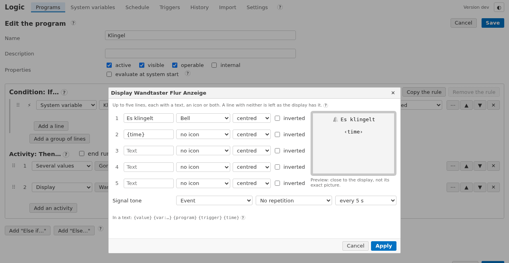</picture>

```yaml
name: Fenster melden
rules:
  - when:
      all: []
    then:
      - display: HmIP-RF/000A1B2C3D4E11:3
        lines:
          - text: "Fenster offen"
            icon: WINDOW_OPEN
          - text: "{var:fenster-kueche}"
            align: LEFT
          - {}
          - text: "seit {time}"
            color: WHITE
            background: BLACK
        sound: EVENT
        repetitions: 2
        interval: 10
```

In the file a line has `text`, `icon`, `align` (`LEFT`, `CENTER`, `RIGHT`; left out: centred), `color` and `background`
(`BLACK`, `WHITE`; left out: a black text on a white line); `- {}` is a line that is left as it is. `sound` is the
signal tone (`LOW_BATTERY`, `DISARMED`, `INTERNALLY_ARMED`, `EXTERNALLY_ARMED`, `DELAYED_INTERNALLY_ARMED`,
`DELAYED_EXTERNALLY_ARMED`, `EVENT`, `ERROR`), `repetitions` 0 to 14 or 15 for "without end", `interval` the seconds
between two (5 to 80 in steps of 5).

The whole display goes to the device in **one command**, as the text a CCU writes into the channel's
`COMBINED_PARAMETER`. When the program is saved, the channel is checked: it must be a display, and its lists must have
the icons and the tone that are named. Delays, "end running delays" and the dry run work as for any activity; the
[history](#trace) shows the lines as they went out.

**From a CCU:** a program that sets a display with the CCU's finished text is imported as it is and sent as it was;
where the text can be read whole, the editor says it in words and offers **Convert into a form**, which makes a
*Display* activity of it. The CCU's "reset the display" text stays as it is.

**How far this is tested:** built and tested against the description of a HmIP-WRCD (firmware 1.4.6) and the text a
CCU writes for it, on a simulated system - **not yet seen on the device itself**. Please report what a real display
does differently. One thing in particular: the tones are numbered as the device describes them; the CCU's own page
names *armed, at home* and *armed, away* (and their delayed forms) the other way round, so a display may play the one
for the other.

#### <a id="display-text"></a>What a text can hold
The display shows **16 characters** of a line. It knows the letters, digits and signs of plain ASCII and `Ä Ö Ü ä ö ü
ß`; a comma, an equals sign and curly brackets cannot be shown (they are the device's own separators) - the editor says
so. In their place the device has no character for `[ ] # $ | _`: typed, they show as `Ä & Ö Ü ö ß`.

A text can take **placeholders**, filled in when the activity runs: `{value}` (the value that triggered the run),
`{var:<key>}` (a system variable's value - its key is the name of its file), `{program}`, `{trigger}` and `{time}`.
What a placeholder brings is cut at the display's width, and a character the display cannot show becomes a blank; a
secret (`{secret:…}`) is never shown on a display.

### <a id="webhook"></a>Webhooks
The activity **Webhook** calls a web address: it tells another service that something happened - a notification
service, a chat, a device with a web interface, another home automation. On a CCU this takes a script with `wget` or
`curl`; here it is a form:

- **Method** - GET, POST or PUT - and the **address**, `http://…` or `https://…`. Addresses on the system itself
  (`127.0.0.1`) are allowed: that is how another addon is reached.
- up to eight **headers** (name and value);
- for POST and PUT a **body** of the kind *JSON*, *form* or *text* - the kind sets the `Content-Type` (a header of that
  name replaces it) and how placeholders are put in;
- **do not verify the certificate**, for a device on the home network that signs its own certificate. Without it an
  `https` address must show a certificate the system trusts.

A call waits at most **ten seconds** for the answer. The answer's content is **never read**: a status from 200 to 299
counts as done, anything else as failed - a program cannot react to what a server says. A connection that cannot be
made is tried **once more**; an answer, whatever it says, and a timeout are not. A redirect is followed on the same
host only.

Calls go out **beside the programs**, at most four at a time: a slow server never delays a program or another
activity. When a hundred calls are waiting, further ones are dropped, and the history says so. A delayed webhook is a
[pending delay](#schedule-delays) like any other: it can be ended, by hand or by "stop all running delays" of a block
that names the same address.

The [history](#trace) shows for each call whether it was answered, the **status code** and how long it took; a failed
call is counted on the program like a refused write command. A [dry run](#dry-run) calls nothing.

#### <a id="webhook-placeholders"></a>Placeholders
In the address, in the headers' values and in the body these stand for a value - a fixed set; everything else in
braces stays as it is, so a JSON body needs no escaping:

| Placeholder | Stands for |
| --- | --- |
| `{program}` | the program's name |
| `{trigger}` | what triggered the run: the name of the variable or of the program that ran this one, a device's datapoint as `Interface/ADDRESS:CHANNEL/PARAMETER`, or `time`, `held`, `start`, `user`, `outside` |
| `{value}` | the value the trigger brought (`true`, `21.5`, a text; nothing when it brought none) |
| `{time}` | the time of the run, like `2026-11-22T16:30:00+01:00` |
| `{var:key}` | the current value of the system variable with that key |
| `{secret:name}` | a [secret](#secrets) from the settings |

A value is put in **so that it fits where it stands**: percent-encoded in the address and in a *form* body, as the
inside of a JSON string in a *JSON* body (write `"text": "{program}"` with the quotes, `"value": {value}` without for a
number), unchanged in a *text* body, and without line breaks in a header. A delayed webhook takes `{value}` from the
trigger that scheduled it, and `{time}` and `{var:…}` from the moment it is carried out.

In the file:

```yaml
name: Tür melden
active: true
rules:
  - when:
      all:
        - all:
            - variable: haustuer-offen
              is: true
              for: 5min
              trigger: change
    then:
      - webhook: "https://ntfy.example.org/zuhause"
        method: POST
        headers:
          - name: Authorization
            value: "Bearer {secret:ntfy-token}"
        body_type: text
        body: Die Haustür ist seit fünf Minuten offen ({time}).
      - wake: "AA:BB:CC:00:11:22"
```

### <a id="wake"></a>Wake-on-LAN
The activity **Wake-on-LAN** switches on a computer, a NAS or a television that listens for it: it sends three
*magic packets* with the machine's **hardware address** (MAC, `AA:BB:CC:DD:EE:FF`) to UDP port 9. Without anything
else they go to the local network (`255.255.255.255`). To reach a machine in **another network** give that network's
broadcast address (*through*, like `192.168.2.255`; `broadcast:` in the file) - the router must let such packets pass.

Nothing answers a magic packet: the history says that the packets were sent, not that the machine woke up. The machine
must have Wake-on-LAN switched on (in its firmware and its network adapter) and be connected by cable; most do not wake
over Wi-Fi.

### <a id="command"></a>Commands
The activity **Command** runs a program of the system - what a script did with `system.Exec` on a CCU: fetch a value
with `curl`, call a script of your own, hand a value to another tool. Two things differ from the CCU, on purpose:

<picture><source media="(prefers-color-scheme: dark)" srcset="../screenshots/en/05-command-dark.png">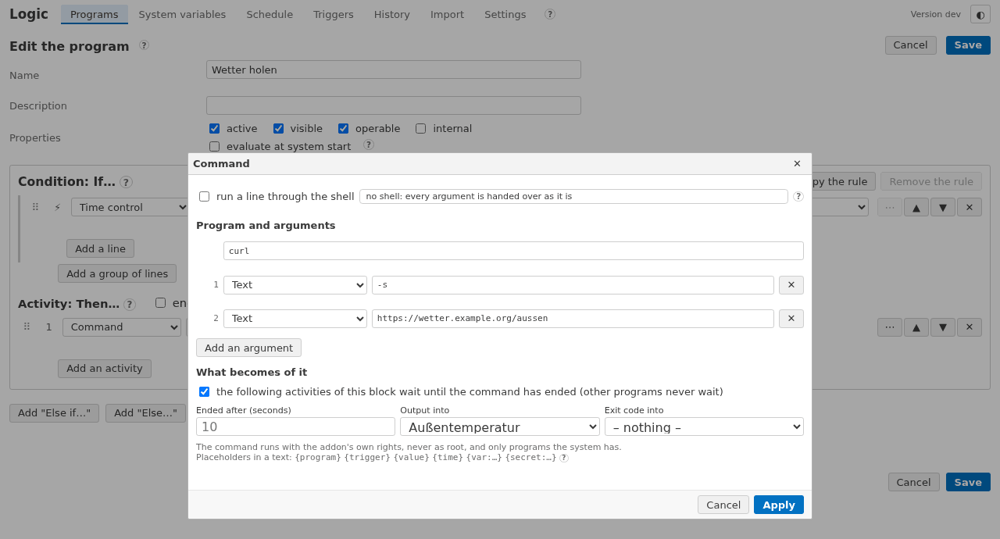</picture>

- **A command never holds up another program.** On a CCU a `system.Exec` that waited stopped every program until it
  came back. Here commands run beside the programs, at most four at a time; when fifty are waiting, further ones are
  dropped, and the history says so.
- **A command has the addon's rights, and no more.** It runs as the user the addon runs as - not as root, and there
  is no way to get more: no `sudo`, no helper. It can read most of the system, reach the network, and write below
  `/usr/local/addons/logic/`, `/tmp` and `/var/tmp`; it cannot change the system's settings, write to another addon's
  files, restart a service or reboot. A command that needs root fails, and the history says why.

Only **administrators** see this page at all, so only they make and change commands.

**What is run** is, without anything else, a **list**: the program, then its arguments, one per row. No shell reads
it: every argument is handed to the program exactly as it stands - a blank, a quote or a `;` in it means nothing. A
program named without a directory (`curl`) is looked for in `/usr/local/sbin`, `/usr/local/bin`, `/usr/sbin`,
`/usr/bin`, `/sbin` and `/bin`.

With **run a line through the shell** the command is one line for `/bin/sh` instead - pipes, redirections and
several commands work as in a terminal. The editor marks such a command, because a line is interpreted: take care what
you write into it. An imported `system.Exec` is such a line, so it runs as it was written.

**What becomes of it:**

- **Ended after** - a command may run for ten seconds unless you give it more, up to 600 (ten minutes). When the
  time is over it is ended, with everything it started. The same happens to what a command leaves running in the
  background when it ends itself: nothing stays behind.
- **The following activities wait** - the rest of the block goes on when the command has ended (also when it
  failed), and delays in the rest count from then. Only this block waits: other programs, and this program when it is
  triggered again, run meanwhile. Without it the command runs in the background and the block goes on at once. New
  commands run in the background; imported ones wait, as on the CCU. A command that is itself delayed never makes the
  block wait.
- **Output into** a system variable - what the command printed (its standard output), without blanks and line breaks
  around it: into a *string* as it is (the first 4000 bytes), into a *number* when it is one (`21.5`, not `21,5`),
  into a *logic value* when it is `true`, `false`, `1` or `0`. The output is written only when the command ended with
  the exit code 0; an output the variable does not take is said in the history. There is no way to pick a value out
  of JSON here - `jq` in the command does that (`curl -s … | jq -r .temperature` as a shell line).
- **Exit code into** a number variable - 0 when all went well, the program's own code otherwise, and **-1** when it
  could not be started or was ended at its timeout. A program can react to it like to any variable.

The [history](#trace) shows for each command the line **as it was run**, with the values put in (a secret stays
`{secret:name}` there), how long it took, the beginning of its output, and for a failure the exit code and what the
program wrote as its error. A failed command is counted on the program like a refused write command. A
[dry run](#dry-run) runs nothing. A delayed command is a [pending delay](#schedule-delays) like any other. When the
addon is stopped, running commands are ended; the rest of a block that waited for one is not made up afterwards.

#### <a id="command-values"></a>Values in a command
An argument is a **text**, or the **value of a system variable** or of a **device's datapoint**. A value is always
**one argument**, whatever it holds - a text variable that says `a b; reboot` arrives as that one text and is never
run. For a value you choose how it is written:

| Value | Written as |
| --- | --- |
| a number | as it is (`21.5`, `3`), or with a fixed number of decimals, 0 to 6 (`format: ".1"` in the file) - always with a point and without the unit |
| a logic value | `true` or `false`, or `1` or `0` (`format: "01"`) |
| an entry of a value list | its name, or its number counted from 0 (`format: "index"`) |
| a text | as it is |

A **text** argument can hold the [placeholders](#webhook-placeholders) a webhook has - `{program}`, `{trigger}`,
`{value}`, `{time}`, `{var:key}`, `{secret:name}` - anywhere in it: `--title=Alarm {program}` stays one argument. The
program itself (the first row) is written out.

With a **shell line** the values are the line's positional parameters: the first is `"$1"`, the second `"$2"` -
write them with the double quotes. Placeholders in the line are put in as **one quoted word** each, so a value never
becomes a second command; do not put quotes of your own around a placeholder.

**What the system has.** The addon brings no programs of its own: a command uses what openccu-lite has, the same on
every hardware. Among others: `curl`, `wget`, `jq`, `awk`, `sed`, `grep`, `cut`, `tr`, `bc`, `date`, `nc`, `openssl`,
`sqlite3`, `logger`, `tclsh` and the other BusyBox tools. The files of **other addons** are closed to everybody but
that addon, so their programs cannot be run - `mosquitto_pub` of the Mosquitto addon, for instance, does not start.
The exception is the *Tools* addon, whose tools are there for everyone: name them by their full path in
`/usr/local/addons/tools/bin/` (`socat`, among others).
What needs root does **not** work: `ether-wake` and `ping` (use the activity [Wake-on-LAN](#wake)), `reboot`, `mount`,
changes below `/etc` or `/usr/local/etc`. There is no Python.

A script of your own belongs into the addon's data folder (`/usr/local/etc/config/addons/logic/`), for example
into a folder `scripts` there: it stays there when the addon is updated and is part of the system's
backup. The addon's user must be able to read and run it.

In the file:

```yaml
name: Wetter holen
active: true
rules:
  - when:
      all:
        - all:
            - variable: anwesend
              is: true
              trigger: change
    then:
      - command:
          - "/usr/bin/curl"
          - "-s"
          - "--max-time"
          - "8"
          - "https://wetter.example.org/aussen?key={secret:wetter-key}"
        wait: true
        output: aussentemperatur
        exit_code: wetter-fehler
      - command: "df /usr/local | tail -n 1 | tr -s ' ' | cut -d ' ' -f 5 | tr -d '%'"
        shell: true
        output: speicher-belegt
      - command:
          - "/usr/local/etc/config/addons/logic/melden.sh"
          - variable: aussentemperatur
            format: ".1"
          - device: HmIP-RF/000A1B2C3D4E01:1/STATE
            format: "01"
        timeout: 1min
        after: 5s
```

A command is a list below `command:` - texts in quotes, a value as `variable:` or `device:` with an optional
`format:` - or, with `shell: true`, a line, whose values are listed below `args:`. `timeout:`, `wait: true`,
`output:` and `exit_code:` are what becomes of it.

**How far this is tested:** built and tested on Linux against real programs (arguments, quoting, timeouts, output
limits), and checked on a Raspberry Pi 4 with openccu-lite 2.0.0-rc.2 - what the addon's user can run and write is
what this section says.

### <a id="not-yet"></a>What this version cannot do yet
- **Scripts** are never run. An imported program with a script stays inactive; the script is kept as text. For such
  tasks Node-RED (RedMatic), Home Assistant or ioBroker are the right tools. (A script that only runs one command is
  taken over as a [command](#command).)

## <a id="time"></a>Time modules
A time module is a condition line that depends on the clock: *daily at 06:30*, *at the weekend from 20:00 to 10:00*,
*every 15 minutes*, *from sunset to sunrise*. Time modules come in with the import from the CCU and behave here as
there - where the CCU was measured it is the reference; what is deliberately different is under
[The clock change](#time-dst) and in the table [What differs](#differences).

Like every line a time module has a trigger mode, **trigger at the times** or **check only** - but for a time module
the mode changes nothing: **a time module always triggers.** The program is evaluated at each of the module's times
(a point, a range's begin and end, every firing of an interval), also when the line says *check only*. That is how the
CCU behaves, whatever its manual says, and programs imported from one have grown used to it; the page marks every time
module line with ⚡, and the import report names the programs it concerns. To use a time of day as a mere condition
without the program running at its begin and end, set a system variable from a small program of its own and check
that variable.

### <a id="time-kinds"></a>Point, range, interval
| Time module | Fires | Is true |
| --- | --- | --- |
| **Point in time** (*at 06:30*) | once, at its instant: the program evaluates and runs "Then" | at its instant only (that second). When another trigger evaluates the program at another time, the line is false |
| **Range** (*from 22:00 to 06:00*, *all day*, every astro time) | at its begin (true: "Then") **and at its end** (false: "Else") | from its begin to its end; the begin belongs to it, the end does not |
| **Interval all day** (*every 15 minutes*) | at every multiple of the interval after midnight; at midnight the count begins again, so the last interval of a day is shorter when the interval does not divide the day | all day: when another trigger evaluates the program between two firings, the line is true. Only until its first firing after a start of the addon it is false (as on the CCU) |
| **Interval in a range** (*every 5 minutes from 22:27 to 23:42*) | at the begin and then at every interval from the begin ("Then"), once more at the end ("Else") | inside the range |
| **Interval at a point** | once a day, at the point - an interval needs a range | at its instant only |

- When two time modules of one program fire at the same instant, the program is evaluated **once** (the CCU ran it
  twice). A program with several time modules gets each one's begin and end: with an "Else", that runs at every end at
  which no other condition is true.
- A program that has only points in time as triggers is false at any other time: evaluated by hand or at system start,
  its "Else" runs.
- For a range over midnight the weekday and the date are those **of the day it begins on**: *at the weekend from 20:00
  to 10:00* ends on Monday at 10:00.
- *All day* on consecutive days fires its begin at every midnight; there is an end only when the next day does not
  belong to it any more.

### <a id="time-pattern"></a>Patterns
| Pattern | Meaning |
| --- | --- |
| once | on one date |
| daily | every day, every *n* days, *on workdays* (Monday to Friday) or *at the weekend* |
| weekly | on the chosen weekdays, every week or every *n* weeks (a week runs from Monday to Sunday) |
| monthly | on the *n*-th day or on the first … fifth of a weekday, every month or every *n* months |
| yearly | on the *n*-th day of a month or on the first … fifth of a weekday in a month |
| interval | see above |

- **Every *n* days, weeks, months** counts from the begin of the validity: from its day, its week, its month. (The
  CCU computed "every *n* months" wrongly in several cases; here it is right.)
- **A day the month does not have** does not happen: the 31st does not fire in April, 29 February only in a leap year,
  a fifth Friday only in months with five Fridays. Nothing is moved to another day.

### <a id="time-validity"></a>Validity
- **Begin:** what begins at or after this moment counts. A date without a time is the start of that day.
- **Ends on:** a date without a time includes that day, as on the CCU: *ends on 10 November* still fires on the
  10th and no more on the 11th. With a time (in the file only), what would begin at or after that moment does not
  happen any more. A range that began before it still ends.
- **Ends after *n* times:** counted on the calendar from the begin of the validity, not with a counter - after a
  restart it is the same last time. For an interval every firing counts.

### <a id="time-dst"></a>The clock change
Time modules go by the clock of the system in its time zone.

- **A time the day does not have** (in spring the hour from 02:00 to 03:00): it happens at the moment the clock
  jumps - *02:00* and *02:30* both fire at 03:00. Nothing is left out. (An old CCU fired such a time an hour early, at
  01:00 and 01:30 winter time; here it is the jump, as on a current one.) A range that lies inside the missing hour
  altogether (*02:10 to 02:30*) begins at the jump and ends a second later, so its "Then" and its "Else" both run.
- **A time the day has twice** (in autumn the hour from 02:00 to 03:00): it happens the first time, and only then.
- **An interval keeps its spacing**, as on the CCU: *every 7 minutes* fires at 01:59 and next at 03:06 in the spring
  night, at 02:55 summer time and next at 02:02 winter time in the autumn night - seven minutes apart each time. All
  day it counts from the day's first moment, so on these two days its times are not the usual ones on the clock
  after the change (*every 2 hours* fires at 03:00, 05:00 … in the spring night); at midnight it begins again.
- **A range ends at its clock time:** *22:00 to 06:00* ends at 06:00, also in the night of the change - it then lasts
  seven or nine hours.
- **A delay is a duration** and stays one: *delayed by 2 hours* is two hours in that night too.

### <a id="time-astro"></a>Astro: sunrise and sunset
An astro time module is always a range: *during the day* from sunrise to sunset, *at night* from sunset to the next
sunrise; the begin can be shifted by minutes either way, and instead of lasting to the sun's other event the range can
have a fixed length (*from 30 minutes before sunset, for an hour*). The times are computed for the
[location](#time-location) and are the real sunrise and sunset, to about a minute. **The CCU's own times are not**: its
sunrise and sunset are off by up to about ten minutes, mostly in autumn (on 10 October at 48.8° N, 9.2° E the CCU has
07:44 and 18:38, the sun rises at 07:36 and sets at 18:46). An imported astro program therefore runs some minutes
earlier or later here than it did on the CCU; what it does, and in which order, is the same. Beyond the polar circles, on days without
a sunrise or a sunset, the time module does not begin; *during the day* stays true throughout the midnight sun, *at
night* throughout the polar night.

### <a id="time-location"></a>The location
For sunrise and sunset the addon must know where the system stands: latitude and longitude in degrees, north and east
positive (Berlin: 52.52 and 13.405). The **Settings** tab holds it; an import takes the CCU's location when none is
set yet. **Without a location an astro time module never triggers** - the program then carries the mark *no location*.

### <a id="time-clock"></a>The clock of the system
- **After the start** the addon waits until the clock of the system is set (a system without a clock battery starts
  with an old time until the network is up): until then no time module fires and none is true, and the program carries
  the mark *clock not set*. If the clock stays unset for five minutes, it runs on the time there is.
- **Nothing is made up:** what was due while the addon was not running does not happen. A range that is under way is
  simply true after the start.
- **When the clock is set forward**, what was passed over by at most two minutes runs at once - for its own instant.
  What lies further back is not made up; the program's history notes it.
- **When the clock is set back**, a step of up to two minutes fires nothing twice. A larger step means the time was
  wrong before: the schedule follows the new time.

### <a id="time-next"></a>The next time
The program list shows when a time module next triggers the program; inside the program every time module line has
its next five times below it (for ranges with *begin* and *end*), when it last fired and whether it is true right now.
The times are those of the system's clock, not the browser's. An inactive program shows the next times of its time
modules too - it is triggered again only once it is active, and nothing is made up then.

### <a id="time-fields"></a>Time modules in the file
| Field | Meaning |
| --- | --- |
| `kind` | `once`, `interval`, `daily`, `weekly`, `monthly`, `yearly` |
| `at`, `all_day`, `astro` | exactly one: the clock time `"HH:MM"` or `"HH:MM:SS"`; `all_day: true`; `astro:` `day`, `night`, `before_sunrise`, `before_sunset` (and `sunrise`, `sunset`, as old CCUs stored *during the day* and *at night*) |
| `offset` | the shift of an astro begin, e.g. `30min` |
| `point` | `point: true` makes an astro module a point instead of a range: it triggers once, at the sun's event shifted by `offset` (the CCU has ranges only) |
| `twilight` | `civil`, `nautical` or `astronomical`: sunrise and sunset become the dawn and the dusk of that twilight (the sun 6, 12 or 18 degrees below the horizon) |
| `duration` | makes a clock time a range, and gives an astro range a fixed length (at most seven days) |
| `interval` | the interval of an `interval` module |
| `every` | every *n* days, weeks or months, counted from `from` |
| `weekdays` | `mon` … `sun`: the days of a weekly module, *workdays*/*the weekend* of a daily one, with `nth` the one weekday of a monthly or yearly one |
| `day`, `nth`, `month` | the day of the month, or the `nth` (1 to 5) weekday; `month` is a yearly module's month |
| `date` | the date of a once module, `"YYYY-MM-DD"` |
| `from`, `until`, `count` | the validity: `"YYYY-MM-DD"` or `"YYYY-MM-DD HH:MM"`; `count` needs `from` |

## <a id="schedule"></a>Schedule
The **Schedule** tab shows what is armed: every time module of every program, and every delayed activity that is not
due yet - what fires next comes first.

<picture><source media="(prefers-color-scheme: dark)" srcset="../screenshots/en/07-schedule-dark.png">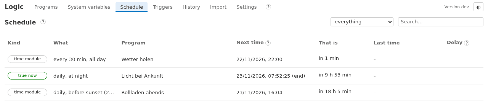</picture>

- **Time modules:** the module in words, its program (a click opens it), **when it fires next** - with *begin*, *end*
  or *repeat* for a range - how far away that is, and when it last fired since the addon started. A range that is
  under way is marked *true now*. The bar below the distance shows how much of the way from the last firing to the next
  is gone.
- A time module that does not fire says why instead of a time: the program is inactive or faulty, the clock of the
  system is not set yet, or sunrise and sunset have no location (see [The location](#time-location)).
- **Times are the wall clock of the system**, not of the browser. A time on the other side of a clock change carries
  its offset (*UTC+2* while the clock still shows winter time): *02:30* on the night the clock goes forward is listed
  at *03:00 UTC+2*, the moment it happens (see [The clock change](#time-dst)).
- **Counting lines:** a condition line with *for at least …* (see [Beyond the CCU](#additions)) is listed while its
  comparison holds - marked *counting*, with the moment it will have held long enough and the bar for how much of that
  time is gone. Once it is reached the line is *true now* until the comparison ends; then it leaves the list. A line of
  an inactive program counts as well.
- The filter shows everything, the time modules only, the pending delays only or the counting lines only; the search
  looks at what, the program and the target.

### <a id="schedule-delays"></a>Pending delays
A delayed activity is listed from the moment its block ran until it is due: *delay of 30 s*, the program and the target
it writes or runs, when it is due and how far away that is. Two buttons:

- **▶ Carry it out now** does the activity at once instead of when it is due - once; it is gone from the list.
- **✕ Cancel** removes it: it will not happen. That is what the block's *end running delays* does for its targets
  (see [Activities and delays](#delays)), here for one activity by hand.

A delay survives a restart of the addon and of the system; one that came due while the addon was not running is
dropped, not made up (see [What differs from the CCU](#differences)).

## <a id="settings"></a>Settings
The **Settings** tab holds the [location](#time-location), the pause between write commands, the loop guard and the
webhooks' [secrets](#secrets), and shows the time the addon goes by. The settings are in the file `settings.yaml` beside the programs and variables and
are part of the history; what is not set there has its default.

<picture><source media="(prefers-color-scheme: dark)" srcset="../screenshots/en/18-settings-dark.png">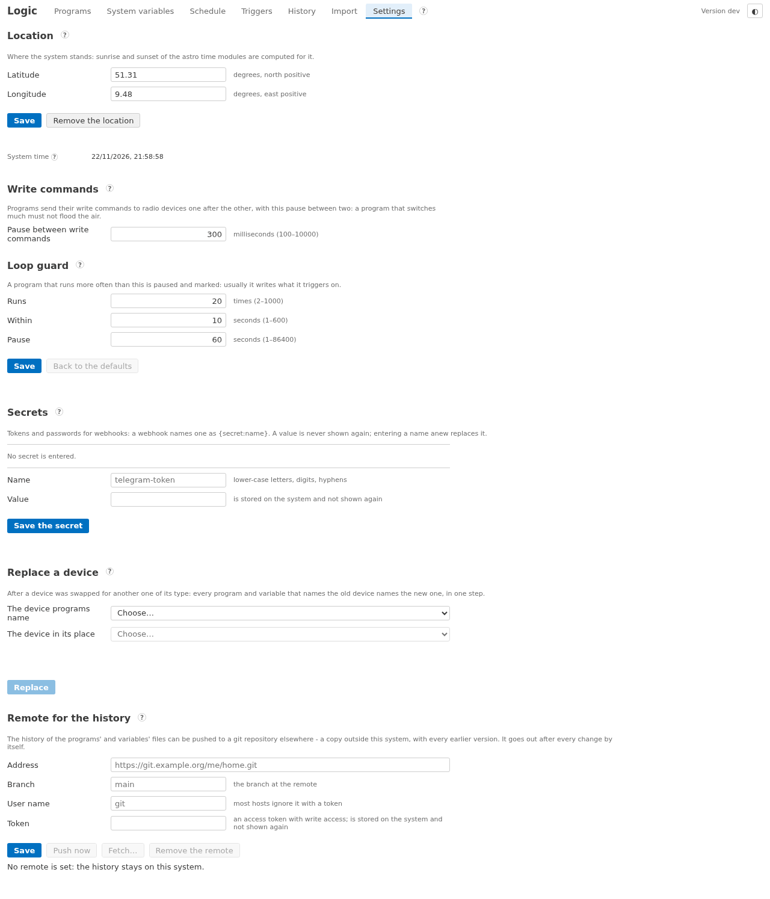</picture>

### <a id="pacing"></a>Write commands
Programs send their write commands to radio devices (HmIP-RF, BidCos-RF) one after the other, each waiting for the
answer of the one before, with a **pause between two** - 300 milliseconds unless set otherwise (100 to 10000;
`pacing_ms` in the file). A program that switches twenty shutters, or the start of the system, therefore does not
become a burst on the radio that uses up the duty cycle. Wired and virtual devices are not paced. A command the system
refuses is counted on the program and not repeated.

### <a id="loop-guard"></a>Loop guard
A program that writes what it triggers on would run forever. A program that runs **more than 20 times within 10
seconds** is therefore **paused for 60 seconds**: it is marked *paused* in the list, its runs say so, and after the
pause it runs again. The three figures can be changed (2 to 1000 runs, 1 to 600 seconds, a pause of 1 to 86400
seconds; `loop_guard` with `runs`, `window_seconds`, `pause_seconds` in the file). A program that is paused again and
again has a fault in its logic - the pause only keeps it from flooding the system.

### <a id="secrets"></a>Secrets
A token or a password a [webhook](#webhook) or a [command](#command) needs is not written into the program: it is
entered once under **Secrets** with a **name** (lower-case letters, digits, hyphens), and the webhook or the command
names it as `{secret:name}`. The
value is kept in a file of its own that only the addon reads - **not** with the programs' files, not in their
[history](#history) and not in what a git remote receives, but part of the system's backup - and is **never shown
again** and never written to a log or the run history. To change a secret enter its name anew. A secret programs name
cannot be removed; a secret a program names that is not entered is said on the Settings tab, and such a webhook fails
without being sent.

### <a id="replace-device"></a>Replace a device
A device broke and another one of the same type took its place - or a program came in with the import and names a
device that is not on this system. The new device has another address, and every program still names the old one.
**Replace a device** on the Settings tab moves them all in one step:

1. Choose **the device programs name**. The list has every device a program or a variable names, with its name - of
   a device that is not here, the name the import noted -, its type and how many programs and variables name it; a
   device the system does not have is marked *not on this system*.
2. Choose **the device in its place**: the list offers the system's other devices **of the same type** (when the type
   of a device that is not here is not known, every device).
3. The line below says **what would change** - how many places, in which programs and variables - or what stands
   against it: a device of another type, or a channel or datapoint that is named and that the new device does not have.
   Nothing is changed before *Replace*.

Replaced is the device wherever it is named: in condition lines, in every kind of activity, in the inputs of a
[computed value](#computed) and in the channel a variable is assigned to - each with the same channel and datapoint
of the new device. Texts stay as they are (a note that mentions the address, a webhook's address). Nothing runs because
of it. The replacement is **one entry** in the [history](#history); every changed program and variable gets a
[version](#versions) from which the state before can be brought back. A delayed activity that was already scheduled
for the old device is still sent to the old one.

A replacement across types - another model, with other channels - is not possible this way: edit those programs.

## <a id="variables"></a>System variables
A system variable holds a value that programs check and set and that other software can read and write. The variables
are this addon's; their values survive a restart of the addon and of the system.

### <a id="variable-page"></a>Variables on the page
The **System variables** tab lists every variable: name, description, type, marks (*system value*, *internal*,
*logged*), the number of programs that use it, its value and when it was last written. Every row has the same height;
a text that does not fit its column is cut and is whole in the text at the pointer.

<picture><source media="(prefers-color-scheme: dark)" srcset="../screenshots/en/06-variables-dark.png">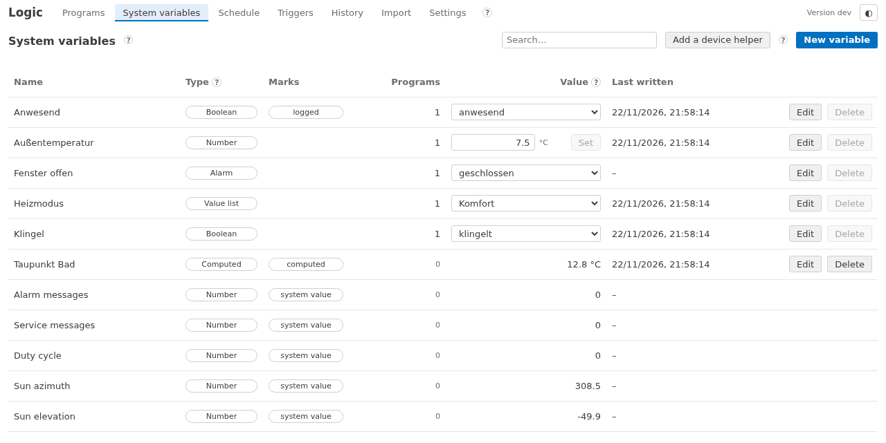</picture>

- **Setting a value:** booleans and value lists by the select, numbers and strings by the field and *Set*. A value
  outside a number's limits is refused; the line above the list says why. Setting a value triggers programs like any write.
- **New variable** and **Edit:** name, description, type and what the type needs - the texts for true and false, a
  value list's entries, a number's unit and limits - and *visible*, *logged*, *internal*. The type of a variable
  that programs use cannot be changed. A value list's entry renamed here is renamed in the programs too; an entry
  that is in use cannot be removed.
- **Delete** works only when no program uses the variable; the column **Programs** has their number and, at the pointer, their names.
- **Alarm messages** are on top while an alarm is triggered and not acknowledged, with *Acknowledge* per row and
  *Acknowledge all*; their number is in the page's header too.
- **System values** are in the same list and cannot be changed.

### <a id="variable-types"></a>Types
| Type | Value | With it |
| --- | --- | --- |
| Boolean | true or false | a text for each of the two states ("es regnet" / "trocken") |
| Value list | one of the entries | the list of entries |
| Number | a number | unit, smallest and largest value |
| String | a text | |
| Alarm | triggered or not triggered | see [Alarms](#alarms) |
| Computed | a number nobody writes | a function and its inputs, see [Computed values](#computed) |

A new variable starts with false, the first entry of its list, the number 0 (or its smallest value when that is above
0) or an empty text.

**Every write is an update, a different value a change.** Programs that listen to a variable "when updated" run at every
write, also when the same value is written again; there is no silent write without an effect on programs.

**Value lists:** programs name an entry by its text. When an entry is renamed, the programs that name it are renamed
with it; an entry a program uses cannot be removed, and the type of a variable a program uses cannot be changed. (On
the CCU a changed list silently shifts the meaning of existing program lines.)

A variable marked as **logged** remembers its last 500 changes. They are kept in a file of their own in the addon's
data folder (`state/log.jsonl`, one line per change with its time), and only new changes are written to storage - a
variable that changes often costs no more writes when its 500 are full.

### <a id="variable-limits"></a>The limits of a number
The smallest and the largest value hold where a person or other software writes: for input on the page and for writes
through the interface `Logic`. A value outside is refused. **A program of this addon may write beyond the limits**, as
on the CCU: an imported counter that passed its largest value keeps counting. An entry a value list does not have is
always refused.

### <a id="alarms"></a>Alarms
An alarm variable behaves as on the CCU:

| Write | State | Counter | First occurrence |
| --- | --- | --- | --- |
| true (was false) | triggered | 1 | now |
| true again, not acknowledged | triggered | counts up | unchanged |
| false – by a program, the page or other software | acknowledged | kept | kept |
| true after an acknowledgement | triggered | 1 again | now |

**Writing false is acknowledging**, and *Acknowledge* writes false: programs that listen to the variable react to it as
to any write. A program sees an alarm variable as a boolean, nothing more. One thing differs from a boolean
variable, as on the CCU: writing false to an alarm that is false already is nothing at all - no program runs, not even
one that listens "on update"; *Acknowledge* on such an alarm still counts as an update.

The **alarm messages** are not a list of past events but the alarm variables that are triggered and not acknowledged
right now – one row each with the first and the last occurrence and the counter. Their number is the system value
`alarm-messages`, which programs can check like a number variable; it cannot be written.

Unlike on the CCU, **an alarm survives a restart**: the CCU forgets every triggered alarm at a restart, here the state,
the counter and the times are kept.

### <a id="computed"></a>Computed values
A **computed value** is a number the addon calculates from other values - the dew point of a room from its temperature
and its humidity, the difference of two temperatures, the warmest of four rooms. Choose the type *Computed* for a new
variable, a function and its inputs:

| Function | Inputs | Result |
| --- | --- | --- |
| Dew point | the temperature in °C and the relative humidity in % | the dew point in °C, to a tenth of a degree |
| Absolute humidity | the temperature in °C and the relative humidity in % | grams of water in a cubic metre of air, to a tenth |
| Difference | two values | the first minus the second |
| Sum, Average, Minimum, Maximum | two to eight values | |

- An **input** is a datapoint of a device, chosen in the device picker (the numeric datapoints of the channel are
  offered), or a number variable, a [system value](#system-values) or another computed value. *Air when the dew point
  outside is below the one inside* is two dew points and their difference, and a program on *difference greater than 0*.
- The value is **calculated again whenever one of its inputs reports**. For programs that is a write like any other: an
  update at every report of an input, a change when the result differs - so *trigger when changed* on *dew point greater
  than 14* runs when the dew point crosses 14. A program that is triggered by the input itself already sees the new
  result.
- **Nobody writes a computed value:** not the page, not a program, not other software through the interface. It has no
  limits and no start value.
- Until every input has a value - right after the first start, or while a device has not reported - the value stays
  what it was (0 for a new one). A humidity of 0 % or less gives no result either.
- A computed value cannot be its own input, not even through others; a variable that is an input cannot be removed
  and cannot become another type.
- The list of functions is closed: there are no formulas. Dew point and absolute humidity use the Magnus formula over
  water.

In the file a computed value is a `number` with `computed:` - see [Programs and variables as files](#files).

### <a id="helpers"></a>Device helpers

A **device helper** keeps a device's counter as system variables: the **total**, and what was added **today** and
**yesterday**. The CCU does the same with hidden programs made of scripts, which it creates when a device is paired
(`svEnergyCounter…`, `svHmIPRainCounter…`); here it is built in, without a script.

<picture><source media="(prefers-color-scheme: dark)" srcset="../screenshots/en/16-helper-dark.png">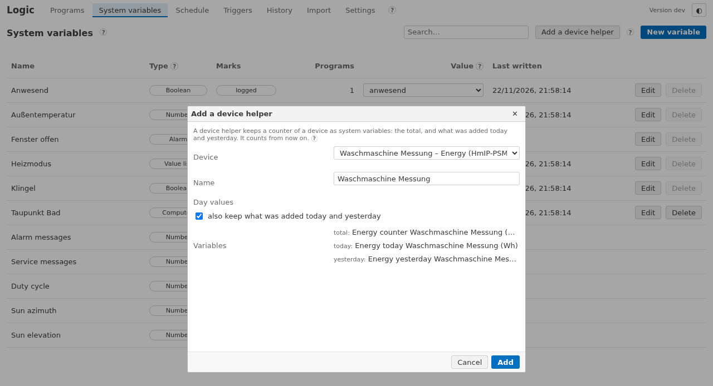</picture>

| Helper | Devices | Counts | Day boundary |
| --- | --- | --- | --- |
| Energy | HmIP measuring actuators (HmIP-PSM, -BSM, -FSM …) | `ENERGY_COUNTER` in Wh | 0:00 |
| Feed-in | HmIP-PSMCO, ELV-SH-PSMCI | `ENERGY_COUNTER_FEED_IN` in Wh | 0:00 |
| Energy or gas | HmIP-ESI | `ENERGY_COUNTER` in Wh or `GAS_VOLUME` in m³, depending on the sensor | 0:00 |
| Energy | HomeMatic measuring actuators (HM-ES-PMSw…) | `ENERGY_COUNTER` in Wh | 0:00 |
| Electricity, gas, IEC meter | HM-ES-TX-WM | `ENERGY_COUNTER`, `GAS_ENERGY_COUNTER`, `IEC_ENERGY_COUNTER` | 0:00 |
| Rain | HmIP-SWO-PL, -PR | `RAIN_COUNTER` in mm | 7:00 |
| Sunshine | HmIP-SWO-B, -PL, -PR | `SUNSHINEDURATION` in minutes | 7:00 |
| Water | HmIP-WSM, ELV-SH-WSM | `WATER_VOLUME` in litres | 0:00 |
| Rain | the HomeMatic weather sensor (HM-WDS100-C6-O) | `RAIN_COUNTER` in mm; today and yesterday only | 7:30 |

**Adding a helper:** *Add a device helper* on the **System variables** tab. Offered are the channels of this system
that have such a counter and no helper yet. The name is the channel's and can be changed; below it stands what the
variables will be called (*Energy counter Washer*, *Energy today Washer*, *Energy yesterday Washer*). The day values
can be left out. A new helper **counts from now on**: the reading the device has at that moment is not counted.

- **Setting the meter reading:** the total can be set in the list like any value - to the electricity meter's
  reading, say, or to 0. Counting goes on from there. A program or other software may set it too. *today* and
  *yesterday* are written by the helper alone.
- **The variables are ordinary numbers:** programs check them, other software reads them through the interface,
  they can be logged. Every counted report of the device is an update of the total for programs, as on the CCU. In
  the list they carry the mark *helper*.
- **The day boundary** is 7:00 for rain and sunshine (the meteorological day, as on the CCU), 7:30 for the HomeMatic
  weather sensor, midnight otherwise - on the system's clock. Then *today* becomes *yesterday* and *today* starts at
  0. If the addon was not running at the boundary, it makes the change up at its start; *yesterday* then holds
  everything since the boundary before. As long as the system's clock is not set, nothing is changed over.
- **A smaller reading** of the device is a restart of the device (its counter starts at 0; the new reading is
  counted) or an overflow (the counter reached its largest value and starts over; counted is up to the largest value
  and on). Which of the two, the device says itself; the largest value the addon reads from the device's
  description. A reading of 0 is passed over.
- **Switching off:** *device helper switched off* in the total's properties. A helper that is off adds nothing;
  switched on again, it counts on from the reading the device has then.
- **Deleting** removes the helper with all its variables; not while a program uses one of them.
- **A device was swapped:** [Replace a device](#replace-device) points the helper at the new device too. Its counter
  starts at 0; the total goes on.

**What differs from the CCU here** - on purpose:

- Rain *today* does not jump to 0 at 1440 (a slip in the CCU's script).
- *today* and the total always move together.
- Sunshine is counted at every report of the sunshine duration, not only at a report of the brightness.
- A day boundary that was missed is made up (the CCU then just lets *today* run on).
- The HomeMatic weather sensor does not set *today* and *yesterday* to 0 after a restart.
- For energy and water, *today* and *yesterday* are variables (on the CCU they only show in the device's controls);
  the CCU's 30-day list does not exist.
- A helper made here counts from now on; on the CCU the first report counts the device's whole reading so far.
  Imported counters treat their first value as the CCU does, so their total goes on without a jump.

In the file a helper's variable is a `number` with `helper:` – see [Programs and variables as files](#files).

### <a id="system-values"></a>System values

Five numbers exist without a variable of their own. Programs check them like a number variable under their fixed key;
they cannot be written, neither by programs nor from the page nor by other software.

| Key | Meaning |
| --- | --- |
| `alarm-messages` | the number of alarm messages (on the CCU the system variable "Alarmmeldungen") |
| `service-messages` | the number of service messages (on the CCU "Servicemeldungen") |
| `duty-cycle` | the duty cycle in percent (on OpenCCU "DutyCycle") |
| `sun-azimuth` | where the sun stands, in degrees clockwise from north: 90 is east, 180 south, 270 west |
| `sun-elevation` | how high the sun stands, in degrees above the horizon; negative when it is below |

`alarm-messages` is kept by the addon itself. The sun's two values are computed for the [location](#time-location)
every five minutes, to a tenth of a degree; without a location they stand at 0. They are meant for shading: *when
`sun-azimuth` is from 135 to less than 225 and `sun-elevation` is greater than 25, lower the blind*. `service-messages`
and `duty-cycle` are not fed yet in this version and stand at 0; imported programs that use them stay readable and
valid.

### <a id="start-value"></a>Value at system start
A variable can get a fixed value after every start of the system; without it, it keeps its value. This is the general
form of what the CCU does built in with *Anwesenheit* (true after every start). The value is set before programs run and
does not trigger a program itself. A start of the system is meant, not a restart or an update of the addon.

## <a id="import"></a>Import
The import takes over the programs and system variables of a CCU. It only reads; nothing is changed at the source.

### <a id="import-sources"></a>Sources
- **A system backup** (`.sbk`) of a CCU3, a CCU2 or OpenCCU/RaspberryMatic. The location and the time zone come
  from it too, when they were set on the CCU.
- **A ReGa database** (`homematic.regadom`), as the CCU keeps it under `/etc/config/`.
- **The database kept on the system:** after the switch from (Open)CCU the old CCU's ReGa database stays on the
  system until it is removed on the *Backup* page. It is as it was on the day of the switch.

### <a id="import-dry-run"></a>A dry run first
The import writes nothing at first. It reads the source and shows a **report**: what would be imported, what stays
inactive and why, what is not imported. Only *Import* creates the files.

**Which programs are active afterwards:** a program keeps the state it had on the CCU when nothing stands against
it. It is imported **inactive** when

- it holds a script (see below),
- a device it uses is not paired with this system,
- it uses CUxD,
- it holds a special value ("last value" or similar),
- the database holds something this version does not know - it does not guess.

With **import everything inactive** every program stays off until you switch it on yourself. That is the right
choice for the backup of somebody else's CCU.

### <a id="import-what"></a>What is imported
**Programs** come one to one: the chain *If … Else if … Else*, the condition blocks with AND and OR, every line with
its comparison and its trigger mode (*trigger on change*, *trigger on update*, *check only*), negated lines, the
activities with *immediately* or *delayed by*, the checkbox that ends running delays, and the properties *active*,
*visible*, *operable*, *internal*.

- **Devices** are in a program by their address. The device does not have to exist: the report names every missing
  one by the name it had on the CCU.
- **Value lists** are taken by the entry's name, not by its number.
- **[Time modules](#time)** are imported with everything they say and run as on the CCU. The CCU's location becomes
  the addon's when none is set yet. A time module whose fields contradict each other (a weekly one without a weekday)
  leaves its program inactive; the report names the reason.
- **System start:** the CCU evaluates every active program once after it starts. Imported programs do the same
  here; the setting "execute at CCU start" of newer OpenCCU versions is taken over.
- **Two scripts are recognised** and become activities: run a program (`…ProgramExecute();`) and switch a program
  on or off (`…Active(true);`, `…Active(false);`).
- **A script that is one `system.Exec`** becomes an activity too. A `wget` or `curl` that only fetches an address
  becomes a [webhook](#webhook) (its answer is not read, and the program does not wait for it), an `ether-wake` a
  [Wake-on-LAN](#wake). Every other line becomes a [command](#command) with the line as it was written, run through
  the shell, and the block waits for it as on the CCU; when the script wrote the command's output into a system
  variable (`system.Exec("…", &out, &err); dom.GetObject("…").State(out);`), the command does the same. A program
  with such a command comes in **inactive**: on the CCU the line ran as root, here it runs with the addon's rights -
  look at it first. The report marks a command that names a system path or a tool only root can use.
- **Any other script** stays in the program as text and is never run; the program comes in inactive. For such tasks
  Node-RED (RedMatic), Home Assistant or ioBroker are the right tools.

**System variables** come with their type (boolean, value list, number, string, alarm), labels, unit, limits,
description, the properties *visible*, *logged*, *internal*, the channel they are bound to - and with their
**value**.

- **Alarm variables** start as "never triggered": the CCU's database stores no alarm state.
- **Presence** is set to "present" after every system start, as on the CCU.
- **The CCU's counters** (energy, feed-in, gas, water, rain, sunshine: `svEnergyCounter…`, `svHmIPRainCounter…`,
  `svCounter…`, *Regen heute* …) become [device helpers](#helpers): the total, today's and yesterday's amounts come
  as system variables with their readings and are counted on. The device's last reading (`…OldVal…`) is kept inside
  the helper and is no variable of its own any more; the CCU's hidden programs are not imported, the helper replaces
  them. What the CCU kept with the channel as today's and yesterday's value for energy and water comes as two
  variables of the helper. A counter whose channel is no longer in the database comes as a plain variable; the
  report says so.
- **The alarm and service message counts, DutyCycle:** these are system values here, maintained by the system
  itself. A program that used them on the CCU reads the system value after the import.

**Not imported** are rooms, functions and device names (the system takes those itself), service messages, users,
favourites and direct links.

### <a id="import-report"></a>The report
The report names

<picture><source media="(prefers-color-scheme: dark)" srcset="../screenshots/en/09-import-dark.png">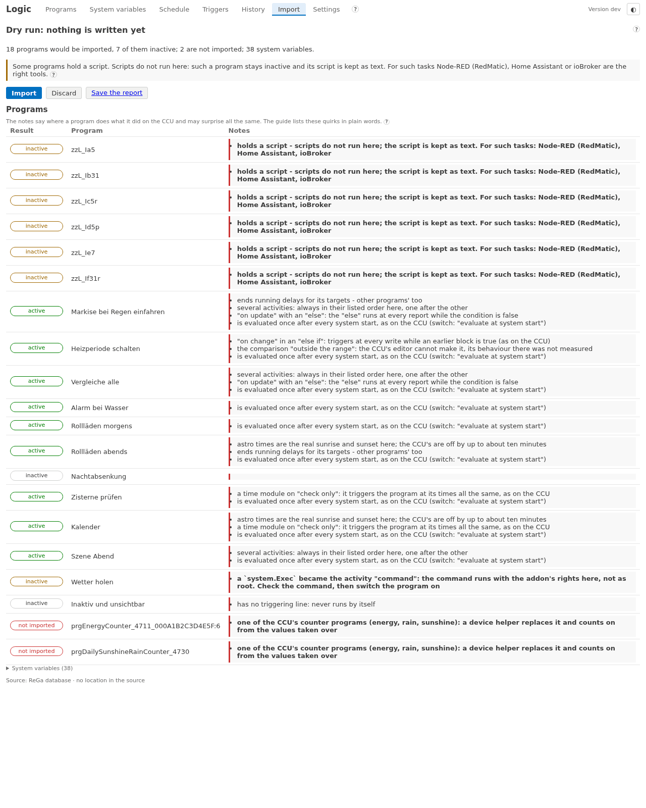</picture>

- every **program** with its result - imported, imported and inactive with the reasons, not imported with the
  reason - and with notes on its behaviour where it may surprise: the evaluation at system start, an *else* under
  *trigger on update*, ending the delays of other programs, astro times, a delay of 24 hours or more that the CCU
  stored as zero;
- every **system variable** with type and value;
- the **devices** programs use, with the name, type and room they had on the CCU, and whether this system has
  them;
- repaired names, the location, and what the database holds.

The report can be saved as a Markdown file.

### <a id="import-again"></a>Importing again
The addon remembers per source which program and which variable of the CCU became which file. Another import of
the same CCU therefore **updates** the same files instead of creating everything a second time; the report marks
them. What you renamed here in the meantime keeps its name in the references.

### <a id="import-anonymise"></a>Passing a database on
When an import goes wrong, the database that shows it helps most - but it holds your home: the names of rooms,
devices and programs, serial numbers, texts, scripts. The addon can write a copy **without** all that:

    /usr/local/addons/logic/bin/logic anonymise backup.sbk anonymous.regadom

It takes a backup or a `homematic.regadom` and writes a database with the same programs, conditions, time modules
and device types, in which

- names are replaced ("Programm 1", "Variable 2", "Gerät 3"; the same name becomes the same replacement),
- serial numbers are numbered anew (`MEQ0123456:1` becomes `MEQ0000001:1`),
- texts that variables hold and programs compare or write become "Text 1", entries of value lists "Wert 1",
  descriptions "Beschreibung",
- scripts become a line that says how long they were (the two one-line scripts the import understands are kept,
  with the replaced name),
- users, passwords, mail addresses, the location and the devices' descriptions are emptied.

**Numbers stay**: the values of number variables (meter readings, too), times, limits. The copy imports exactly as
the original does, which is what makes it useful for a report. Look through the file before you pass it on. It is
meant for this import, not for a CCU.

## <a id="files"></a>Programs and variables as files
Every program and every system variable is a readable file of its own, in YAML. On the system they are below
`/usr/local/etc/config/addons/logic/tree/`:

```
tree/
  programs/markise-bei-regen-einfahren.yaml
  variables/regen.yaml
```

The file's name is the **key** of the program or variable: made from the name when it is created (lower-case letters,
digits, hyphens, at most 48 characters; "Rollläden abends" becomes `rolllaeden-abends`) and stable afterwards. Renaming
a program changes only `name:` in the file, not the file's name. Programs refer to variables and to other programs by
this key.

The addon always writes a file the same way: a fixed order of keys, two spaces of indentation, defaults left out. The
same program so always gives the same file, and comparing two versions shows only what really changed. The variables'
**values** are not in these files; they belong to the addon's state and are part of the system backup.

### <a id="file-program"></a>A program
```yaml
name: Markise bei Regen einfahren
note: Regensensor auf der Terrasse; im Winter deaktiviert
active: true
rules:
  - when:
      any:
        - all:
            - variable: regen
              is: true
              trigger: change
            - device: HmIP-RF/00111BE9AB9012:4/LEVEL  # Markise Terrasse
              op: gt
              value: 0
              trigger: check
    cancel_pending: true
    then:
      - set: HmIP-RF/00111BE9AB9012:4/LEVEL  # Markise Terrasse
        to: 0
      - variable: markise-hinweis
        to: wegen Regen eingefahren
        after: 30s
  - else: []
```

| Key | Meaning |
| --- | --- |
| `name`, `note` | name and description |
| `active` | the program is active (not given: no) |
| `visible`, `operable`, `internal` | visible, operable (not given: yes), internal (not given: no) |
| `at_start` | check at system start (not given: no) |
| `rules` | the rules in their order: *If…*, any number of *Else if…*, at most one *Else…* at the end |

A rule with a condition has `when` and `then`; the *Else* rule has only `else` with its activities. `cancel_pending: true`
is the CCU's checkbox "before executing, stop all running delays for these activities".

A condition always has two levels, as on the CCU: groups of lines. `all` means AND, `any` means OR, on each of the two
levels. A condition without groups (`all: []`) is always true.

A **condition line** is on exactly one of:

| Line | Meaning |
| --- | --- |
| `device: Interface/ADDRESS:CHANNEL/PARAMETER` | a datapoint of a device; the comment after it is the device's name at the time of saving |
| `variable: key` | a system variable |
| `time:` | a time module; its fields are under [Time modules in the file](#time-fields) |

The comparison is `is: value` (equal) or `op:` with its values: `ne` (not equal), `gt` (greater), `ge` (greater or
equal), `lt` (less), `le` (less or equal), each with `value:`; `range` with `from:` and `below:` (from … to less than …);
`outside` with `from:` and `to:` (outside the range). An entry of a value list is named by its **text**, never by its
number. `not: true` inverts the line.

`trigger` is required and says when the line triggers the program: `change` (trigger when changed), `update` (trigger
when updated), `value` (at every change of the value), `check` (check only). `for:` (`10min`) makes the line true only
once its comparison has held that long: see [Beyond the CCU](#additions).

An **activity** is exactly one of:

| Activity | Meaning |
| --- | --- |
| `set: Interface/ADDRESS:CHANNEL/PARAMETER` | write a datapoint |
| `variable: key` | write a system variable |
| `run: key` with `mode: then` or `mode: check` | run another program: only its first *Then* block without checking (`then`) or with its conditions checked (`check`) |
| `activate: key`, `deactivate: key` | switch another program on or off |
| `script:` | an imported script, kept as text and never run |
| `channel: Interface/ADDRESS:CHANNEL` with `values:` (datapoints with their values) | write several datapoints of a channel in one command: see [Several values in one command](#values) |
| `display: Interface/ADDRESS:CHANNEL` with `lines:` and `sound:` | show up to five lines on a display and play a signal tone: see [A display](#display) |
| `webhook: "address"` with `method:` and, as needed, `headers:` (a list of `name:` and `value:`), `body_type:` (`json`, `form`, `text`) with `body:`, `insecure: true` | call a web address: see [Webhooks](#webhook) |
| `wake: "AA:BB:CC:DD:EE:FF"`, with `broadcast:` for another network | Wake-on-LAN: see [Wake-on-LAN](#wake) |
| `command:` - a list (the program, then its arguments) or, with `shell: true`, a line with `args:` - and, as needed, `timeout:`, `wait: true`, `output:`, `exit_code:` | run a program of the system: see [Commands](#command) |

What is written is, for `set` and `variable`, exactly one of `to:` (a value), `from:` (the current value of another
datapoint), `from_variable:` (a variable's value) or `special:` (one of the CCU's special values such as "last value";
such an activity is skipped until it is edited). `after:` delays the activity, counted from the trigger: `30s`, `5min`,
`2h`, `1h30min`. With `after_up_to:` beside it the delay is drawn at random, to the second, between `after` (`0s` when left out)
and `after_up_to`, anew each time the block runs. `on_for:` on a `set` with `to:` is *on for*: see
[Beyond the CCU](#additions).

### <a id="file-variable"></a>A system variable
```yaml
name: Regen
note: Regensensor Terrasse
type: bool
labels:
  "false": trocken
  "true": es regnet
logged: true
```

| Key | Meaning |
| --- | --- |
| `name`, `note` | name and description |
| `type` | `bool` (boolean), `list` (value list), `number`, `string`, `alarm` |
| `labels` | the texts for false and true (boolean, alarm) |
| `entries` | the entries of a value list |
| `unit`, `min`, `max` | unit and limits of a number |
| `visible`, `internal`, `logged` | visible (not given: yes), internal, logged |
| `channel` | the channel the variable is assigned to, `Interface/ADDRESS:CHANNEL` |
| `start_value` | the value the variable gets after a start of the system; not given, it keeps its value |
| `computed` | makes a `number` a [computed value](#computed): `function` (`dew-point`, `absolute-humidity`, `difference`, `sum`, `average`, `min`, `max`) and `inputs`, a list of `device: Interface/ADDRESS:CHANNEL/PARAMETER` and `variable: key` entries; without `min`, `max` and `start_value` |
| `helper` | makes a `number` a variable of a [device helper](#helpers): `kind` (`energy`, `feed-in`, `esi`, `energy-hm`, `energy-wm`, `gas-wm`, `iec-wm`, `rain`, `sunshine`, `water`, `rain-hm`), `channel` (`Interface/ADDRESS:CHANNEL`), `role` (`total`, `today`, `yesterday`; `rain-hm` has no `total`) and, on the total, `off: true` for a helper that is switched off. The variables with the same `kind` and `channel` are one helper; without `start_value` |

### <a id="file-rules"></a>Editing files by hand
The files may be edited by hand. The addon reads a strict subset of YAML: one entry per line (no `[…]` or `{…}` notation
except for empty lists), no anchors, no tags, one document per file, no key twice and none the format does not know.
Texts that YAML would read as something else (`true`, `on`, numbers, times of day) belong in quotes. A file the addon
cannot read is reported with the file and the line; only that one program then does not run, all others keep running.
Comments (`#`) are allowed but are lost as soon as the program is saved from the page; for remarks that should stay
there is `note:` on the program, on every rule, every line and every activity.

### <a id="history"></a>History
The folder `tree/` is an ordinary git repository. The addon keeps the history in it by itself, without git being
installed on the system; another git can read and clone the folder. The files are the truth and the history a
convenience: a save never depends on the history entry succeeding, and the addon never reads programs from the history.

An entry is made in the background, shortly after the save. It holds every file as one whole saved version - also a
file that is saved again while the entry is being made; that later version is the next entry's. Files you put into
the folder or change by hand are recorded when the addon reads the folder again (at its start); what a `.gitignore`
in the folder names is left out.

### <a id="versions"></a>Versions: compare and bring back
Every save of a program or a system variable is a **version**. **Versions…** - on a program's view beside *Copy*, for
a variable in its *Edit* dialog - lists them, the newest first: when, what happened (*created*, *changed*, *restored to
its version …*, an import, a change by hand) and who did it.

<picture><source media="(prefers-color-scheme: dark)" srcset="../screenshots/en/15-versions-dark.png">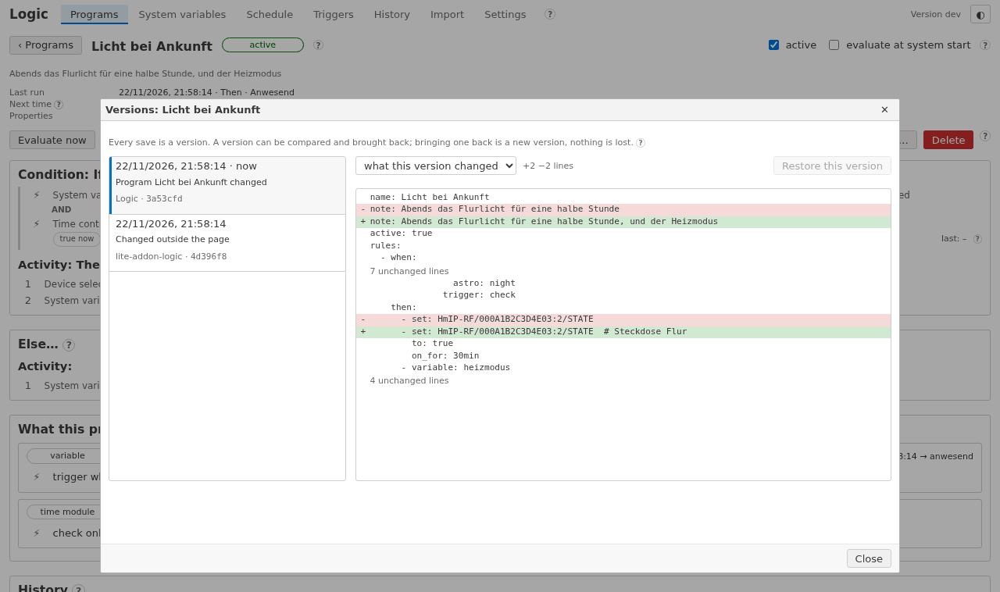</picture>

- A click on a version shows the **comparison, line by line**, at the right: green with `+` what came, red with `-`
  what went; long unchanged stretches are left out. Compared is either **what this version changed** (against the
  version before it) or **from this version to now**. What you see is the program's [file](#file-program) - the same
  one that lies in the folder.
- **Restore this version** makes the program or the variable what it was in that version. It is a save like any other:
  it is checked (a version that names a variable deleted since is refused and says why), nothing runs, and it makes
  **a new version** - what is there now stays in the history and can be brought back the same way.

Two saves shortly after one another can be one version: the history is written in the background and records the file
as it is then.

### <a id="remote"></a>A remote for the history
The [history](#history) can be pushed to a git repository elsewhere - on any git host that is reached over HTTPS or
SSH. That is a copy of every program and every variable outside the system, with every earlier version, readable
with any git; and it is the way to carry programs from one system to another. It is optional: without a remote the
history simply stays on the system.

**Setting it up** (Settings tab, *Remote for the history*): make an empty repository at the host, then enter its
**address** and, if it is not `main`, the **branch**.

| Address | What the host needs |
| --- | --- |
| `https://host/path.git` | an **access token** with write access to that repository, entered as *Token* (a user name only if the host wants one). It is stored on the system in a file only the addon reads and is never shown again |
| `ssh://git@host/path.git` or `git@host:path.git` | the **public key** the addon shows once the remote is saved: enter it at the host as a *deploy key* with write access. The private key never leaves the system. *New key* makes another pair |

A remote by folder path is not possible, and `http://` only for a host on the system itself: a token must not travel
unprotected.

With SSH the addon **remembers the host's key at the first contact** and refuses the host when it later presents
another one - *Forget* is for a host that was set up anew.

**What goes out:** the folder `tree/` - programs, variables, the settings, the record of imports. Not the values of
variables, not the run history, not the [secrets](#secrets), and not the remote's own token or key.

**Pushing** happens by itself after every change, in the background. A save never waits for it and never fails
because of it: when the remote cannot be reached or refuses, the page says so in a line at the top and on the Settings
tab, with the reason, and the addon tries again every five minutes and with the next change. *Push now* tries at
once. Nothing is ever forced: a remote that holds entries this system does not have keeps them.

**Taking over what the remote has:** *Fetch…* gets the remote's branch and shows how it relates to the history here -
without changing anything:

- *the same*, or this system is *ahead* (the next push sends it): nothing to take over;
- the remote has **entries this system lacks**, and they continue the history here: the list shows those entries
  and **every file that would change** - new, changed, removed, with the program's or the variable's name. Every file
  is read and checked like a save. *Take over* writes the files and reads programs and variables anew; **nothing
  runs because of it**, values and pending delays stay;
- a file the addon cannot read, or a program that would name a variable which is gone, is marked with the reason,
  and *Take over* is not offered until it is put right at the remote;
- the two have **each gone their own way** (a change here and another one there): nothing is taken over. The addon
  never merges - bring the two together with git on another machine, push the result, and fetch again.

A **new system** whose history is still empty can take a remote's history over as it is: that is how programs move to
another system, or come back after a new installation.

## <a id="interface"></a>For other software: the interface "Logic"
Other software needs no connection of its own to this addon for system variables and programs. On the system the
addon is an **interface** like those of the radio modules: its name is `Logic`, and everything that reads and
switches devices and follows their events through the system's programming interface (lite-rpc) sees variables and
programs as devices of this interface - Node-RED (RedMatic), hm2mqtt.js, Homematic Manager, your own scripts.

The interface listens on the system itself only (127.0.0.1, port 31310); from outside it is reached through the system
and with its access rights: who may read devices sees the values, who may operate sets variables and runs programs.
Programs and variables can be **edited** on the addon's page only.

### <a id="interface-devices"></a>Devices and addresses
Every system variable and every program is a device. The address is made of the key (the file's name) and does not
change when the name is changed:

| Object | Address | Device type | Channel with the values |
| --- | --- | --- | --- |
| system variable `regen` | `var-regen` | `LOGIC-VARIABLE` | `var-regen:1` |
| program `markise-bei-regen` | `prg-markise-bei-regen` | `LOGIC-PROGRAM` | `prg-markise-bei-regen:1` |

Every device also has the channel `:0`, as every Homematic device. The name of the device and of its channel `:1`
is the variable's or the program's name; the addon writes it into the system's names and keeps it current. The
names of variables and programs that are gone are removed again - also of those that went while the addon was not
running, a restored folder or a file deleted by hand for instance. When a
variable or a program is added or removed, the interface reports it like a device that was paired or deleted.

The field `FLAGS` of the channel `:1` says what is set as **visible** and **internal** on the addon's page, with
the values Homematic has for channels: 1 for visible, 2 for internal, 3 for both, 0 for neither. A user interface
can decide by it what to show; the system's Control page leaves what is not visible out of its list of unassigned
channels (a checkbox shows it) and shows it where it is assigned to a room or a function.

### <a id="interface-variable"></a>Datapoints of a system variable
| Datapoint | Type | Meaning |
| --- | --- | --- |
| `VALUE` | by the variable | the value; read, write, an event at every write |

- **Boolean** and **alarm:** `BOOL`. When the variable has texts of its own for false and true, they are in
  `VALUE_LIST`: the text for false first, then the one for true (empty where none is given). The value stays
  `true` or `false`.
- **Number:** `FLOAT` with the variable's unit, minimum and maximum.
- **Value list:** `ENUM` - the value is the entry's **number** (0 for the first), the entries are in `VALUE_LIST`.
  A write also takes the entry's text.
- **String:** `STRING`.

An **alarm variable** also has:

| Datapoint | Type | Meaning |
| --- | --- | --- |
| `ACKNOWLEDGE` | `ACTION` | acknowledges the alarm (write only) |
| `COUNT` | `INTEGER` | how often the alarm reported since it last went off |
| `FIRST` | `INTEGER` | when it first went off, Unix time in seconds (0: never) |
| `LAST` | `INTEGER` | the last write, Unix time in seconds (0: never) |

**Writing from outside:** a number outside minimum and maximum is refused, and so is an entry the list does not
have. A write triggers programs like a write on the page.

**System values** are devices too, whose `VALUE` can only be read: `var-alarm-messages` (the number of alarm
messages), `var-service-messages` (the number of service messages), `var-duty-cycle` (the duty cycle in percent).

### <a id="interface-program"></a>Datapoints of a program
| Datapoint | Type | Meaning |
| --- | --- | --- |
| `ACTIVE` | `BOOL` | active; read, write, an event when it is switched |
| `RUN` | `ACTION` | evaluates the program now with its conditions and runs what applies |
| `RUN_THEN` | `ACTION` | runs the first *Then* without looking at the conditions (the CCU's "Start") |
| `LAST_RUN` | `INTEGER` | an event at every run: the number of the block that ran (1 for the first; 0 for *Else* or nothing) |

`RUN` and `RUN_THEN` are taken only by a program that is **operable**. For any other, the description of the two
datapoints already says that they cannot be written (`OPERATIONS` 0).

### <a id="interface-notes"></a>Notes for your own software
- The interface speaks XML-RPC as rfd and HmIPServer do: `init`, `listDevices`, `getDeviceDescription`,
  `getParamsetDescription`, `getParamset`, `getValue`, `setValue`, `putParamset`, `ping`, `system.listMethods`,
  `system.multicall`; events arrive as a `system.multicall` of `event` calls.
- Nothing radio-specific exists: no service messages, no direct links, no `MASTER` parameters.
- Address the interface by its name `Logic` through lite-rpc, not by its port: the system reads the port from the
  addon's manifest and lists the interface in `InterfacesList.xml`. Until 1.0.0-beta.1 it was 39310, which lies in
  the range the system takes ports for outgoing connections from - another program's connection could hold it, and
  Logic then did not start.
- A device's `FIRMWARE` field is a fingerprint of its datapoints' description. Software that keeps descriptions
  per device type and firmware thus has the right one for every shape - a number with other limits, a list with
  other entries, other texts for true and false. Visible, internal and operable are part of the shape too. When
  the shape of a variable or a program changes, its device is reported as deleted and new - also to software that
  registers again after an update of the addon and still keeps the device with the old firmware.
